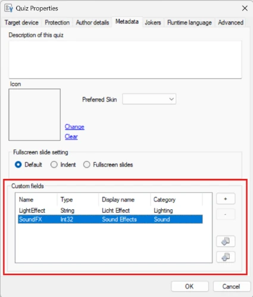
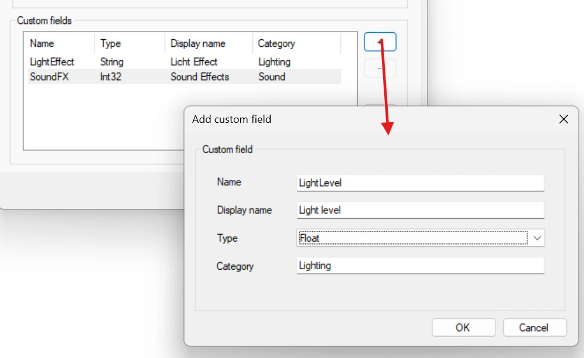
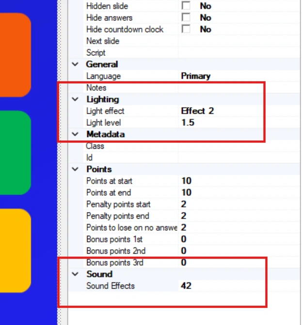
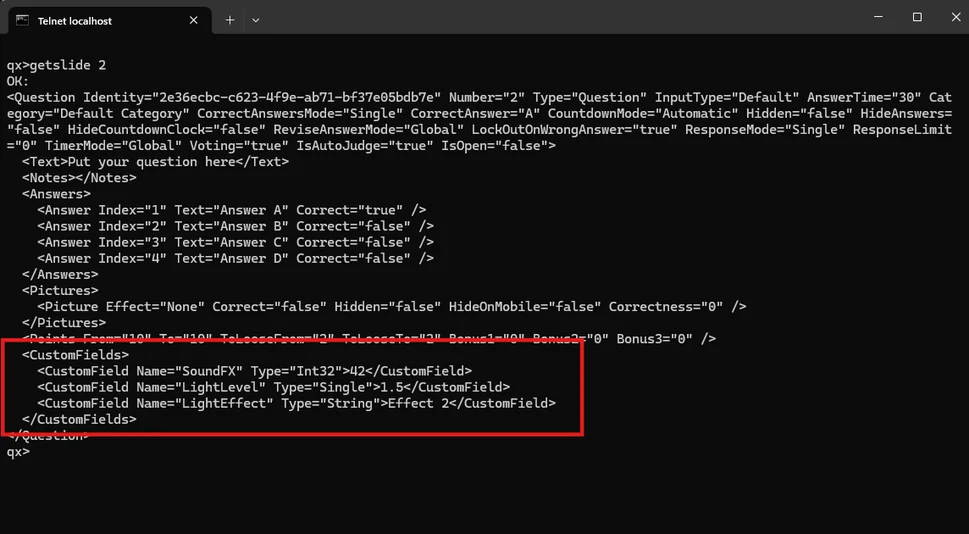

# Campi dati personalizzati

È ora possibile definire il proprio dizionario dati in un quiz e memorizzare dati arbitrari insieme alle diapositive del quiz. Durante l'interfacciamento con QuizXpress, i dati possono essere recuperati tramite il canale TCP (comandi getslide o getquiz) e utilizzati per pilotare logiche esterne, come effetti luminosi, effetti sonori, hardware personalizzato o altre funzionalità. Tale logica risiederebbe in un livello di integrazione attorno a QuizXpress che comunica con QX tramite il canale TCP in ingresso di MessageBroker.

I campi personalizzati si definiscono nel quiz nella finestra di dialogo File->Options, scheda Metadata:

{ width="271" loading=lazy }

Qui è possibile aggiungere campi di tipo: string, int o float

{ width="462" loading=lazy }

Una volta definiti i campi, compaiono nella griglia delle proprietà di ogni diapositiva:

{ width="235" loading=lazy }

Il livello di integrazione può recuperare i dati della diapositiva corrente per ottenere i campi personalizzati:

{ width="485" loading=lazy }

Il comando getslide restituisce i dati di una singola diapositiva in formato XML leggibile. È possibile usare anche getquiz per ottenere i dati di tutte le diapositive in una sola chiamata.
