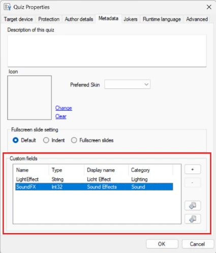
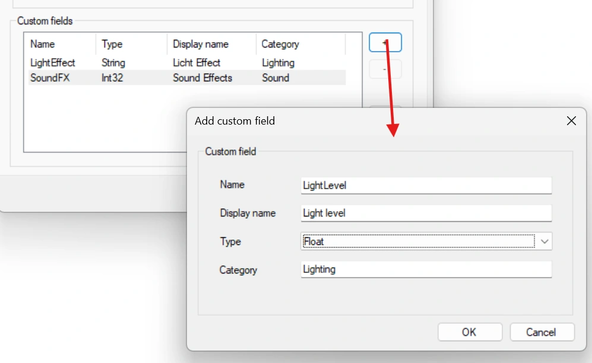
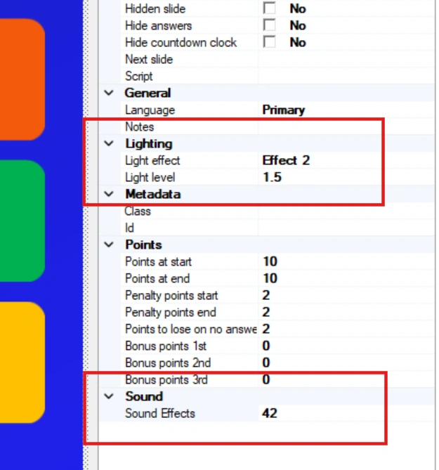
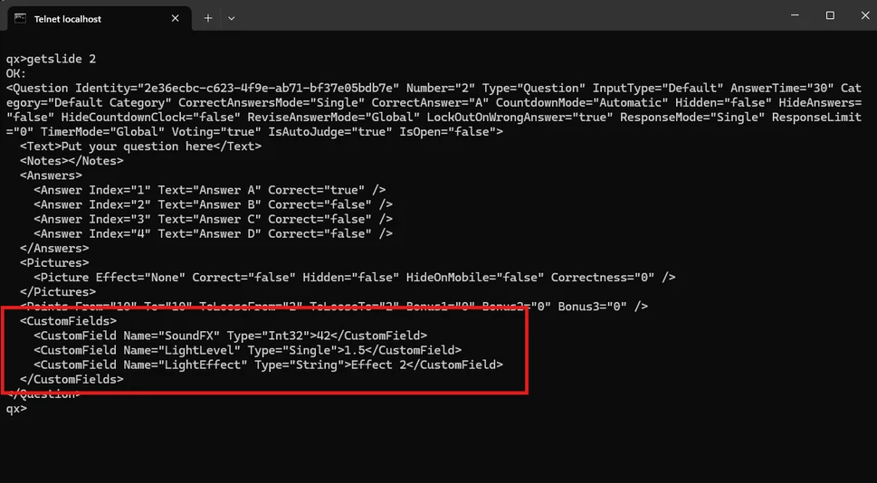

# Aangepaste gegevensvelden

U kunt nu in een quiz uw eigen gegevenswoordenboek definiëren en willekeurige gegevens bij de dia’s van de quiz opslaan. Bij een koppeling met QuizXpress kunnen de gegevens worden opgehaald via het TCP-kanaal (de commando’s getslide of getquiz) en worden gebruikt om externe logica aan te sturen, zoals lichteffecten, geluidseffecten, aangepaste hardware of andere functionaliteit. Deze logica zou zich bevinden in een integratielaag rond QuizXpress, die met QX communiceert via het inkomende TCP-kanaal van MessageBroker.

U definieert aangepaste velden in uw quiz in het dialoogvenster Bestand->Opties, tabblad Metagegevens:

{ width="271" loading=lazy }

Hier kunt u velden toevoegen van het type: string, int of float

{ width="462" loading=lazy }

Zodra de velden zijn gedefinieerd, verschijnen ze voor elke dia in het eigenschappenraster:

{ width="235" loading=lazy }

De integratielaag kan gegevens van de huidige dia ophalen om de aangepaste velden te krijgen:

{ width="485" loading=lazy }

Het commando getslide geeft de gegevens van één dia terug in een voor mensen leesbaar XML-formaat. U kunt ook getquiz gebruiken om de gegevens van alle dia’s in één keer op te halen.
