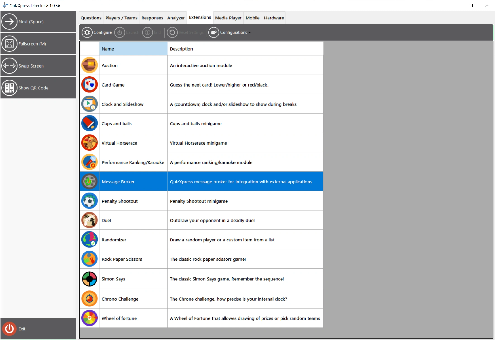
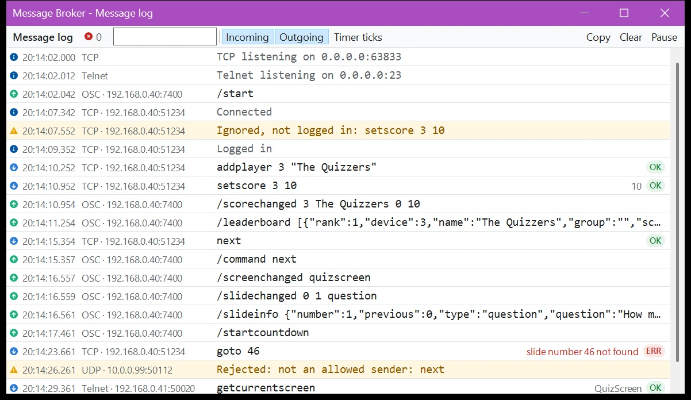

# Message Broker

Message Broker est un plugin avancé de QuizXpress qui échange des données avec des applications et des appareils externes, tels que des contrôleurs de lumière MIDI et DMX. Utilisez-le pour créer des effets qui réagissent à ce qui se passe dans le quiz, configurer des salles de quiz, contrôler l'éclairage, créer des formats de jeu personnalisés ou construire vos propres modules externes dans des environnements tels que [Cycling ‘74 Max](https://cycling74.com/).

Cette section décrit QuizXpress 8.5 et versions ultérieures.

!!! note
    Message Broker est un module complémentaire sous licence pour QuizXpress et nécessite un achat unique.

## Canaux de données

- **TCP/UDP :** communication entrante et sortante à l'aide de messages en texte brut (ASCII ou UTF-8). Voir [Canal IP entrant](ip-inbound.md) et [Canal IP sortant](ip-outbound.md).
- **Telnet :** envoyez des commandes et recevez des données directement depuis une console Telnet. Voir [Canal IP entrant](ip-inbound.md).
- **OSC :** le canal sortant peut aussi envoyer des messages [Open Sound Control](ip-outbound.md#parametres), pour des outils tels que Max, QLab et TouchOSC. Pour envoyer exactement les messages qu'attend une console d'éclairage ou un autre appareil, comme un ETC Eos ou Ion, utilisez [OSC Out](osc-out.md).
- **MIDI :** les événements de QuizXpress déclenchent des messages MIDI configurables, souvent utilisés pour contrôler des tables de lumière DMX. Voir [MIDI et DMX](midi-and-dmx.md).

Ce schéma montre comment tout est connecté :

{ loading=lazy }

## Ouvrir les paramètres de Message Broker

Message Broker se configure depuis QuizXpress Director pendant qu'un quiz est en cours. Démarrez un quiz, appuyez sur la touche 'D' pour ouvrir [QuizXpress Director](../../live/quizxpress-director/index.md), et allez dans l'onglet 'Extensions' :

{ loading=lazy }

!!! warning
    Fermez les paramètres de Message Broker avec 'OK', et non 'Cancel'. 'Cancel' annule toutes vos modifications.

## Journal des messages

Le journal des messages montre tout ce que fait Message Broker pendant le quiz : les commandes qui arrivent avec leur résultat, les messages qui sortent via UDP, OSC et MIDI, et ce que font les serveurs (écoute, connexions, identifications et expéditeurs rejetés). Utilisez-le pour configurer et tester une connexion, ou pour comprendre pourquoi une application externe ne réagit pas comme prévu.

Ouvrez-le avec 'Message log...' en bas des paramètres de Message Broker. Pour l'ouvrir automatiquement à chaque démarrage d'un quiz, cochez 'Open the message log at start' dans l'onglet 'IP Inbound'.

{ loading=lazy }

- L'icône au début de chaque ligne indique de quoi il s'agit : une flèche bleue vers le bas pour une commande entrante, une flèche verte vers le haut pour un message sortant, et un signe d'information, d'avertissement ou d'erreur pour tout le reste.
- Les commandes entrantes affichent leur résultat à droite : 'OK' avec la réponse, ou 'ERR' avec la raison de l'échec de la commande.
- Saisissez du texte dans la zone de filtre pour n'afficher que les lignes qui contiennent ce texte, par exemple une commande, un message ou une adresse IP.
- 'Incoming' et 'Outgoing' affichent ou masquent les commandes et les messages. 'Timer ticks' affiche les tops du compte à rebours et les heartbeats, qui sont envoyés chaque seconde et sont masqués par défaut.
- 'Pause' empêche l'apparition de nouvelles lignes afin que vous puissiez lire la liste ; il compte les nouvelles lignes, qui apparaissent quand vous cliquez de nouveau sur 'Pause'.
- Cliquez sur une ligne pour voir son texte complet et sa réponse sous la liste. 'Copy' copie les lignes visibles, par exemple pour les envoyer au support. 'Clear' vide le journal.

Le journal conserve les 5000 dernières lignes. Les mots de passe n'y apparaissent jamais : ils sont affichés sous la forme `****`.

!!! note
    Le journal des messages s'ouvre sur l'écran de QuizXpress Director. Lorsqu'il s'ouvre au début d'un quiz, avant l'affichage de Director, il s'ouvre sur un écran sans le quiz, ce qui vous permet de le garder ouvert pendant un show en direct. Avec un seul écran, il s'ouvre par-dessus le quiz.
