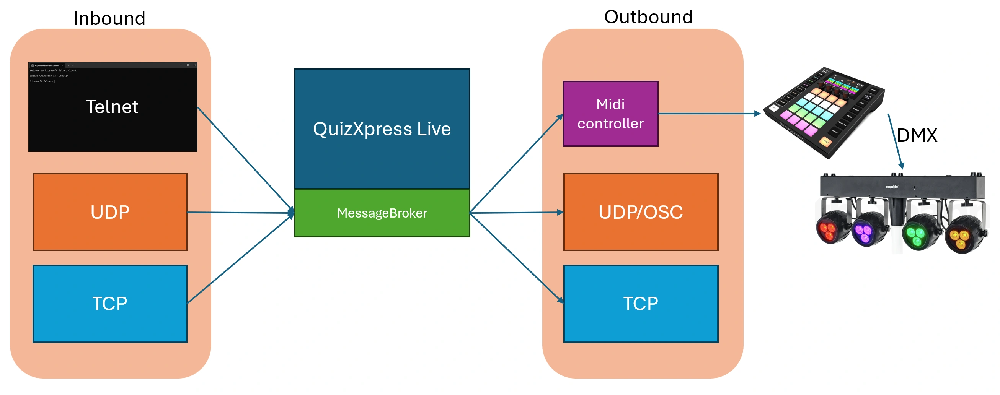
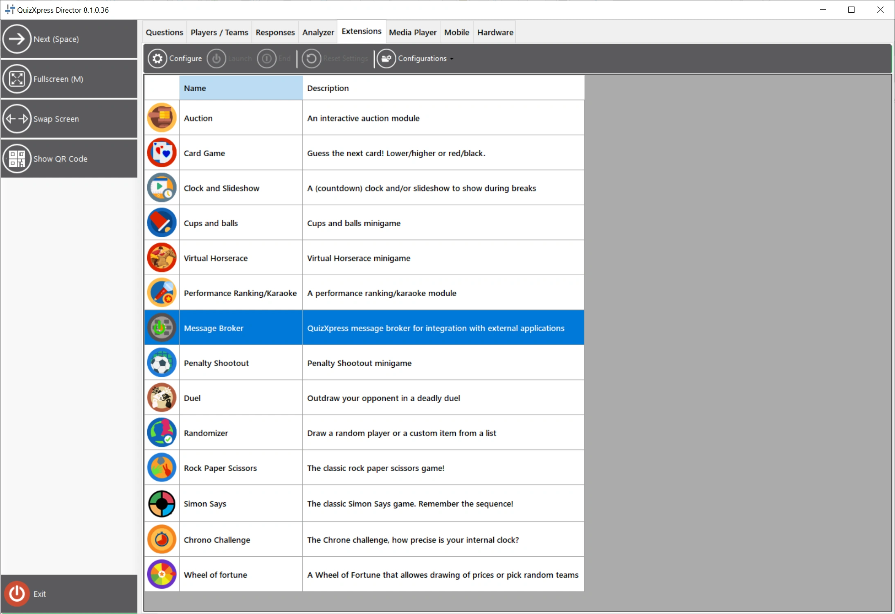
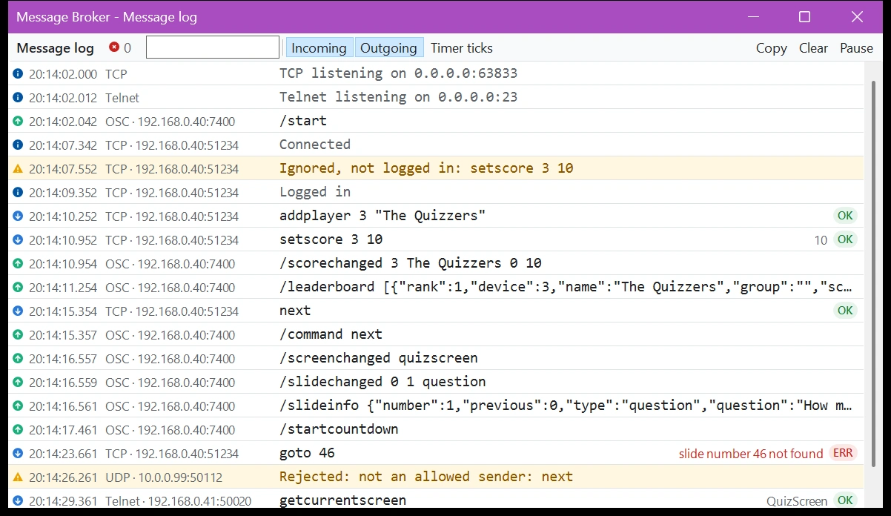

# Message Broker

Message Broker is een geavanceerde QuizXpress-plug-in die gegevens uitwisselt met externe toepassingen en apparaten, zoals MIDI- en DMX-lichtbesturingen. Gebruik het om effecten te bouwen die reageren op wat er in de quiz gebeurt, quizruimtes in te richten, verlichting te besturen, eigen spelvormen te maken of uw eigen externe modules te bouwen in omgevingen zoals [Cycling ‘74 Max](https://cycling74.com/).

Dit gedeelte beschrijft QuizXpress 8.5 en later.

!!! note
    Message Broker is een gelicentieerde uitbreiding voor QuizXpress en vereist een eenmalige aankoop.

## Datakanalen

- **TCP/UDP:** inkomende en uitgaande communicatie met berichten in platte tekst (ASCII of UTF-8). Zie [Inkomend IP-kanaal](ip-inbound.md) en [Uitgaand IP-kanaal](ip-outbound.md).
- **Telnet:** commando’s verzenden en gegevens ontvangen rechtstreeks vanuit een Telnet-console. Zie [Inkomend IP-kanaal](ip-inbound.md).
- **OSC:** het uitgaande kanaal kan ook berichten in [Open Sound Control](ip-outbound.md#instellingen)-formaat verzenden, voor tools zoals Max, QLab en TouchOSC. Gebruik [OSC Uit](osc-out.md) om exact de berichten te verzenden die een lichtbesturing of ander apparaat verwacht, zoals een ETC Eos of Ion.
- **MIDI:** QuizXpress-gebeurtenissen activeren configureerbare MIDI-berichten, vaak gebruikt om DMX-lichttafels te besturen. Zie [MIDI en DMX](midi-and-dmx.md).

Dit overzicht laat zien hoe alles met elkaar is verbonden:

{ loading=lazy }

## De Message Broker-instellingen openen

Message Broker wordt geconfigureerd vanuit QuizXpress Director terwijl een quiz draait. Start een quiz, druk op de toets ‘D’ om [QuizXpress Director](../../live/quizxpress-director/index.md) te openen en ga naar het tabblad 'Extensies':

{ loading=lazy }

!!! warning
    Sluit de Message Broker-instellingen af met 'OK', niet met 'Annuleren'. Met 'Annuleren' gaan al uw wijzigingen verloren.

## Berichtenlogboek

Het berichtenlogboek toont alles wat Message Broker doet terwijl de quiz draait: de commando’s die binnenkomen met hun resultaat, de berichten die via UDP, OSC en MIDI naar buiten gaan, en wat de servers doen (luisteren, verbindingen, aanmeldingen en geweigerde afzenders). Gebruik het om een verbinding in te stellen en te testen, of om uit te zoeken waarom een externe toepassing niet reageert zoals verwacht.

Open het met 'Berichtenlogboek...' onderaan de Message Broker-instellingen. Om het automatisch te openen telkens wanneer een quiz start, vinkt u 'Berichtenlogboek openen bij start' aan op het tabblad 'IP Inkomend'.

{ loading=lazy }

- Het pictogram voor elke regel laat zien wat het is: een blauwe pijl omlaag voor een binnenkomend commando, een groene pijl omhoog voor een uitgaand bericht, en een informatie-, waarschuwings- of foutteken voor al het overige.
- Binnenkomende commando’s tonen rechts hun resultaat: 'OK' met het antwoord, of 'ERR' met de reden waarom het commando mislukte.
- Typ in het filterveld om alleen de regels te tonen die die tekst bevatten, bijvoorbeeld een commando, een bericht of een IP-adres.
- Met 'Inkomend' en 'Uitgaand' toont of verbergt u commando’s en berichten. 'Timerticks' toont de aftelticks en heartbeats, die elke seconde worden verzonden en standaard zijn verborgen.
- 'Pauzeer' voorkomt dat er nieuwe regels verschijnen, zodat u de lijst kunt lezen; het telt de nieuwe regels, die verschijnen wanneer u opnieuw op 'Pauzeer' klikt.
- Klik op een regel om de volledige tekst en het antwoord onder de lijst te zien. 'Kopiëren' kopieert de zichtbare regels, bijvoorbeeld om naar de ondersteuning te sturen. 'Wissen' maakt het logboek leeg.

Het logboek bewaart de laatste 5000 regels. Wachtwoorden komen er nooit in voor: ze worden weergegeven als `****`.

!!! note
    Het berichtenlogboek opent op het scherm van QuizXpress Director. Wanneer het bij de start van een quiz opent, voordat de Director wordt getoond, opent het op een scherm zonder de quiz, zodat u het tijdens een live show open kunt laten. Met slechts één scherm opent het bovenop de quiz.
