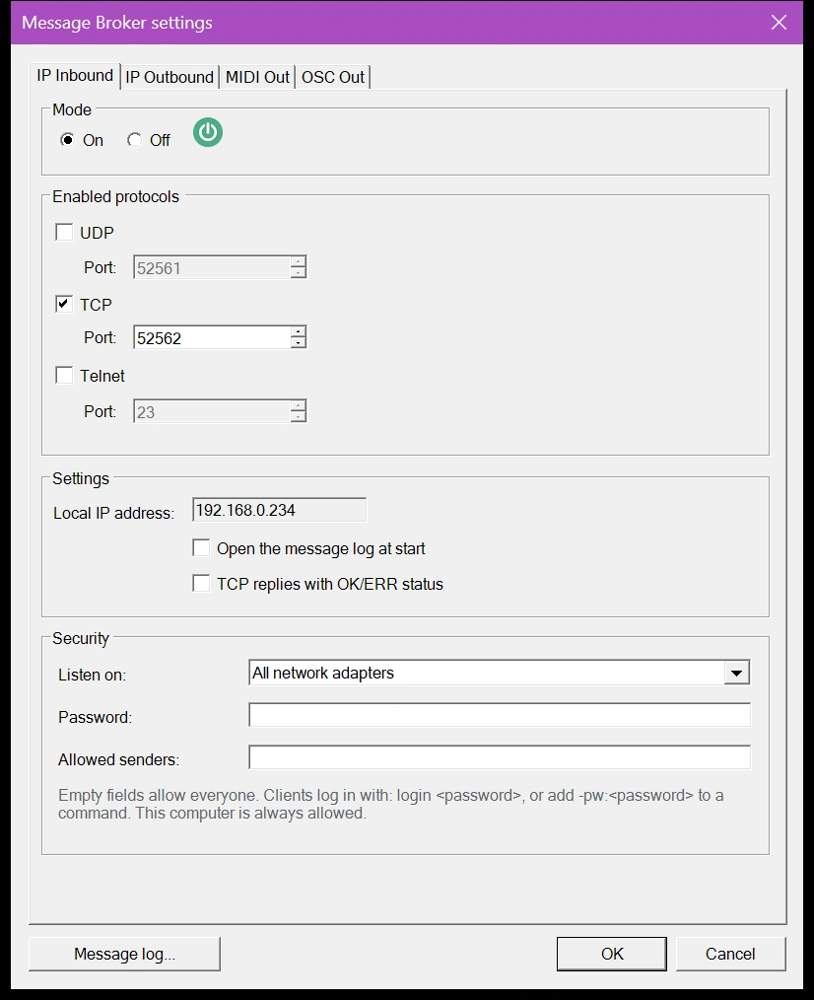
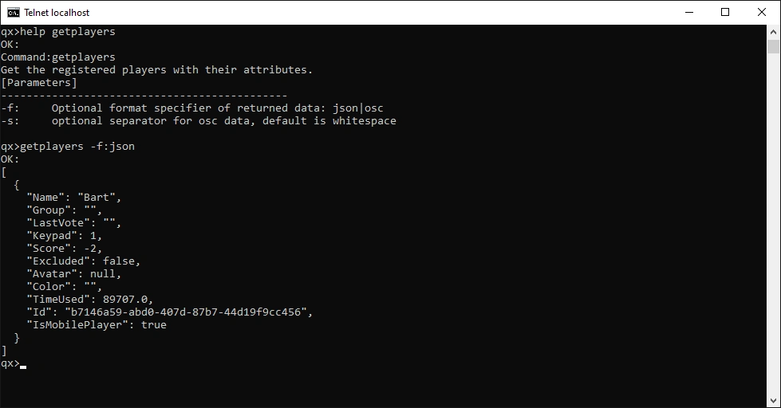
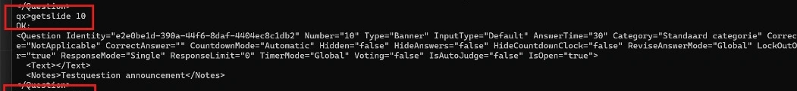
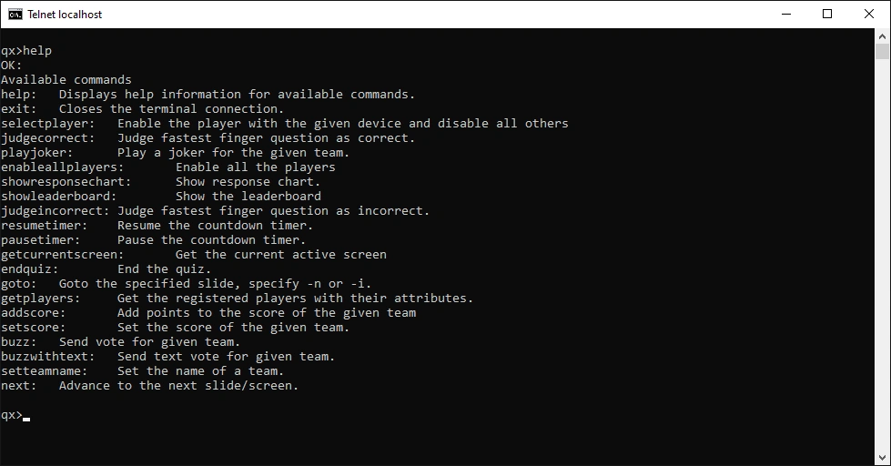

# Canale IP in ingresso

Con il canale in ingresso, applicazioni esterne inviano comandi di testo a QuizXpress, ad esempio per passare alla diapositiva successiva, giudicare una risposta o modificare un punteggio. I comandi possono arrivare tramite UDP, TCP o Telnet.

Configurarlo nella scheda 'IP Inbound' delle [impostazioni di Message Broker](index.md#aprire-le-impostazioni-di-message-broker):

{ width="420" loading=lazy }

## Impostazioni

**On/Off**
:   Attiva o disattiva i messaggi in ingresso.

**Protocol**
:   Endpoint per UDP, TCP e Telnet. È possibile abilitare tutti e tre contemporaneamente, ma ciascuno richiede un proprio numero di porta. La porta Telnet predefinita è 23.

**Settings**
:   - 'Local IP address' mostra l'indirizzo IP di questo computer, necessario al lato mittente.
    - 'Open the message log at start' apre il [registro messaggi](index.md#registro-messaggi) ogni volta che si avvia un quiz, in modo da poter seguire ogni comando in arrivo.
    - 'TCP replies with OK/ERR status' fa sì che ogni comando TCP risponda con il proprio risultato. Vedere [Risposte](#risposte).

## Sicurezza

Per impostazione predefinita, chiunque si trovi sulla rete può inviare comandi a QuizXpress. In un locale con una rete Wi-Fi pubblica, usare le impostazioni 'Security' per mantenere il controllo dello show. Lasciare vuoto un campo per lasciarlo aperto.

**Listen on**
:   La scheda di rete che riceve i comandi:

    - 'All network adapters': tutte le reti a cui è collegato questo computer (impostazione predefinita).
    - 'This computer only (127.0.0.1)': solo le applicazioni su questo computer possono inviare comandi.
    - Un indirizzo IP di questo computer: solo la rete di quella scheda.

    Se si sceglie un indirizzo e in seguito il computer ne riceve un altro, ad esempio su un'altra rete, l'elenco mostra l'indirizzo salvato come '(not available)' e il [registro messaggi](index.md#registro-messaggi) mostra un errore che indica che il canale in ingresso non ha potuto avviarsi.

**Password**
:   Quando si imposta una password, i comandi vengono accettati solo dopo che il mittente ha dimostrato di conoscerla:

    - **TCP:** inviare `login <password>` una volta dopo la connessione. Dopo tre password errate QuizXpress chiude la connessione.
    - **Telnet:** Telnet chiede la password non appena ci si connette.
    - **Qualsiasi comando, anche tramite UDP:** aggiungere `-pw:<password>` al comando, ad esempio `next -pw:quiz123`. UDP non ha una connessione su cui effettuare l'accesso, quindi tramite UDP ogni comando la richiede.

    I comandi senza la password corretta vengono ignorati e mostrati come avviso nel registro messaggi.

**Allowed senders**
:   Gli indirizzi IP autorizzati a inviare comandi, separati da virgole. Un intervallo si scrive con una lunghezza di prefisso: `192.168.1.0/24` consente da `192.168.1.0` a `192.168.1.255`. Esempio: `192.168.1.20, 192.168.1.30, 10.0.0.0/8`. QuizXpress ignora tutto ciò che proviene da altri indirizzi e lo mostra come 'Rejected' nel registro messaggi. Se una voce non è un indirizzo o un intervallo valido, il suggerimento diventa rosso e 'OK' resta disabilitato finché non la si corregge.

!!! note
    Questo computer è sempre autorizzato, qualunque cosa si inserisca in 'Allowed senders'.

!!! warning
    La password protegge lo show da chi non la conosce, ma viene inviata come testo semplice sulla rete, proprio come i comandi. La password è memorizzata come testo semplice nelle impostazioni di Message Broker.

## Comandi

Questi comandi funzionano tramite Telnet, TCP e UDP. Telnet e TCP inviano una risposta; UDP mai.

| Comando | Cosa fa |
|---|---|
| `next` | Avanzare, ad esempio alla diapositiva successiva. |
| `showleaderboard` | Mostrare la tabella punteggi generale. |
| `showresponsechart` | Mostrare il grafico delle risposte dopo una domanda a risposta multipla. |
| `judgecorrect` | Giudicare corretta una domanda aperta o manuale. |
| `judgeincorrect` | Giudicare errata una domanda aperta o manuale. |
| `pausetimer` | Mettere in pausa il conto alla rovescia. Se il timer è già in pausa, non accade nulla. |
| `resumetimer` | Riprendere il conto alla rovescia. Se il timer è già in funzione, non accade nulla. |
| `endquiz` | Terminare il quiz e passare alla schermata dei punteggi finali. |
| `restart` | Riavviare il quiz. |
| `goto` | Andare a una diapositiva in base al numero o all'id della diapositiva, ad esempio `goto 10` o `goto #banner1`. I numeri delle diapositive iniziano da 1, come in Studio. L'id è un valore di testo univoco che si può impostare su una diapositiva. Mettere prima in pausa il conto alla rovescia: mentre il conto alla rovescia è in corso, il salto viene ignorato. |
| `enableallplayers` | Abilitare tutti i giocatori registrati. |
| `selectplayer` | Abilitare il giocatore con il numero di dispositivo indicato ed escludere tutti gli altri. |
| `selectplayers` | Abilitare un intervallo di giocatori, come `1-5` o `1,2,10`, ed escludere tutti gli altri. |
| `addplayer` | Aggiungere un giocatore con un numero di dispositivo e un nome, ad esempio `addplayer 1 "John Trivialta"`. |
| `resetplayers` | Rimuovere tutti i giocatori. |
| `addscore` | Aggiungere punti al punteggio di un giocatore, in base al numero di dispositivo o al nome della squadra, ad esempio `addscore 3 5` o `addscore "The Quizzers" -2`. |
| `setscore` | Impostare il punteggio di un giocatore, in base al numero di dispositivo o al nome della squadra, ad esempio `setscore 3 0`. |
| `setteamname` | Impostare il nome della squadra per un dispositivo, ad esempio `setteamname 1 "John Trivialta"`. |
| `setvolume` | Impostare il volume del lettore del quiz (0–100). |
| `buzz` | Inviare un voto per un giocatore, ad esempio `buzz 1 FF` o `buzz 1 A`. Aggiungere `-f` per forzare il voto anche quando la diapositiva blocca i buzzer. |
| `buzzwithtext` | Inviare un voto testuale, per domande numeriche, di lettera o a testo libero, ad esempio `buzzwithtext 3 "Paris"`. Aggiungere `-f` per forzarlo. |
| `playjoker` | Giocare un jolly per un giocatore: `playjoker <device> <joker>`, dove il jolly è `FreeRide`, `PointBooster` o `TimeWarp`. |
| `sendkey` | Premere un tasto nel lettore del quiz, come se fosse digitato sulla tastiera, ad esempio `sendkey Space` o `sendkey Up`. |
| `getcurrentscreen` | Restituire la schermata corrente: `WelcomeScreen`, `SignOnScreen`, `CountdownScreen`, `QuizScreen` o `FinalScoreScreen`. |
| `getplayers` | Restituire tutti i giocatori con i loro attributi (punteggio, nome, dispositivo e così via). Aggiungere `-f json` o `-f osc` per scegliere il formato. |
| `getquiz` | Restituire un'esportazione completa del quiz in XML, senza immagini, audio o video. Può trattarsi di una grande quantità di dati. |
| `getslide` | Restituire i dettagli di una diapositiva in XML, senza immagini, audio o video, ad esempio `getslide 10`. Senza numero restituisce la diapositiva corrente. |
| `login` | Effettuare l'accesso su una connessione TCP quando è impostata una [password](#sicurezza): `login <password>`. |

Racchiudere tra virgolette doppie il testo con spazi: `setteamname 1 "The Quizzers"`. Funzionano anche le virgolette singole: `setteamname 1 'The Quizzers'`. I nomi delle squadre possono contenere apostrofi e due punti, come `"Bart's Team"` o `12:30`. Il comando stesso non distingue tra maiuscole e minuscole; i nomi delle squadre e le risposte mantengono le maiuscole.

Esempio di output di `getplayers`:

{ loading=lazy }

Esempio di output di `getslide 10`:

{ loading=lazy }

## Risposte

Telnet risponde sempre con `OK:` o `FAILED:`, seguito dalla risposta.

Tramite TCP, QuizXpress invia solo il testo di risposta di un comando riuscito, e nulla quando fallisce o non ha risposta. Questo rende difficile per un'applicazione sapere quando una risposta è completa. Selezionare 'TCP replies with OK/ERR status' per ottenere una risposta a ogni comando, in questo formato:

- una prima riga `OK`, oppure `ERR` seguito dal motivo per cui il comando non è riuscito;
- per `OK`, le righe della risposta;
- un'ultima riga con solo un punto (`.`).

Una riga di risposta che inizia con un punto riceve un punto in più davanti, così l'applicazione può leggere righe finché non riceve un solo `.`. Ad esempio, `setscore 3 0` seguito da `setscore 9 5` (il dispositivo 9 non esiste) produce:

```
OK
0
.
ERR team 9 not found
.
```

## Provare i comandi con Telnet

Telnet è il modo più semplice per provare i comandi a mano o per fare debug. Windows non include il client Telnet per impostazione predefinita; per installarlo:

1. Aprire 'Control Panel'.
2. Aprire 'Programs'.
3. Selezionare 'Turn Windows features on or off'.
4. Selezionare 'Telnet Client'.
5. Fare clic su 'OK'. Windows cerca i file necessari e installa il client.

Quindi aprire un prompt dei comandi e digitare `telnet localhost` (supponendo che QuizXpress usi la porta predefinita 23). Si apre una finestra Telnet con il prompt `qx>`. Digitare `help` per vedere tutti i comandi, oppure `help <command>` per ottenere aiuto su un comando:

{ loading=lazy }

!!! tip
    Aprire il [registro messaggi](index.md#registro-messaggi) accanto alla finestra Telnet: mostra ogni comando che QuizXpress riceve e il risultato.
