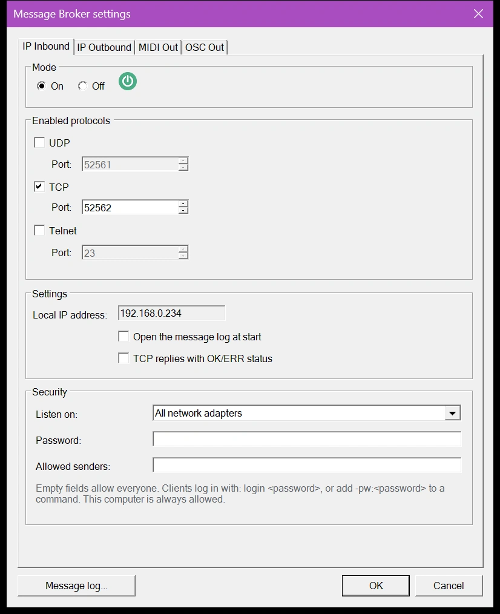
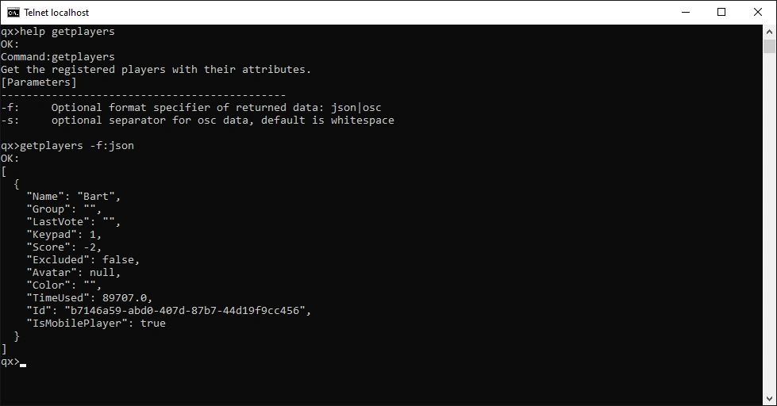
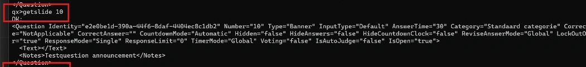
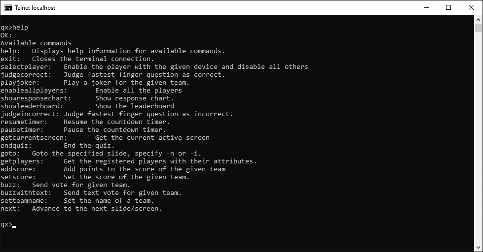

# Inkomend IP-kanaal

Via het inkomende kanaal sturen externe toepassingen tekstcommando’s naar QuizXpress, bijvoorbeeld om naar de volgende dia te gaan, een antwoord te beoordelen of een score te wijzigen. Commando’s kunnen binnenkomen via UDP, TCP of Telnet.

Configureer het op het tabblad 'IP Inkomend' van de [Message Broker-instellingen](index.md#de-message-broker-instellingen-openen):

{ width="420" loading=lazy }

## Instellingen

**Aan/Uit**
:   Schakelt inkomende berichten in of uit.

**Protocol**
:   Eindpunten voor UDP, TCP en Telnet. U kunt alle drie tegelijk inschakelen, maar elk heeft een eigen poortnummer nodig. De standaard Telnet-poort is 23.

**Instellingen**
:   - 'Lokaal IP-adres' toont het IP-adres van deze computer, dat de verzendende kant nodig heeft.
    - 'Berichtenlogboek openen bij start' opent het [berichtenlogboek](index.md#berichtenlogboek) telkens wanneer een quiz start, zodat u elk binnenkomend commando kunt volgen.
    - 'TCP-antwoorden met OK/ERR-status' zorgt ervoor dat elk TCP-commando met zijn resultaat antwoordt. Zie [Antwoorden](#antwoorden).

## Beveiliging

Standaard kan iedereen op het netwerk commando’s naar QuizXpress sturen. Gebruik op een locatie met een openbaar wifi-netwerk de instellingen onder 'Beveiliging' om de show onder controle te houden. Laat een veld leeg om het open te laten.

**Luisteren op**
:   De netwerkadapter die commando’s ontvangt:

    - 'Alle netwerkadapters': elk netwerk waarmee deze computer is verbonden (de standaardinstelling).
    - 'Alleen deze computer (127.0.0.1)': alleen toepassingen op deze computer kunnen commando’s sturen.
    - Een IP-adres van deze computer: alleen het netwerk van die adapter.

    Als u een adres kiest en de computer later een ander adres krijgt, bijvoorbeeld op een ander netwerk, toont de lijst het opgeslagen adres als '(niet beschikbaar)' en toont het [berichtenlogboek](index.md#berichtenlogboek) een fout dat het inkomende kanaal niet kon starten.

**Wachtwoord**
:   Als u een wachtwoord instelt, worden commando’s pas geaccepteerd nadat de afzender bewijst dat hij het wachtwoord kent:

    - **TCP:** stuur eenmalig `login <password>` na het verbinden. Na drie foute wachtwoorden verbreekt QuizXpress de verbinding.
    - **Telnet:** Telnet vraagt om het wachtwoord zodra u verbinding maakt.
    - **Elk commando, ook via UDP:** voeg `-pw:<password>` toe aan het commando, bijvoorbeeld `next -pw:quiz123`. UDP heeft geen verbinding om op in te loggen, dus via UDP heeft elk commando het nodig.

    Commando’s zonder het juiste wachtwoord worden genegeerd en als waarschuwing getoond in het berichtenlogboek.

**Toegestane afzenders**
:   De IP-adressen die commando’s mogen sturen, gescheiden door komma’s. Een bereik schrijft u met een prefixlengte: `192.168.1.0/24` staat `192.168.1.0` tot en met `192.168.1.255` toe. Voorbeeld: `192.168.1.20, 192.168.1.30, 10.0.0.0/8`. QuizXpress negeert alles van andere adressen en toont het als 'Geweigerd' in het berichtenlogboek. Als een item geen geldig adres of bereik is, wordt de hint rood en blijft 'OK' uitgeschakeld totdat u het corrigeert.

!!! note
    Deze computer is altijd toegestaan, wat u ook invoert bij 'Toegestane afzenders'.

!!! warning
    Het wachtwoord beschermt de show tegen mensen die het niet kennen, maar wordt, net als de commando’s, als platte tekst over het netwerk verzonden. Het wachtwoord wordt als platte tekst opgeslagen in de Message Broker-instellingen.

## Commando’s

Deze commando’s werken via Telnet, TCP en UDP. Telnet en TCP sturen een antwoord; UDP nooit.

| Commando | Wat het doet |
|---|---|
| `next` | Doorgaan, bijvoorbeeld naar de volgende dia. |
| `showleaderboard` | Het algemene scorebord tonen. |
| `showresponsechart` | De antwoordgrafiek tonen na een meerkeuzevraag. |
| `judgecorrect` | Een open of handmatige vraag als juist beoordelen. |
| `judgeincorrect` | Een open of handmatige vraag als onjuist beoordelen. |
| `pausetimer` | De aftelklok pauzeren. Als de klok al is gepauzeerd, gebeurt er niets. |
| `resumetimer` | De aftelklok hervatten. Als de klok al loopt, gebeurt er niets. |
| `endquiz` | De quiz beëindigen en naar het eindscorescherm gaan. |
| `restart` | De quiz opnieuw starten. |
| `goto` | Naar een dia gaan op nummer of op dia-id, bijvoorbeeld `goto 10` of `goto #banner1`. Dianummers beginnen bij 1, zoals in Studio. Het id is een unieke tekstwaarde die u op een dia kunt instellen. Pauzeer eerst het aftellen: zolang het aftellen loopt, wordt de sprong genegeerd. |
| `enableallplayers` | Alle geregistreerde spelers inschakelen. |
| `selectplayer` | De speler op het opgegeven apparaatnummer inschakelen en alle anderen uitsluiten. |
| `selectplayers` | Een reeks spelers inschakelen, zoals `1-5` of `1,2,10`, en alle anderen uitsluiten. |
| `addplayer` | Een speler toevoegen met een apparaatnummer en naam, bijvoorbeeld `addplayer 1 "John Trivialta"`. |
| `resetplayers` | Alle spelers verwijderen. |
| `addscore` | Punten toevoegen aan de score van een speler, op apparaatnummer of teamnaam, bijvoorbeeld `addscore 3 5` of `addscore "The Quizzers" -2`. |
| `setscore` | De score van een speler instellen, op apparaatnummer of teamnaam, bijvoorbeeld `setscore 3 0`. |
| `setteamname` | De teamnaam voor een apparaat instellen, bijvoorbeeld `setteamname 1 "John Trivialta"`. |
| `setvolume` | Het volume van de quizspeler instellen (0–100). |
| `buzz` | Een stem voor een speler verzenden, bijvoorbeeld `buzz 1 FF` of `buzz 1 A`. Voeg `-f` toe om de stem af te dwingen, ook als de dia buzzers blokkeert. |
| `buzzwithtext` | Een tekststem verzenden, voor getal-, letter- of volledige-tekstvragen, bijvoorbeeld `buzzwithtext 3 "Paris"`. Voeg `-f` toe om het af te dwingen. |
| `playjoker` | Een joker inzetten voor een speler: `playjoker <device> <joker>`, waarbij de joker `FreeRide`, `PointBooster` of `TimeWarp` is. |
| `sendkey` | Een toets indrukken in de quizspeler, alsof deze op het toetsenbord is getypt, bijvoorbeeld `sendkey Space` of `sendkey Up`. |
| `getcurrentscreen` | Het huidige scherm teruggeven: `WelcomeScreen`, `SignOnScreen`, `CountdownScreen`, `QuizScreen` of `FinalScoreScreen`. |
| `getplayers` | Alle spelers teruggeven met hun kenmerken (score, naam, apparaat enzovoort). Voeg `-f json` of `-f osc` toe om het formaat te kiezen. |
| `getquiz` | Een volledige export van de quiz in XML teruggeven, zonder afbeeldingen, geluid of video. Dit kan veel gegevens zijn. |
| `getslide` | De details van één dia in XML teruggeven, zonder afbeeldingen, geluid of video, bijvoorbeeld `getslide 10`. Zonder nummer geeft het de huidige dia terug. |
| `login` | Inloggen op een TCP-verbinding wanneer een [wachtwoord](#beveiliging) is ingesteld: `login <password>`. |

Zet tekst met spaties tussen dubbele aanhalingstekens: `setteamname 1 "The Quizzers"`. Enkele aanhalingstekens werken ook: `setteamname 1 'The Quizzers'`. Teamnamen mogen apostrofs en dubbele punten bevatten, zoals `"Bart's Team"` of `12:30`. Het commando zelf is niet hoofdlettergevoelig; teamnamen en antwoorden behouden hun hoofdletters.

Voorbeelduitvoer van `getplayers`:

{ loading=lazy }

Voorbeelduitvoer van `getslide 10`:

{ loading=lazy }

## Antwoorden

Telnet antwoordt altijd met `OK:` of `FAILED:`, gevolgd door het antwoord.

Via TCP stuurt QuizXpress alleen de antwoordtekst van een commando dat is gelukt, en niets wanneer het mislukt of geen antwoord heeft. Daardoor is het voor een toepassing lastig te weten wanneer een antwoord compleet is. Vink 'TCP-antwoorden met OK/ERR-status' aan om op elk commando een antwoord te krijgen, in dit formaat:

- een eerste regel `OK`, of `ERR` gevolgd door de reden waarom het commando mislukte;
- bij `OK` de regels van het antwoord;
- een laatste regel met alleen een punt (`.`).

Een antwoordregel die met een punt begint, krijgt er een extra punt voor, zodat uw toepassing regels kan lezen totdat er een enkele `.` binnenkomt. Bijvoorbeeld, `setscore 3 0` gevolgd door `setscore 9 5` (er is geen apparaat 9) geeft:

```
OK
0
.
ERR team 9 not found
.
```

## Commando’s uitproberen met Telnet

Telnet is de eenvoudigste manier om commando’s met de hand uit te proberen of te debuggen. Windows bevat de Telnet-client standaard niet; om deze te installeren:

1. Open het 'Configuratiescherm'.
2. Open 'Programma’s'.
3. Selecteer 'Windows-onderdelen in- of uitschakelen'.
4. Vink 'Telnet-client' aan.
5. Klik op 'OK'. Windows zoekt de benodigde bestanden en installeert de client.

Open vervolgens een opdrachtprompt en typ `telnet localhost` (ervan uitgaande dat QuizXpress de standaardpoort 23 gebruikt). Er opent een Telnet-venster met de prompt `qx>`. Typ `help` om alle commando’s te zien, of `help <command>` voor hulp bij één commando:

{ loading=lazy }

!!! tip
    Open het [berichtenlogboek](index.md#berichtenlogboek) naast uw Telnet-venster: het toont elk commando dat QuizXpress ontvangt en het resultaat.
