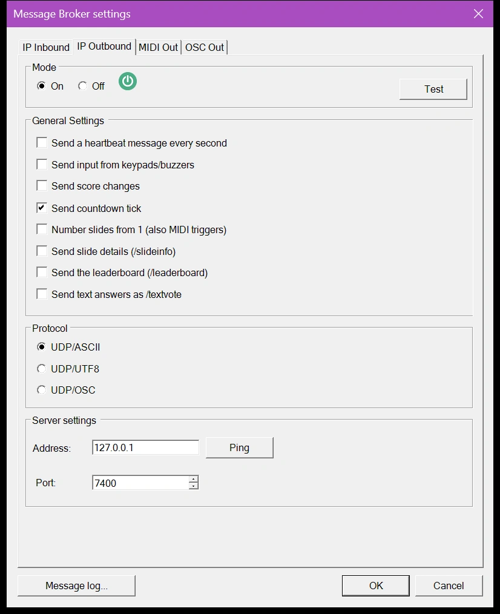
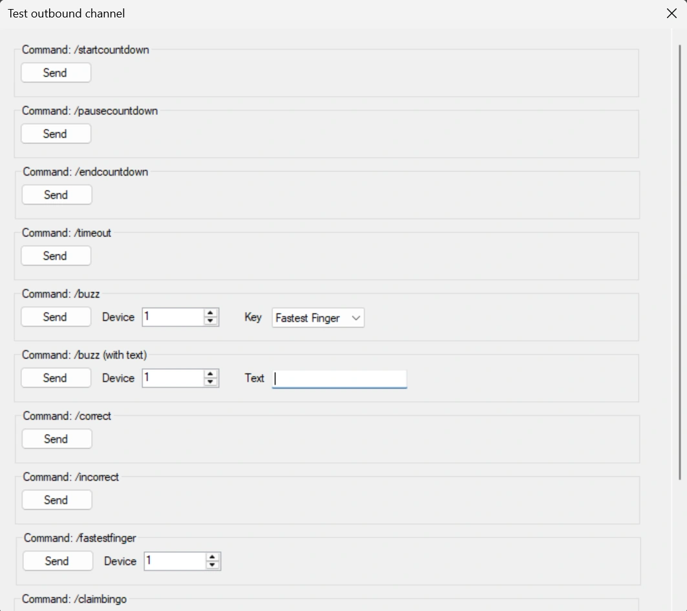
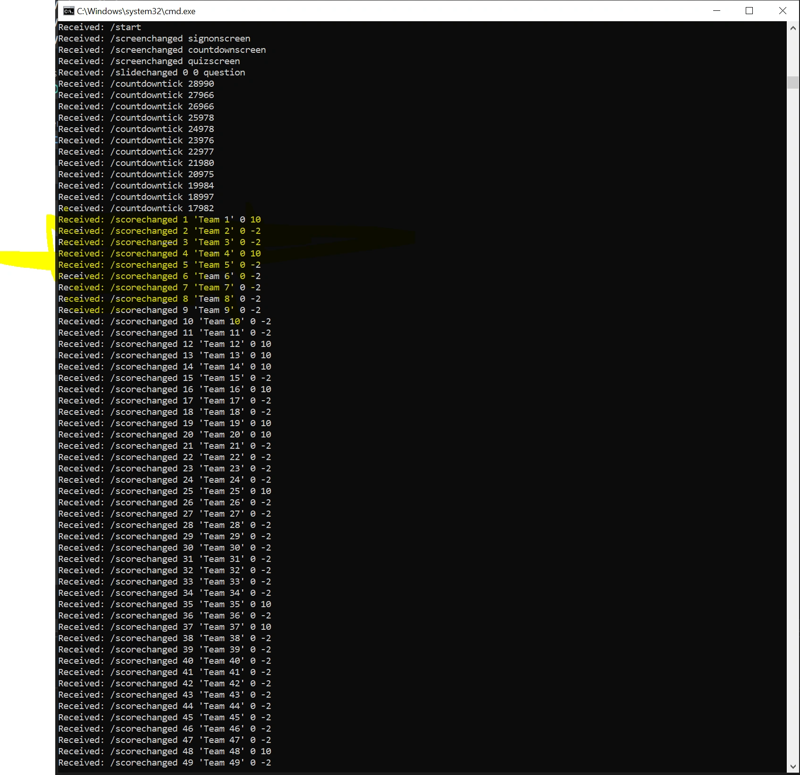

# Canal IP de salida

Con el canal de salida, QuizXpress envía un mensaje cada vez que ocurre algo en el quiz, como un cambio de diapositiva, una pulsación de pulsador o un cambio de puntuación. Su propia aplicación escucha estos mensajes y responde, por ejemplo controlando un marcador externo o un espectáculo de luces.

Actívelo en la pestaña 'IP Outbound' de los [ajustes de Message Broker](index.md#abrir-los-ajustes-de-message-broker):

{ width="420" loading=lazy }

## Ajustes

**On/Off**
:   Activa o desactiva el canal de salida.

**Test**
:   Abre un formulario de prueba donde puede activar eventos manualmente:

    { width="560" loading=lazy }

**Send a heartbeat message every second**
:   Envía un mensaje de latido (heartbeat) cada segundo, para que el lado receptor pueda saber que el reproductor del quiz sigue en ejecución. Úselo para detectar una conexión que se ha interrumpido inesperadamente; una sesión normal siempre empieza con `/start` y termina con `/close`.

**Send input from keypads/buzzers**
:   Retransmite cada pulsación de mando y de pulsador. Es opcional porque puede producir muchos mensajes.

**Send score changes**
:   Envía un mensaje cada vez que cambia la puntuación de un jugador, por ejemplo para controlar marcadores externos.

**Send countdown tick**
:   Envía el tiempo restante cada segundo mientras la cuenta atrás está en marcha.

**Number slides from 1 (also MIDI triggers)**
:   Los números de diapositiva en `/slidechanged`, `/slideinfo` y el disparador MIDI 'Slide Changed' empiezan en 1, como en Studio y en los comandos de entrada `goto` y `getslide`. Cuando está desactivado, empiezan en 0, como en versiones anteriores; manténgalo desactivado si su aplicación o su configuración MIDI ya cuenta desde 0.

**Send slide details (/slideinfo)**
:   Envía la pregunta, las respuestas y la respuesta correcta de cada diapositiva nueva. Consulte [Detalles de la diapositiva y clasificación](#detalles-de-la-diapositiva-y-clasificacion).

**Send the leaderboard (/leaderboard)**
:   Envía todos los equipos por orden de clasificación cuando cambian las puntuaciones. Consulte [Detalles de la diapositiva y clasificación](#detalles-de-la-diapositiva-y-clasificacion).

**Send text answers as /textvote**
:   Las respuestas de texto de los mandos (números, letras, texto completo) se envían como `/textvote` en lugar de `/buzz`, para que su aplicación pueda distinguirlas de las pulsaciones de botón. Cuando está desactivado, ambas se envían como `/buzz`, como en versiones anteriores. Requiere 'Send input from keypads/buzzers'.

**Protocol**
:   - **UDP/ASCII:** texto ASCII sin formato, con los parámetros separados por espacios.
    - **UDP/UTF8:** lo mismo, codificado como UTF-8. Elija esta opción cuando los nombres de equipo o las respuestas contengan caracteres con acento.
    - **UDP/OSC:** mensajes en formato [Open Sound Control (OSC)](https://en.wikipedia.org/wiki/Open_Sound_Control), que [Max](https://cycling74.com/), QLab, TouchOSC y herramientas similares pueden procesar directamente. Los números se envían como enteros de 32 bits y el texto como cadenas UTF-8.

**Server address**
:   La dirección IP del ordenador que recibe los mensajes. Utilice `127.0.0.1` si es el mismo ordenador.

**Server port**
:   El número de puerto en el que escucha la aplicación receptora.

!!! tip
    El [registro de mensajes](index.md#registro-de-mensajes) muestra cada mensaje que sale, para que pueda comprobar qué debería recibir su aplicación.

!!! note
    Una consola de iluminación como una ETC Eos o Ion solo reacciona a sus propios comandos, no a estos mensajes fijos. Utilice [OSC Out](osc-out.md) para enviarle exactamente los mensajes que espera.

## Mensajes

El lado receptor abre un socket UDP. Los mensajes son cadenas de texto sin formato con el formato `/message {parameter1} {parameter2} …`. Cada sesión empieza con `/start` y termina con `/close`.

| Mensaje | Significado |
|---|---|
| `/start` | Inicio de la sesión. |
| `/close` | Fin de la sesión: QuizXpress Live se está cerrando. |
| `/heartbeat {counter}` | Se envía cada segundo con un contador creciente, por ejemplo `/heartbeat 2345`. |
| `/countdowntick {remainingtimeMs}` | Se envía cada segundo mientras la cuenta atrás está en marcha, con el tiempo restante en milisegundos, por ejemplo `/countdowntick 23100`. |
| `/slidechanged {old#} {new#} {questiontype} {slide class} {slide id}` | Se muestra una nueva diapositiva. La clase y el id son opcionales y se establecen en los metadatos de la diapositiva en Studio, de modo que puede reaccionar a una clase o a un id en lugar de a un número de diapositiva que cambia cuando se reordenan las diapositivas. Ejemplo: `/slidechanged 6 7 question MySpecialSlideType banner1`. Con 'Number slides from 1', `0` como número anterior significa que no había una diapositiva previa. |
| `/command {command}` | Un comando del mando a distancia del presentador del quiz: `power`, `scores`, `chart`, `leaderboard`, `groupchart`, `up`, `down`, `pause`, `questionmark`, `next`, `wrong` o `right`. Ejemplo: `/command up`. |
| `/buzz {device} {key}` | Una pulsación de tecla en un dispositivo, por ejemplo `/buzz 10 A`, o `/buzz 8 RED` para el botón de dedo más rápido. Las respuestas de texto también se envían como `/buzz`, a menos que 'Send text answers as /textvote' esté activado. |
| `/textvote {device} {text}` | Una respuesta de texto de un dispositivo, por ejemplo `/textvote 8 Paris`. Solo con 'Send text answers as /textvote'. |
| `/fastestfinger {device}` | El dispositivo que fue el primero en una pregunta de dedo más rápido. |
| `/screenchanged {screentype}` | El reproductor del quiz cambió de pantalla: `welcomescreen`, `signonscreen`, `countdownscreen`, `quizscreen` o `finalscorescreen`. Ejemplo: `/screenchanged countdownscreen`. |
| `/timeout` | La pregunta agotó su tiempo sin una respuesta correcta. |
| `/startcountdown` | Se inició la cuenta atrás de la pregunta. |
| `/pausecountdown` | La cuenta atrás está en pausa; el sistema está inactivo. |
| `/endcountdown` | La cuenta atrás se detuvo; la pregunta ha terminado. |
| `/correct` | Una respuesta a la pregunta actual se juzgó correcta. |
| `/incorrect` | Una respuesta a la pregunta actual se juzgó incorrecta. |
| `/answerrevealed` | La respuesta correcta se muestra en la diapositiva, por ejemplo cuando se acaba el tiempo en una pregunta de votación. En una diapositiva de Trivia Feud se envía por cada respuesta que se da la vuelta en el tablero. |
| `/restart` | El quiz se reinició desde la pantalla de puntuación final. |
| `/scorechanged {device} {teamname} {old score} {new score}` | Cambió la puntuación de un equipo. Ejemplo: `/scorechanged 10 'John Trivialta' 5 10` significa que el equipo 'John Trivialta' del dispositivo 10 pasó de 5 a 10 puntos. En OSC el nombre del equipo es una cadena sin las comillas. |
| `/claimbingo` | Un jugador reclamó Bingo. |
| `/falsebingo` | Un Bingo reclamado resultó ser falso. |
| `/bingo` | Un Bingo reclamado es válido. |
| `/slideinfo {json}` | Los detalles de la nueva diapositiva, enviados justo después de `/slidechanged`. Solo con 'Send slide details'. |
| `/leaderboard {json}` | Todos los equipos por orden de clasificación. Solo con 'Send the leaderboard'. |

Ejemplo de los mensajes durante un quiz:

{ loading=lazy }

## Detalles de la diapositiva y clasificación

`/slideinfo` y `/leaderboard` llevan [JSON](https://www.json.org/) en una sola línea, que la mayoría de las herramientas pueden leer directamente (Node-RED, Max con `dict.deserialize`, Bitfocus Companion, Python). En OSC el JSON es un único argumento de tipo cadena. Con UDP/ASCII, los caracteres con acento se escriben como códigos `\u`, que cualquier lector de JSON convierte de nuevo en el carácter correcto.

`/slideinfo` se envía justo después de `/slidechanged`, por ejemplo:

```
/slideinfo {"number":44,"previous":45,"type":"question","question":"Which aircraft type has recently been added?","answers":["A340","A380","B787"],"correctAnswer":"C","category":"Default Category","answerTime":30,"points":10,"class":"","id":""}
```

| Campo | Significado |
|---|---|
| `number`, `previous` | El número de la diapositiva nueva y el de la anterior, contados según lo establecido en 'Number slides from 1'. |
| `type` | El tipo de diapositiva, el mismo que en `/slidechanged`. |
| `question`, `answers` | El texto de la pregunta y las respuestas, en el orden de la diapositiva. |
| `correctAnswer` | La respuesta correcta, por ejemplo `C` para la tercera respuesta. |
| `category`, `answerTime`, `points` | La categoría, el tiempo de respuesta en segundos y los puntos por una respuesta correcta. |
| `class`, `id` | La clase y el id de la diapositiva de los metadatos de la diapositiva en Studio. |

!!! warning
    `/slideinfo` contiene la respuesta correcta en cuanto aparece la diapositiva. No la muestre en una pantalla que los jugadores puedan ver antes de que se revele la respuesta.

`/leaderboard` se envía cuando cambian las puntuaciones. Cuando cambian muchas puntuaciones a la vez, por ejemplo al final de una pregunta, recibe una sola clasificación después del último cambio en lugar de una por equipo:

```
/leaderboard [{"rank":1,"device":2,"name":"Brainiacs","group":"","score":30},{"rank":2,"device":1,"name":"Zoë's Team","group":"","score":10},{"rank":2,"device":3,"name":"Quizzers","group":"","score":10}]
```

Los equipos con la misma puntuación comparten posición, y se omite la siguiente (1, 2, 2, 4). `group` es el grupo demográfico del equipo, si lo tiene.

## Ejemplo: un sencillo receptor UDP

Esta aplicación de consola en C# (.NET Framework 4.8) escucha en el puerto 12345 e imprime cada mensaje que recibe. Establezca el 'Server port' en Message Broker con el mismo número.

```csharp
using System;
using System.Net;
using System.Net.Sockets;
using System.Text;

class UDPServer
{
    static void Main(string[] args)
    {
        int port = 12345; // The port to listen on
        UdpClient udpListener = new UdpClient(port);
        Console.WriteLine($"UDP server is listening on port {port}");

        try
        {
            while (true)
            {
                IPEndPoint senderEndPoint = new IPEndPoint(IPAddress.Any, port);
                byte[] receivedBytes = udpListener.Receive(ref senderEndPoint);
                string receivedText = Encoding.UTF8.GetString(receivedBytes);
                Console.WriteLine($"Received: {receivedText}");
            }
        }
        catch (Exception e)
        {
            Console.WriteLine($"An error occurred: {e.Message}");
        }
        finally
        {
            udpListener.Close();
        }
    }
}
```
