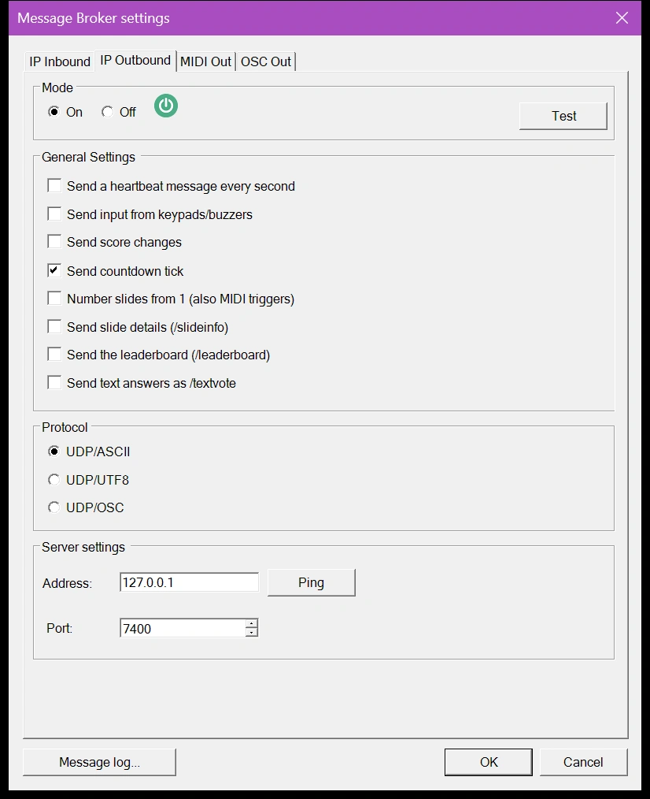
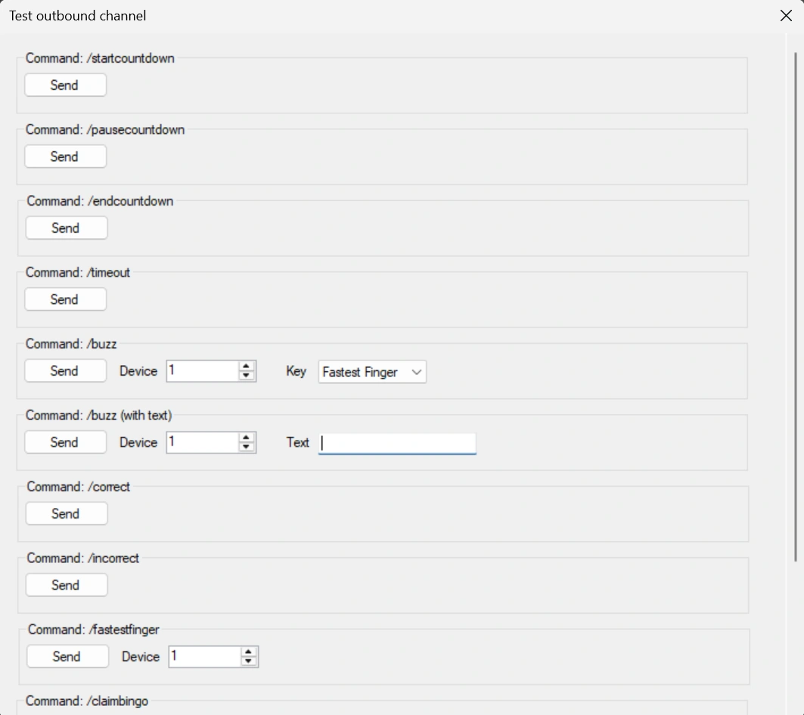
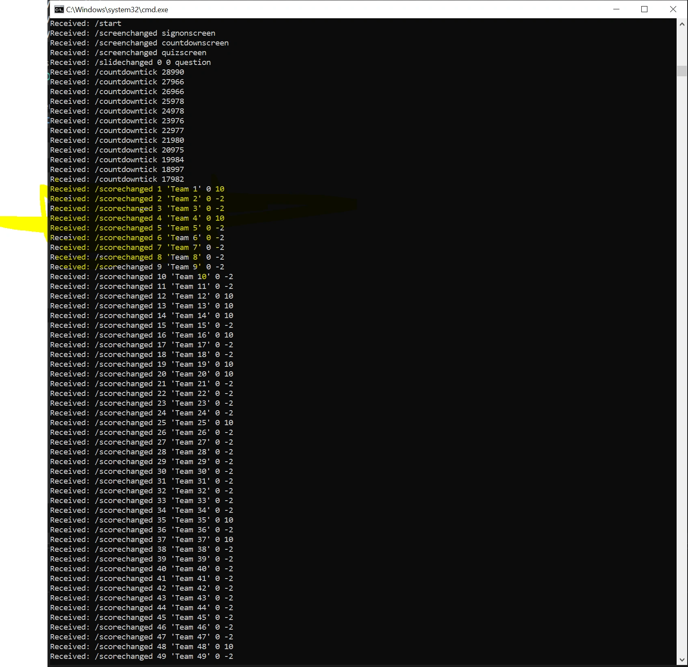

# Uitgaand IP-kanaal

Via het uitgaande kanaal verzendt QuizXpress een bericht wanneer er iets gebeurt in de quiz, zoals een diawisseling, een buzzerdruk of een scorewijziging. Uw eigen toepassing luistert naar deze berichten en reageert erop, bijvoorbeeld door een extern scorebord of een lichtshow aan te sturen.

Schakel het in op het tabblad 'IP Uitgaand' van de [Message Broker-instellingen](index.md#de-message-broker-instellingen-openen):

{ width="420" loading=lazy }

## Instellingen

**Aan/Uit**
:   Schakelt het uitgaande kanaal in of uit.

**Testen**
:   Opent een testformulier waarin u gebeurtenissen met de hand kunt activeren:

    { width="560" loading=lazy }

**Stuur elke seconde een 'heartbeat'**
:   Verzendt elke seconde een heartbeat-bericht, zodat de ontvangende kant kan zien dat de quizspeler nog draait. Gebruik het om een onverwacht verbroken verbinding te detecteren; een normale sessie begint altijd met `/start` en eindigt met `/close`.

**Stuur input van keypads / buzzers**
:   Geeft elke druk op een keypad of buzzer door. Dit is optioneel omdat het veel berichten kan opleveren.

**Verzend scorewijzigingen**
:   Verzendt een bericht wanneer de score van een speler verandert, bijvoorbeeld om externe scoreborden aan te sturen.

**Stuur countdown tick**
:   Verzendt elke seconde de resterende tijd terwijl het aftellen loopt.

**Dia’s nummeren vanaf 1 (ook MIDI-triggers)**
:   Dianummers in `/slidechanged`, `/slideinfo` en de MIDI-trigger 'Dia wisselt' beginnen bij 1, zoals in Studio en in de inkomende commando’s `goto` en `getslide`. Als het uit staat, beginnen ze bij 0, zoals in eerdere versies; laat het uit als uw toepassing of MIDI-configuratie al vanaf 0 telt.

**Diadetails verzenden (/slideinfo)**
:   Verzendt de vraag, de antwoorden en het juiste antwoord van elke nieuwe dia. Zie [Diadetails en ranglijst](#diadetails-en-ranglijst).

**Ranglijst verzenden (/leaderboard)**
:   Verzendt na scorewijzigingen alle teams in volgorde van rangschikking. Zie [Diadetails en ranglijst](#diadetails-en-ranglijst).

**Tekstantwoorden als /textvote verzenden**
:   Tekstantwoorden van keypads (getallen, letters, volledige tekst) worden verzonden als `/textvote` in plaats van `/buzz`, zodat uw toepassing ze kan onderscheiden van drukken op knoppen. Als het uit staat, worden beide als `/buzz` verzonden, zoals in eerdere versies. Vereist 'Stuur input van keypads / buzzers'.

**Protocol**
:   - **UDP/ASCII:** gewone ASCII-tekst, parameters gescheiden door spaties.
    - **UDP/UTF8:** hetzelfde, gecodeerd als UTF-8. Kies dit wanneer teamnamen of antwoorden letters met accenten bevatten.
    - **UDP/OSC:** berichten in [Open Sound Control (OSC)](https://en.wikipedia.org/wiki/Open_Sound_Control)-formaat, die [Max](https://cycling74.com/), QLab, TouchOSC en vergelijkbare tools rechtstreeks kunnen verwerken. Getallen worden verzonden als 32-bits gehele getallen en tekst als UTF-8-strings.

**Server adres**
:   Het IP-adres van de computer die de berichten ontvangt. Gebruik `127.0.0.1` als het dezelfde computer is.

**Server poort**
:   Het poortnummer waarop de ontvangende toepassing luistert.

!!! tip
    Het [berichtenlogboek](index.md#berichtenlogboek) toont elk bericht dat naar buiten gaat, zodat u kunt controleren wat uw toepassing moet ontvangen.

!!! note
    Een lichtbesturing zoals een ETC Eos of Ion reageert alleen op zijn eigen commando’s, niet op deze vaste berichten. Gebruik [OSC Uit](osc-out.md) om hem precies de berichten te sturen die hij verwacht.

## Berichten

De ontvangende kant opent een UDP-socket. Berichten zijn gewone strings in het formaat `/bericht {parameter1} {parameter2} …`. Elke sessie begint met `/start` en eindigt met `/close`.

| Bericht | Betekenis |
|---|---|
| `/start` | Begin van de sessie. |
| `/close` | Einde van de sessie: QuizXpress Live wordt afgesloten. |
| `/heartbeat {counter}` | Elke seconde verzonden met een oplopende teller, bijvoorbeeld `/heartbeat 2345`. |
| `/countdowntick {remainingtimeMs}` | Elke seconde verzonden terwijl het aftellen loopt, met de resterende tijd in milliseconden, bijvoorbeeld `/countdowntick 23100`. |
| `/slidechanged {old#} {new#} {questiontype} {slide class} {slide id}` | Er wordt een nieuwe dia getoond. De klasse en het id zijn optioneel en worden ingesteld in de metagegevens van de dia in Studio, zodat u kunt reageren op een klasse of id in plaats van op een dianummer dat verandert wanneer dia’s worden herschikt. Voorbeeld: `/slidechanged 6 7 question MySpecialSlideType banner1`. Bij 'Dia’s nummeren vanaf 1' betekent `0` als oud nummer dat er geen vorige dia was. |
| `/command {command}` | Een commando van de afstandsbediening van de quizmaster: `power`, `scores`, `chart`, `leaderboard`, `groupchart`, `up`, `down`, `pause`, `questionmark`, `next`, `wrong` of `right`. Voorbeeld: `/command up`. |
| `/buzz {device} {key}` | Een toetsdruk op een apparaat, bijvoorbeeld `/buzz 10 A`, of `/buzz 8 RED` voor de knop van de snelste vinger. Tekstantwoorden worden ook als `/buzz` verzonden, tenzij 'Tekstantwoorden als /textvote verzenden' aan staat. |
| `/textvote {device} {text}` | Een tekstantwoord van een apparaat, bijvoorbeeld `/textvote 8 Paris`. Alleen met 'Tekstantwoorden als /textvote verzenden'. |
| `/fastestfinger {device}` | Het apparaat dat als eerste was bij een snelste-vingervraag. |
| `/screenchanged {screentype}` | De quizspeler is van scherm gewisseld: `welcomescreen`, `signonscreen`, `countdownscreen`, `quizscreen` of `finalscorescreen`. Voorbeeld: `/screenchanged countdownscreen`. |
| `/timeout` | De tijd voor de vraag was voorbij zonder juist antwoord. |
| `/startcountdown` | Het aftellen van de vraag is gestart. |
| `/pausecountdown` | Het aftellen is gepauzeerd; het systeem is inactief. |
| `/endcountdown` | Het aftellen is gestopt; de vraag is afgelopen. |
| `/correct` | Een antwoord op de huidige vraag is als juist beoordeeld. |
| `/incorrect` | Een antwoord op de huidige vraag is als onjuist beoordeeld. |
| `/answerrevealed` | Het juiste antwoord wordt op de dia getoond, bijvoorbeeld wanneer de tijd om is bij een stemvraag. Bij een Trivia Feud-dia wordt het verzonden voor elk antwoord dat op het bord wordt omgedraaid. |
| `/restart` | De quiz is opnieuw gestart vanaf het eindscorescherm. |
| `/scorechanged {device} {teamname} {old score} {new score}` | De score van een team is veranderd. Voorbeeld: `/scorechanged 10 'John Trivialta' 5 10` betekent dat team 'John Trivialta' op apparaat 10 van 5 naar 10 punten ging. In OSC is de teamnaam een string zonder de aanhalingstekens. |
| `/claimbingo` | Een speler heeft Bingo geclaimd. |
| `/falsebingo` | Een geclaimde Bingo bleek vals te zijn. |
| `/bingo` | Een geclaimde Bingo is geldig. |
| `/slideinfo {json}` | De details van de nieuwe dia, direct na `/slidechanged` verzonden. Alleen met 'Diadetails verzenden'. |
| `/leaderboard {json}` | Alle teams in volgorde van rangschikking. Alleen met 'Ranglijst verzenden'. |

Voorbeeld van de berichten tijdens een quiz:

{ loading=lazy }

## Diadetails en ranglijst

`/slideinfo` en `/leaderboard` bevatten [JSON](https://www.json.org/) op één regel, die de meeste tools rechtstreeks kunnen lezen (Node-RED, Max met `dict.deserialize`, Bitfocus Companion, Python). In OSC is de JSON één stringargument. Bij UDP/ASCII worden letters met accenten geschreven als `\u`-codes, die elke JSON-lezer terugzet naar het juiste teken.

`/slideinfo` wordt direct na `/slidechanged` verzonden, bijvoorbeeld:

```
/slideinfo {"number":44,"previous":45,"type":"question","question":"Which aircraft type has recently been added?","answers":["A340","A380","B787"],"correctAnswer":"C","category":"Default Category","answerTime":30,"points":10,"class":"","id":""}
```

| Veld | Betekenis |
|---|---|
| `number`, `previous` | Het nieuwe en het vorige dianummer, geteld zoals ingesteld met 'Dia’s nummeren vanaf 1'. |
| `type` | Het diatype, hetzelfde als in `/slidechanged`. |
| `question`, `answers` | De vraagtekst en de antwoorden, in de volgorde van de dia. |
| `correctAnswer` | Het juiste antwoord, bijvoorbeeld `C` voor het derde antwoord. |
| `category`, `answerTime`, `points` | De categorie, de antwoordtijd in seconden en de punten voor een juist antwoord. |
| `class`, `id` | De diaklasse en het id uit de metagegevens van de dia in Studio. |

!!! warning
    `/slideinfo` bevat het juiste antwoord zodra de dia verschijnt. Toon het niet op een scherm dat de spelers kunnen zien voordat het antwoord wordt onthuld.

`/leaderboard` wordt verzonden nadat scores veranderen. Wanneer veel scores tegelijk veranderen, bijvoorbeeld aan het einde van een vraag, krijgt u één ranglijst na de laatste wijziging in plaats van één per team:

```
/leaderboard [{"rank":1,"device":2,"name":"Brainiacs","group":"","score":30},{"rank":2,"device":1,"name":"Zoë's Team","group":"","score":10},{"rank":2,"device":3,"name":"Quizzers","group":"","score":10}]
```

Teams met dezelfde score delen een rang, en de volgende rang wordt overgeslagen (1, 2, 2, 4). `group` is de demografische groep van het team, indien aanwezig.

## Voorbeeld: een eenvoudige UDP-listener

Deze C#-consoletoepassing (.NET Framework 4.8) luistert op poort 12345 en drukt elk ontvangen bericht af. Stel de 'Server poort' in Message Broker in op hetzelfde nummer.

```csharp
using System;
using System.Net;
using System.Net.Sockets;
using System.Text;

class UDPServer
{
    static void Main(string[] args)
    {
        int port = 12345; // The port to listen on
        UdpClient udpListener = new UdpClient(port);
        Console.WriteLine($"UDP server is listening on port {port}");

        try
        {
            while (true)
            {
                IPEndPoint senderEndPoint = new IPEndPoint(IPAddress.Any, port);
                byte[] receivedBytes = udpListener.Receive(ref senderEndPoint);
                string receivedText = Encoding.UTF8.GetString(receivedBytes);
                Console.WriteLine($"Received: {receivedText}");
            }
        }
        catch (Exception e)
        {
            Console.WriteLine($"An error occurred: {e.Message}");
        }
        finally
        {
            udpListener.Close();
        }
    }
}
```
