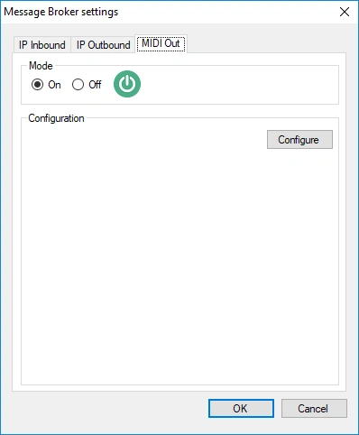
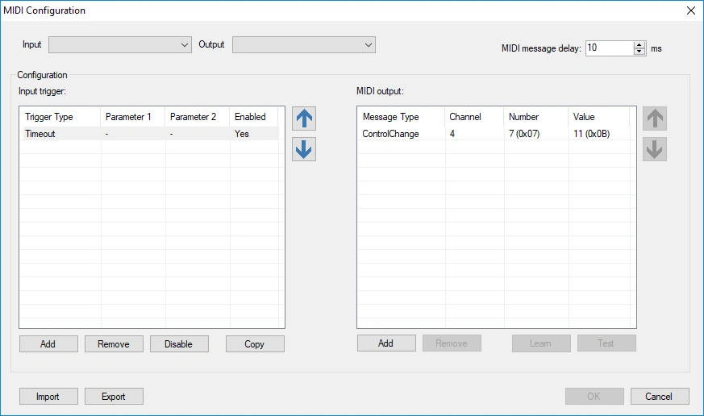
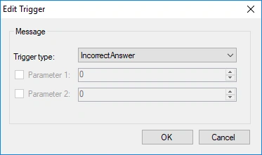
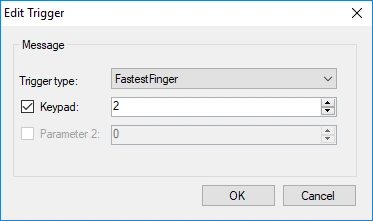
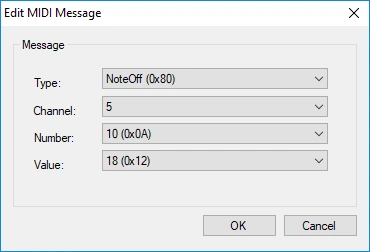
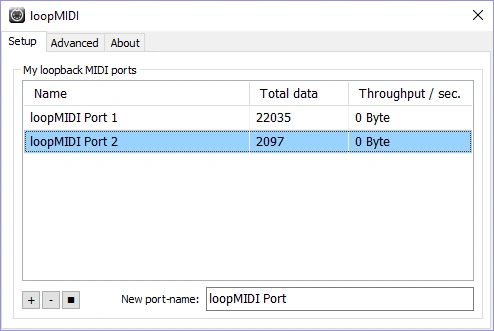
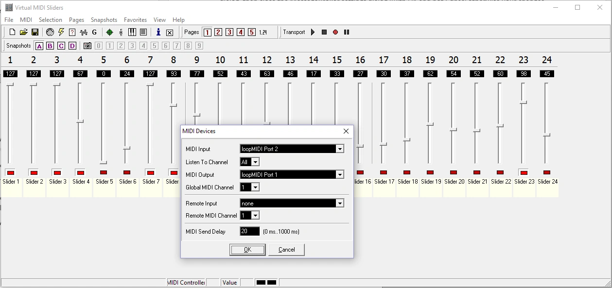

# MIDI et DMX

QuizXpress peut contrôler des appareils externes via MIDI. Un exemple typique est un contrôleur de lumière DMX : lorsqu'un événement se produit dans le quiz, comme une bonne réponse ou la fin du compte à rebours, QuizXpress envoie des messages MIDI qui basculent les lumières vers une scène correspondante.

## Activer la prise en charge du MIDI

Ouvrez les [paramètres de Message Broker](index.md#ouvrir-les-parametres-de-message-broker), activez la prise en charge du MIDI et cliquez sur 'Configure' :

{ width="300" loading=lazy }

L'écran de configuration MIDI s'ouvre :

{ loading=lazy }

- **En haut :** sélectionnez le périphérique d'entrée et de sortie MIDI. Le périphérique d'entrée n'est utilisé que pour la fonction 'Learn' (voir ci-dessous). Le périphérique de sortie reçoit les messages MIDI que QuizXpress envoie lorsque des événements se produisent dans le quiz.
- **Au milieu, à gauche :** les déclencheurs, c'est-à-dire les événements qui se produisent dans QuizXpress.
- **Au milieu, à droite :** les messages MIDI envoyés pour le déclencheur sélectionné.

## Ajouter un déclencheur

Cliquez sur le bouton 'Add' de gauche et choisissez le type de déclencheur :

{ width="300" loading=lazy }

Certains déclencheurs ont un paramètre facultatif qui précise quand ils se déclenchent. Dans cet exemple, le déclencheur ne se déclenche que lorsque le buzzer 2 remporte une question de type fastest finger :

{ width="300" loading=lazy }

### Déclencheurs disponibles

| Déclencheur | Se déclenche quand… |
|---|---|
| Timeout | La question en cours expire, par exemple parce que personne n'a répondu à temps. |
| Correct Answer | L'animateur de quiz juge une réponse correcte. |
| Incorrect Answer | L'animateur de quiz juge une réponse incorrecte. |
| Answer Revealed | La bonne réponse est affichée sur la diapositive. Sur une diapositive Trivia Feud, chaque réponse retournée sur le tableau. |
| Start Countdown | Le compte à rebours démarre. |
| End Countdown | Le compte à rebours se termine. |
| Pause Countdown | L'animateur de quiz met le compte à rebours en pause. |
| Countdown Tick | Le compte à rebours avance. Vous pouvez filtrer sur le nombre de secondes restantes. |
| Restart | Le quiz redémarre et retourne à l'écran d'accueil. |
| Fastest Finger | Un joueur est le premier à répondre à une question de type fastest finger. Vous pouvez filtrer sur le numéro de l'appareil (clavier ou buzzer). |
| Screen Changed | L'écran change, par exemple écran d'accueil → écran d'inscription des buzzers → écran du quiz → écran des scores. Vous pouvez filtrer sur le type d'écran. |
| Slide Changed | Le quiz passe à une autre diapositive. Vous pouvez filtrer sur le numéro de diapositive de départ/d'arrivée ou sur la classe de la diapositive. Les numéros de diapositive commencent à 0 (la première diapositive est 0), sauf si 'Number slides from 1' est coché dans l'onglet [IP Outbound](ip-outbound.md#parametres). |
| Remote Command | Une commande arrive depuis la télécommande de l'animateur de quiz. |
| Receive Keypad | Un signal arrive d'un clavier ou d'un buzzer. Vous pouvez filtrer sur le numéro du clavier et la touche (A = 1, B = 2, etc. ; fastest finger = 0). |
| Claim Bingo | Un joueur réclame un Bingo. |
| False Bingo | Un Bingo réclamé échoue à la validation. |
| Bingo | Un Bingo réclamé est valide et le joueur gagne. |

!!! tip
    Filtrer 'Slide Changed' sur une **classe de diapositive** est plus robuste que filtrer sur des numéros de diapositive. Vous attribuez une classe à une diapositive dans QuizXpress Studio ; si vous réorganisez ensuite vos diapositives, les déclencheurs basés sur la classe continuent de fonctionner, alors que ceux basés sur les numéros devraient être mis à jour.

## Définir les messages MIDI

Pour chaque déclencheur, définissez la séquence de messages MIDI à envoyer au périphérique de sortie (la liste de droite). Il y a deux façons de procéder.

**Les apprendre depuis votre contrôleur (recommandé).** Cliquez sur 'Learn' (le bouton devient vert), puis réglez votre contrôleur de lumière sur la scène souhaitée. Les messages MIDI apparaissent dans la liste au fur et à mesure. Cliquez de nouveau sur 'Learn' quand vous avez terminé.

**Les saisir manuellement.** Cliquez sur le bouton 'Add' de droite :

{ width="300" loading=lazy }

Double-cliquez sur un message ou un déclencheur dans la liste pour le modifier.

Cliquez sur 'Test' pour envoyer les messages sélectionnés au périphérique de sortie et vérifier que le contrôleur réagit correctement.

Quand tout est configuré, fermez l'écran de configuration MIDI puis fermez les paramètres de Message Broker avec 'OK'. À partir de là, QuizXpress envoie les messages MIDI au périphérique de sortie sélectionné.

## Tester sans matériel MIDI

Deux outils gratuits permettent de tester sans aucun périphérique MIDI physique :

1. **[loopMIDI](https://www.tobias-erichsen.de/software/loopmidi.html)** crée un périphérique MIDI virtuel, afin que des programmes puissent communiquer en MIDI entre eux sans matériel.

    { width="500" loading=lazy }

2. **[Virtual MIDI Sliders](http://www.granucon.com/SoftwarePages/Vms.aspx)** montre comment QuizXpress pilote un contrôleur MIDI générique. La fonction 'Learn' fonctionne aussi avec ce périphérique virtuel.

    { loading=lazy }
