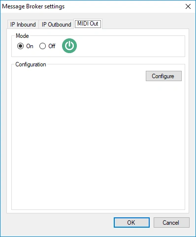
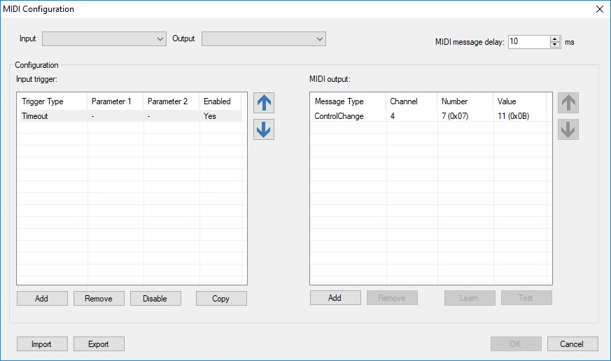
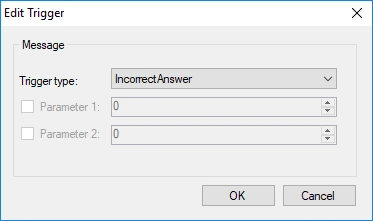
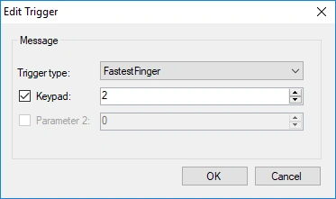
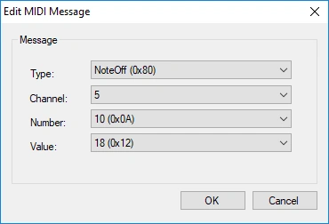
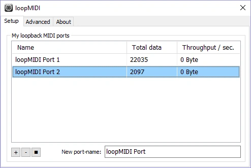
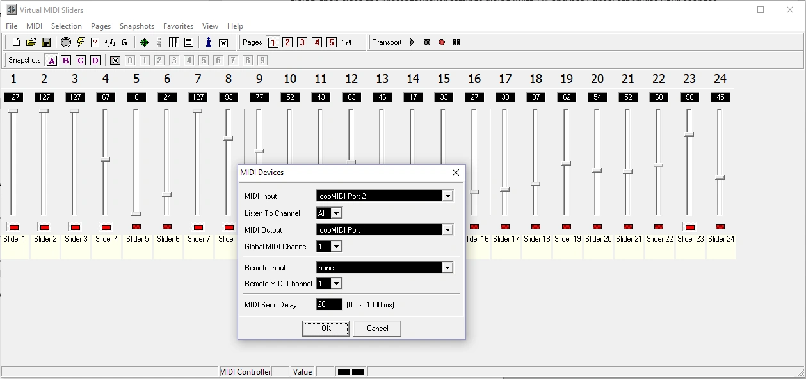

# MIDI en DMX

QuizXpress kan externe apparaten besturen via MIDI. Een typisch voorbeeld is een DMX-lichtbesturing: wanneer er iets gebeurt in de quiz, zoals een juist antwoord of het einde van het aftellen, verzendt QuizXpress MIDI-berichten die de verlichting naar een passende scène schakelen.

## MIDI-ondersteuning inschakelen

Open de [Message Broker-instellingen](index.md#de-message-broker-instellingen-openen), schakel MIDI-ondersteuning in en klik op 'Configureren':

{ width="300" loading=lazy }

Het MIDI-configuratiescherm opent:

{ loading=lazy }

- **Boven:** selecteer het MIDI-invoer- en uitvoerapparaat. Het invoerapparaat wordt alleen gebruikt voor de functie 'Leren' (zie hieronder). Het uitvoerapparaat ontvangt de MIDI-berichten die QuizXpress verzendt wanneer er gebeurtenissen in de quiz plaatsvinden.
- **Midden, links:** de triggers, dit zijn gebeurtenissen die binnen QuizXpress plaatsvinden.
- **Midden, rechts:** de MIDI-berichten die voor de geselecteerde trigger worden verzonden.

## Een trigger toevoegen

Klik op de linker knop 'Toevoegen' en kies het triggertype:

{ width="300" loading=lazy }

Sommige triggers hebben een optionele parameter die bepaalt wanneer ze afgaan. In dit voorbeeld gaat de trigger alleen af wanneer buzzer 2 een snelste-vingervraag wint:

{ width="300" loading=lazy }

### Beschikbare triggers

| Trigger | Gaat af wanneer… |
|---|---|
| Tijd voorbij | De tijd voor de huidige vraag voorbij is, bijvoorbeeld omdat niemand op tijd antwoordde. |
| Correct antwoord | De quizmaster een antwoord als juist beoordeelt. |
| Fout antwoord | De quizmaster een antwoord als onjuist beoordeelt. |
| Antwoord wordt getoond | Het juiste antwoord op de dia wordt getoond. Bij een Trivia Feud-dia: elk antwoord dat op het bord wordt omgedraaid. |
| Aftellen begint | De aftelklok start. |
| Aftellen stopt | De aftelklok eindigt. |
| Aftellen gepauzeerd | De quizmaster de aftelklok pauzeert. |
| Aftellen tik | De aftelklok verder tikt. U kunt filteren op het aantal resterende seconden. |
| Quiz begint opnieuw | De quiz opnieuw start en teruggaat naar het welkomstscherm. |
| Snelste vinger | Een speler als eerste reageert op een snelste-vingervraag. U kunt filteren op het apparaatnummer (keypad of buzzer). |
| Scherm wisselt | Het scherm wisselt, bijvoorbeeld welkomstscherm → buzzer-aanmeldscherm → quizscherm → scorescherm. U kunt filteren op het type scherm. |
| Dia wisselt | De quiz doorgaat naar een andere dia. U kunt filteren op het van/naar-dianummer of op de diaklasse. Dianummers beginnen bij 0 (de eerste dia is 0), tenzij 'Dia’s nummeren vanaf 1' is aangevinkt op het tabblad [IP Uitgaand](ip-outbound.md#instellingen). |
| Knop van de afstandsbediening | Een commando binnenkomt van de afstandsbediening van de quizmaster. |
| Keypad ingedrukt | Een signaal binnenkomt van een keypad of buzzer. U kunt filteren op het keypadnummer en de toets (A = 1, B = 2, enzovoort; snelste vinger = 0). |
| Bingo geclaimd | Een speler Bingo claimt. |
| Vals bingo | Een geclaimde Bingo de validatie niet doorstaat. |
| Bingo | Een geclaimde Bingo geldig is en de speler wint. |

!!! tip
    Filteren van 'Dia wisselt' op een **diaklasse** is robuuster dan filteren op dianummers. U wijst een klasse aan een dia toe in QuizXpress Studio; als u uw dia’s later herschikt, blijven de op klasse gebaseerde triggers werken, terwijl op nummer gebaseerde triggers moeten worden bijgewerkt.

## De MIDI-berichten definiëren

Definieer voor elke trigger de reeks MIDI-berichten die naar het uitvoerapparaat moet worden verzonden (de lijst rechts). Dat kan op twee manieren.

**Laat ze leren van uw controller (aanbevolen).** Klik op 'Leren' (het wordt groen) en zet daarna uw lichtbesturing op de gewenste scène. De MIDI-berichten verschijnen in de lijst terwijl u bezig bent. Klik nogmaals op 'Leren' als u klaar bent.

**Voer ze handmatig in.** Klik op de rechter knop 'Toevoegen':

{ width="300" loading=lazy }

Dubbelklik op een bericht of trigger in de lijst om het te bewerken.

Klik op 'Testen' om de geselecteerde berichten naar het uitvoerapparaat te sturen en te controleren of de controller correct reageert.

Wanneer alles is geconfigureerd, sluit u het MIDI-configuratiescherm en daarna de Message Broker-instellingen met 'OK'. Vanaf dat moment verzendt QuizXpress de MIDI-berichten naar het geselecteerde uitvoerapparaat.

## Testen zonder MIDI-hardware

Twee gratis tools laten u testen zonder fysieke MIDI-apparaten:

1. **[loopMIDI](https://www.tobias-erichsen.de/software/loopmidi.html)** maakt een virtueel MIDI-apparaat, zodat programma’s zonder hardware MIDI met elkaar kunnen praten.

    { width="500" loading=lazy }

2. **[Virtual MIDI Sliders](http://www.granucon.com/SoftwarePages/Vms.aspx)** toont hoe QuizXpress een generieke MIDI-controller aanstuurt. De functie 'Leren' werkt ook met dit virtuele apparaat.

    { loading=lazy }
