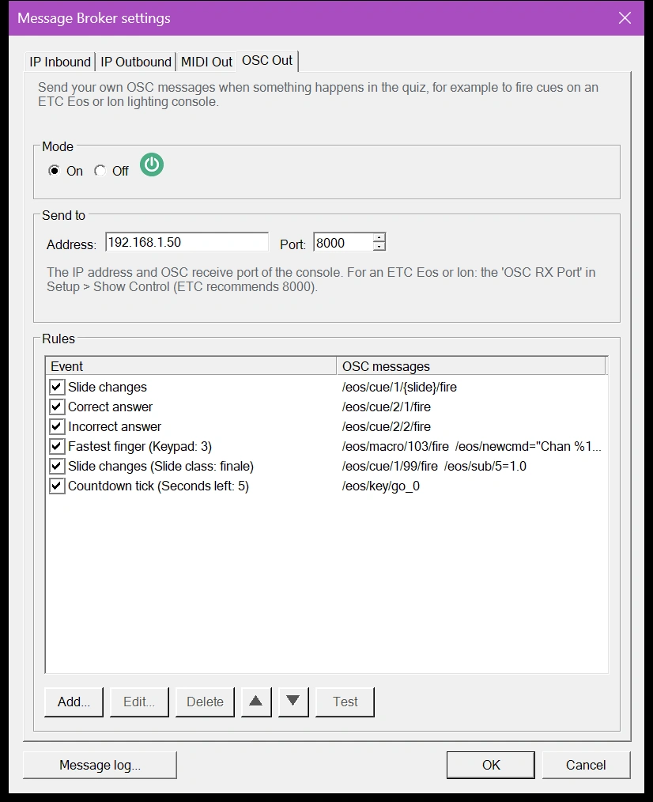
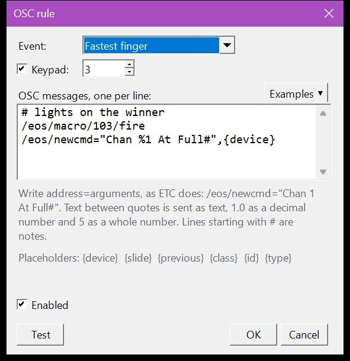
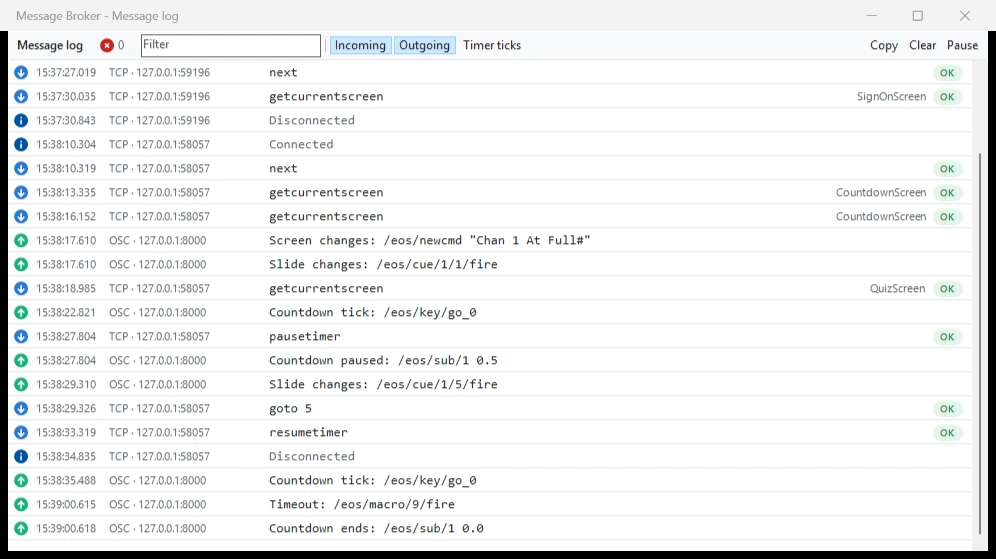

# OSC Out

With OSC Out you decide which OSC message QuizXpress sends when something happens in the quiz. Use it for devices that only react to their own commands, such as an ETC Eos or Ion lighting console: a correct answer can fire cue 20, the fastest finger on keypad 3 can fire a macro, and every new slide can fire the cue with the same number.

The [IP outbound channel](ip-outbound.md) always sends the same fixed messages, such as `/correct` and `/buzz 3 A`. That works for your own software, but a lighting console ignores messages it doesn't know. OSC Out sends exactly the messages the console expects, and you can use both at the same time.

## Preparing an ETC Eos or Ion console

An Eos family console (Eos, Gio, Ion, Element, ETCnomad) only accepts OSC messages that start with `/eos/`. Before QuizXpress can control it:

1. In the network settings of the console, tick 'UDP Strings & OSC' for the network port that connects to the QuizXpress computer.
2. In Setup, under 'Show Control', enable 'OSC RX' and 'String RX', and set the 'OSC RX Port'. ETC recommends port 8000.
3. Note the IP address of the console. Send to the primary console, not to a backup or a client.

The names of these settings differ slightly between Eos software versions; the ETC manual of your version has the details.

## Turning on OSC Out

Open the [Message Broker settings](index.md#opening-the-message-broker-settings) and go to the 'OSC Out' tab:

{ width="420" loading=lazy }

**Mode**
:   Turns OSC Out on or off.

**Send to**
:   The IP address and the OSC receive port of the console, for an ETC console the 'OSC RX Port' from its Show Control settings.

**Rules**
:   Each rule tells QuizXpress which messages to send for an event. 'Add...' creates a rule and 'Edit...' (or a double-click) changes one. Untick a rule to switch it off without deleting it. The arrows change the order, and 'Test' sends the selected rule to the console right away, so you can check it reacts.

## Editing a rule

{ width="420" loading=lazy }

**Event**
:   What happens in the quiz, for example 'Correct answer' or 'Slide changes'. See [Events and filters](#events-and-filters).

**Filters**
:   Some events can be narrowed down, for example 'Fastest finger' to one keypad, or 'Slide changes' to slides with a certain class. A filter that isn't ticked accepts everything.

**OSC messages**
:   The messages to send, one per line, in the order you write them. 'Examples' inserts ready-made lines for ETC Eos and QLab.

**Enabled**
:   Switches the rule on or off.

**Test**
:   Sends the messages to the console now. Placeholders get a sample value, for example slide 1.

While you type, the editor checks every line and shows what is wrong, for example a missing quote.

### Writing messages

Write a message the way ETC writes them in its manuals: the address, then `=` and the arguments, separated by commas.

| You write | QuizXpress sends |
|---|---|
| `/eos/cue/1/20/fire` | Address only, no arguments: fire cue 20 of cue list 1. |
| `/eos/sub/1=1.0` | A decimal number (`1.0`): submaster 1 to full. |
| `/eos/macro/fire=5` | A whole number (`5`): fire macro 5. |
| `/eos/newcmd="Chan 1 At Full#"` | Text between double quotes: types the command on the console's command line. |
| `# finale lights` | Nothing: a line that starts with `#` is a note. |

Text between double quotes is always sent as text, also when it is a number (`"7"`). Without quotes, a number with a decimal point is sent as a decimal number, a number without one as a whole number, and anything else as text.

### Placeholders

Placeholders between curly brackets are replaced by values from the quiz when the message is sent. `/eos/cue/1/{slide}/fire` fires cue 5 when slide 5 appears, so one rule covers the whole quiz.

| Placeholder | Value | Available for |
|---|---|---|
| `{slide}` | The number of the current slide, counted from 1 as in Studio. | All events |
| `{previous}` | The number of the previous slide, `0` for the first slide. | All events |
| `{class}`, `{id}` | The class and id of the current slide, set in the slide's metadata in Studio. | All events |
| `{type}` | The slide type, for example `question`. | All events |
| `{device}` | The keypad or buzzer number. | Fastest finger, Keypad press |
| `{key}` | The key that was pressed, for example `A`. | Keypad press |
| `{keynumber}` | The key as a number: A = 1, B = 2 and so on, the fastest-finger button = 0. | Keypad press |
| `{seconds}`, `{ms}` | The time left in seconds and in milliseconds. | Countdown tick |
| `{screen}` | The screen, for example `quizscreen` or `finalscorescreen`. | Screen changes |
| `{command}` | The remote control button, for example `ok` or `f1`. | Remote control button |

A placeholder that doesn't belong to the event is sent as it is written; the editor warns you about it.

!!! note
    OSC Out always counts slides from 1, as Studio does, also when 'Number slides from 1' on the 'IP Outbound' tab is off.

### Events and filters

| Event | Fires when… | Filters |
|---|---|---|
| Slide changes | A new slide is shown. | 'From slide', 'To slide', 'Slide class' |
| Screen changes | The quiz player switches screens, for example to the quiz or the final scores. | 'Screen' |
| Countdown starts | The countdown starts or continues after a pause. | – |
| Countdown paused | The countdown is paused. | – |
| Countdown tick | Every second while the countdown runs. | 'Seconds left' |
| Countdown ends | The countdown stops. | – |
| Timeout | The question timed out. | – |
| Correct answer | An answer is judged correct. | – |
| Incorrect answer | An answer is judged wrong. | – |
| Answer revealed | The correct answer is shown on the slide, also on voting questions where nobody judges an answer. On a Trivia Feud slide, every answer that is turned over on the board. | – |
| Fastest finger | A player is first in a fastest-finger question. | 'Keypad' |
| Keypad press | A key is pressed on a keypad or buzzer. | 'Keypad', 'Key' (A = 1, B = 2, fastest finger = 0) |
| Remote control button | A button is pressed on the quizmaster remote control. | 'Button' |
| Quiz restarts | The quiz restarts. | – |
| Bingo claimed, False bingo, Bingo | A Bingo is claimed, turns out false, or is valid. | – |

- 'Countdown tick' without a filter sends its messages every second. With 'Seconds left' it sends them once, when the countdown passes that moment, for example 5 seconds before the end.
- Right after a fastest finger, the countdown ends. That 'Countdown ends' is skipped, so the lights can stay on the winner.
- Slide numbers in the 'From slide' and 'To slide' filters count from 1. Filtering on a slide class keeps working when you reorder the slides.

## Examples for ETC Eos

| What should happen | Event and filter | OSC message |
|---|---|---|
| Every slide fires the cue with its number in cue list 1 | Slide changes | `/eos/cue/1/{slide}/fire` |
| A correct answer fires cue 20 | Correct answer | `/eos/cue/1/20/fire` |
| The reveal of every question gets its own look, in cue list 2 | Answer revealed | `/eos/cue/2/{slide}/fire` |
| The winner's light comes on | Fastest finger | `/eos/newcmd="Chan %1 At Full#",{device}` |
| A special look for the finale | Slide changes, 'Slide class' finale | `/eos/macro/99/fire` |
| Press Go 5 seconds before the end | Countdown tick, 'Seconds left' 5 | `/eos/key/go_0` |
| Dim submaster 1 when the countdown pauses | Countdown paused | `/eos/sub/1=0.3` |

In `/eos/newcmd`, Eos replaces `%1` with the first argument, here the keypad number, so the command becomes for example `Chan 3 At Full`. The `#` at the end works as the Enter key.

!!! tip
    Other devices work the same way. QLab, for example, starts cue 5 with `/cue/5/start`; use `/cue/{slide}/start` to follow the slides.

## Checking what is sent

The [message log](index.md#message-log) shows every OSC message that goes out, with the event that sent it. A line that could not be sent, for example because a placeholder made the address invalid, appears as an error.

{ loading=lazy }

!!! note
    OSC Out sends over UDP to one console. The console doesn't answer, so the message log shows what QuizXpress sent, not what the console did with it.
