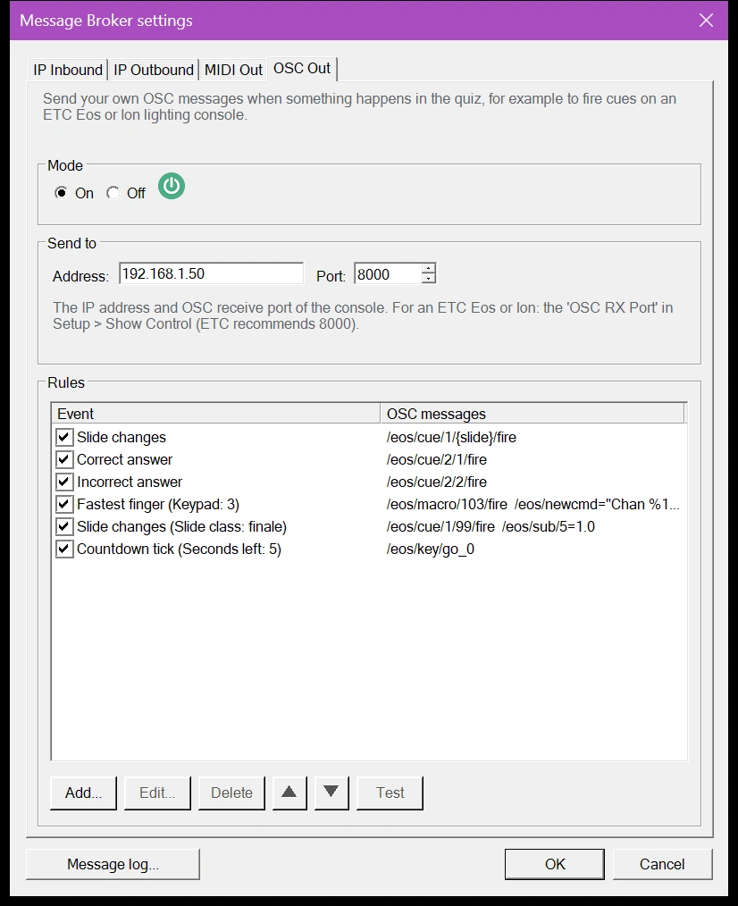
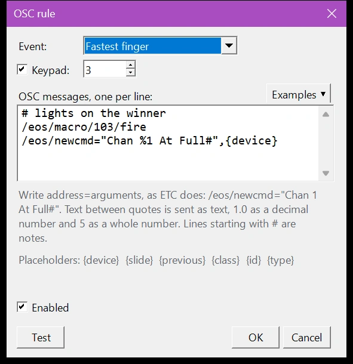
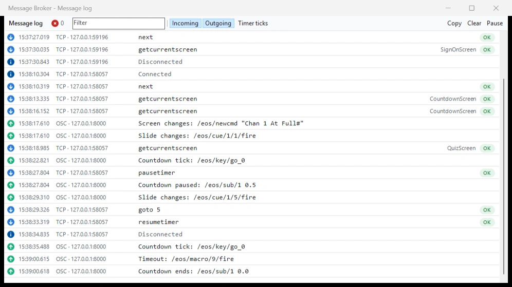

# OSC Uit

Met OSC Uit bepaalt u welk OSC-bericht QuizXpress verzendt wanneer er iets gebeurt in de quiz. Gebruik het voor apparaten die alleen op hun eigen commando’s reageren, zoals een ETC Eos- of Ion-lichtbesturing: een juist antwoord kan cue 20 afvuren, de snelste vinger op keypad 3 kan een macro afvuren, en elke nieuwe dia kan de cue met hetzelfde nummer afvuren.

Het [uitgaande IP-kanaal](ip-outbound.md) verzendt altijd dezelfde vaste berichten, zoals `/correct` en `/buzz 3 A`. Dat werkt voor uw eigen software, maar een lichtbesturing negeert berichten die hij niet kent. OSC Uit verzendt exact de berichten die de besturing verwacht, en u kunt beide tegelijk gebruiken.

## Een ETC Eos- of Ion-besturing voorbereiden

Een besturing uit de Eos-familie (Eos, Gio, Ion, Element, ETCnomad) accepteert alleen OSC-berichten die beginnen met `/eos/`. Voordat QuizXpress hem kan besturen:

1. Vink in de netwerkinstellingen van de besturing 'UDP Strings & OSC' aan voor de netwerkpoort die verbinding maakt met de QuizXpress-computer.
2. Schakel in Setup, onder 'Show Control', 'OSC RX' en 'String RX' in en stel de 'OSC RX Port' in. ETC adviseert poort 8000.
3. Noteer het IP-adres van de besturing. Verzend naar de primaire besturing, niet naar een backup of een client.

De namen van deze instellingen verschillen enigszins tussen versies van de Eos-software; de ETC-handleiding van uw versie bevat de details.

## OSC Uit inschakelen

Open de [Message Broker-instellingen](index.md#de-message-broker-instellingen-openen) en ga naar het tabblad 'OSC uit':

{ width="420" loading=lazy }

**Modus**
:   Schakelt OSC Uit in of uit.

**Verzenden naar**
:   Het IP-adres en de OSC-ontvangstpoort van de besturing, bij een ETC-besturing de 'OSC RX Port' uit de Show Control-instellingen.

**Regels**
:   Elke regel geeft aan welke berichten QuizXpress voor een gebeurtenis verzendt. Met 'Toevoegen...' maakt u een regel en met 'Bewerken...' (of een dubbelklik) wijzigt u er een. Haal het vinkje bij een regel weg om hem uit te schakelen zonder hem te verwijderen. Met de pijlen wijzigt u de volgorde, en 'Testen' verzendt de geselecteerde regel direct naar de besturing, zodat u kunt controleren of die reageert.

## Een regel bewerken

{ width="420" loading=lazy }

**Gebeurtenis**
:   Wat er in de quiz gebeurt, bijvoorbeeld 'Correct antwoord' of 'Dia wisselt'. Zie [Gebeurtenissen en filters](#gebeurtenissen-en-filters).

**Filters**
:   Sommige gebeurtenissen kunnen worden beperkt, bijvoorbeeld 'Snelste vinger' tot één keypad, of 'Dia wisselt' tot dia’s met een bepaalde klasse. Een filter dat niet is aangevinkt, accepteert alles.

**OSC-berichten**
:   De te verzenden berichten, één per regel, in de volgorde waarin u ze schrijft. 'Voorbeelden' voegt kant-en-klare regels in voor ETC Eos en QLab.

**Ingeschakeld**
:   Schakelt de regel in of uit.

**Testen**
:   Verzendt de berichten nu naar de besturing. Plaatshouders krijgen een voorbeeldwaarde, bijvoorbeeld dia 1.

Terwijl u typt, controleert de editor elke regel en toont wat er mis is, bijvoorbeeld een ontbrekend aanhalingsteken.

### Berichten schrijven

Schrijf een bericht zoals ETC dat in zijn handleidingen doet: het adres, dan `=` en de argumenten, gescheiden door komma’s.

| U schrijft | QuizXpress verzendt |
|---|---|
| `/eos/cue/1/20/fire` | Alleen een adres, geen argumenten: cue 20 van cuelijst 1 afvuren. |
| `/eos/sub/1=1.0` | Een decimaal getal (`1.0`): submaster 1 op vol. |
| `/eos/macro/fire=5` | Een geheel getal (`5`): macro 5 afvuren. |
| `/eos/newcmd="Chan 1 At Full#"` | Tekst tussen dubbele aanhalingstekens: typt het commando op de commandoregel van de besturing. |
| `# finale lights` | Niets: een regel die met `#` begint, is een notitie. |

Tekst tussen dubbele aanhalingstekens wordt altijd als tekst verzonden, ook als het een getal is (`"7"`). Zonder aanhalingstekens wordt een getal met een decimaalteken als decimaal getal verzonden, een getal zonder als geheel getal, en al het andere als tekst.

### Plaatshouders

Plaatshouders tussen accolades worden vervangen door waarden uit de quiz wanneer het bericht wordt verzonden. `/eos/cue/1/{slide}/fire` vuurt cue 5 af wanneer dia 5 verschijnt, zodat één regel de hele quiz dekt.

| Plaatshouder | Waarde | Beschikbaar voor |
|---|---|---|
| `{slide}` | Het nummer van de huidige dia, geteld vanaf 1 zoals in Studio. | Alle gebeurtenissen |
| `{previous}` | Het nummer van de vorige dia, `0` voor de eerste dia. | Alle gebeurtenissen |
| `{class}`, `{id}` | De klasse en het id van de huidige dia, ingesteld in de metagegevens van de dia in Studio. | Alle gebeurtenissen |
| `{type}` | Het diatype, bijvoorbeeld `question`. | Alle gebeurtenissen |
| `{device}` | Het keypad- of buzzernummer. | Snelste vinger, Keypad ingedrukt |
| `{key}` | De toets die is ingedrukt, bijvoorbeeld `A`. | Keypad ingedrukt |
| `{keynumber}` | De toets als getal: A = 1, B = 2 enzovoort, de snelste-vingerknop = 0. | Keypad ingedrukt |
| `{seconds}`, `{ms}` | De resterende tijd in seconden en in milliseconden. | Aftellen tik |
| `{screen}` | Het scherm, bijvoorbeeld `quizscreen` of `finalscorescreen`. | Scherm wisselt |
| `{command}` | De knop van de afstandsbediening, bijvoorbeeld `ok` of `f1`. | Knop van de afstandsbediening |

Een plaatshouder die niet bij de gebeurtenis hoort, wordt verzonden zoals hij is geschreven; de editor waarschuwt u hiervoor.

!!! note
    OSC Uit telt dia’s altijd vanaf 1, zoals Studio, ook als 'Dia’s nummeren vanaf 1' op het tabblad 'IP Uitgaand' uit staat.

### Gebeurtenissen en filters

| Gebeurtenis | Gaat af wanneer… | Filters |
|---|---|---|
| Dia wisselt | Een nieuwe dia wordt getoond. | 'Van dia', 'Naar dia', 'Diaklasse' |
| Scherm wisselt | De quizspeler van scherm wisselt, bijvoorbeeld naar de quiz of naar de eindscores. | 'Scherm' |
| Aftellen begint | Het aftellen start of gaat verder na een pauze. | – |
| Aftellen gepauzeerd | Het aftellen wordt gepauzeerd. | – |
| Aftellen tik | Elke seconde terwijl het aftellen loopt. | 'Seconden over' |
| Aftellen stopt | Het aftellen stopt. | – |
| Tijd voorbij | De tijd voor de vraag was voorbij. | – |
| Correct antwoord | Een antwoord wordt als juist beoordeeld. | – |
| Fout antwoord | Een antwoord wordt als onjuist beoordeeld. | – |
| Antwoord wordt getoond | Het juiste antwoord wordt op de dia getoond, ook bij stemvragen waarbij niemand een antwoord beoordeelt. Bij een Trivia Feud-dia: elk antwoord dat op het bord wordt omgedraaid. | – |
| Snelste vinger | Een speler is als eerste bij een snelste-vingervraag. | 'Keypad' |
| Keypad ingedrukt | Er wordt een toets ingedrukt op een keypad of buzzer. | 'Keypad', 'Toets' (A = 1, B = 2, snelste vinger = 0) |
| Knop van de afstandsbediening | Er wordt een knop ingedrukt op de afstandsbediening van de quizmaster. | 'Knop' |
| Quiz begint opnieuw | De quiz start opnieuw. | – |
| Bingo geclaimd, Vals bingo, Bingo | Een Bingo wordt geclaimd, blijkt vals te zijn of is geldig. | – |

- 'Aftellen tik' zonder filter verzendt zijn berichten elke seconde. Met 'Seconden over' verzendt het ze één keer, wanneer het aftellen dat moment passeert, bijvoorbeeld 5 seconden voor het einde.
- Direct na een snelste vinger eindigt het aftellen. Dat 'Aftellen stopt' wordt overgeslagen, zodat de lichten op de winnaar kunnen blijven.
- Dianummers in de filters 'Van dia' en 'Naar dia' tellen vanaf 1. Filteren op een diaklasse blijft werken wanneer u de dia’s herschikt.

## Voorbeelden voor ETC Eos

| Wat er moet gebeuren | Gebeurtenis en filter | OSC-bericht |
|---|---|---|
| Elke dia vuurt de cue met zijn nummer af in cuelijst 1 | Dia wisselt | `/eos/cue/1/{slide}/fire` |
| Een juist antwoord vuurt cue 20 af | Correct antwoord | `/eos/cue/1/20/fire` |
| De onthulling van elke vraag krijgt een eigen look, in cuelijst 2 | Antwoord wordt getoond | `/eos/cue/2/{slide}/fire` |
| Het licht van de winnaar gaat aan | Snelste vinger | `/eos/newcmd="Chan %1 At Full#",{device}` |
| Een speciale look voor de finale | Dia wisselt, 'Diaklasse' finale | `/eos/macro/99/fire` |
| Go indrukken 5 seconden voor het einde | Aftellen tik, 'Seconden over' 5 | `/eos/key/go_0` |
| Submaster 1 dimmen wanneer het aftellen pauzeert | Aftellen gepauzeerd | `/eos/sub/1=0.3` |

In `/eos/newcmd` vervangt Eos `%1` door het eerste argument, hier het keypadnummer, zodat het commando bijvoorbeeld `Chan 3 At Full` wordt. De `#` aan het einde werkt als de Enter-toets.

!!! tip
    Andere apparaten werken op dezelfde manier. QLab start bijvoorbeeld cue 5 met `/cue/5/start`; gebruik `/cue/{slide}/start` om de dia’s te volgen.

## Controleren wat er wordt verzonden

Het [berichtenlogboek](index.md#berichtenlogboek) toont elk OSC-bericht dat naar buiten gaat, met de gebeurtenis die het verzond. Een regel die niet kon worden verzonden, bijvoorbeeld doordat een plaatshouder het adres ongeldig maakte, verschijnt als fout.

{ loading=lazy }

!!! note
    OSC Uit verzendt via UDP naar één besturing. De besturing antwoordt niet, dus het berichtenlogboek toont wat QuizXpress heeft verzonden, niet wat de besturing ermee heeft gedaan.
