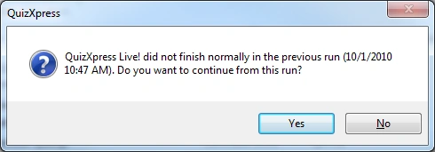

# Modo de recuperación de QuizXpress Live

Para evitar la pérdida de datos o tener que reiniciar el quiz en caso de fallo del sistema, QuizXpress Live dispone de un mecanismo de recuperación integrado. Después de cada pregunta completada, el sistema guarda todo su estado interno en el disco en un archivo de instantánea, incluyendo las puntuaciones, los datos de asignación de pulsadores, la pregunta actual, etc.

El archivo de instantánea se elimina si la aplicación finaliza *con normalidad*. Si el sistema finaliza *de forma anómala* por algún motivo, el archivo permanece y se detecta la próxima vez que se inicia QuizXpress Live. Entonces le mostrará una pregunta:

{ width="395" loading=lazy }

Cuando responde ‘Yes’, el sistema vuelve a cargar la instantánea y usted puede continuar donde lo dejó. Si responde ‘No’, el sistema se inicia con normalidad. Así, pase lo que pase, no tiene que molestar a su público repitiendo parte del quiz.

!!! note

    este modo de recuperación no está activo cuando inicia el quiz desde QuizXpress Studio en modo de prueba. Cuando ejecute el quiz ante un público real, se recomienda por tanto iniciarlo haciendo doble clic en el archivo .qx, iniciando Quiz Show.exe y seleccionando un archivo manualmente, o iniciando el quiz con ‘Run Production’ desde QuizXpress Studio.
