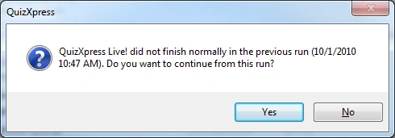

# Herstelmodus van QuizXpress Live

Om gegevensverlies of het opnieuw moeten starten van de quiz bij een systeemstoring te voorkomen, heeft QuizXpress Live een ingebouwd herstelmechanisme. Na elke voltooide vraag slaat het systeem zijn volledige interne status op schijf op in een snapshotbestand, inclusief scores, buzzertoewijzingen, de huidige vraag enzovoort.

Het snapshotbestand wordt verwijderd als de toepassing *normaal* wordt afgesloten. Als het systeem om welke reden dan ook *abnormaal* wordt beëindigd, blijft het bestand bestaan en wordt het gedetecteerd wanneer QuizXpress Live de volgende keer start. U krijgt dan een vraag:

{ width="395" loading=lazy }

Als u met ‘Ja’ antwoordt, laadt het systeem de snapshot opnieuw en kunt u doorgaan waar u gebleven was. Met ‘Nee’ start het systeem normaal. Wat er ook gebeurt, u hoeft uw publiek dus niet lastig te vallen met het opnieuw afspelen van een deel van uw quiz.

!!! note

    Deze herstelmodus is niet actief wanneer u uw quiz vanuit QuizXpress Studio in testmodus start. Wanneer u uw quiz voor een echt publiek draait, wordt aangeraden hem te starten door te dubbelklikken op het .qx-bestand, door Quiz Show.exe te starten en handmatig een bestand te selecteren, of door de quiz vanuit QuizXpress Studio te starten met ‘Start Productie’.
