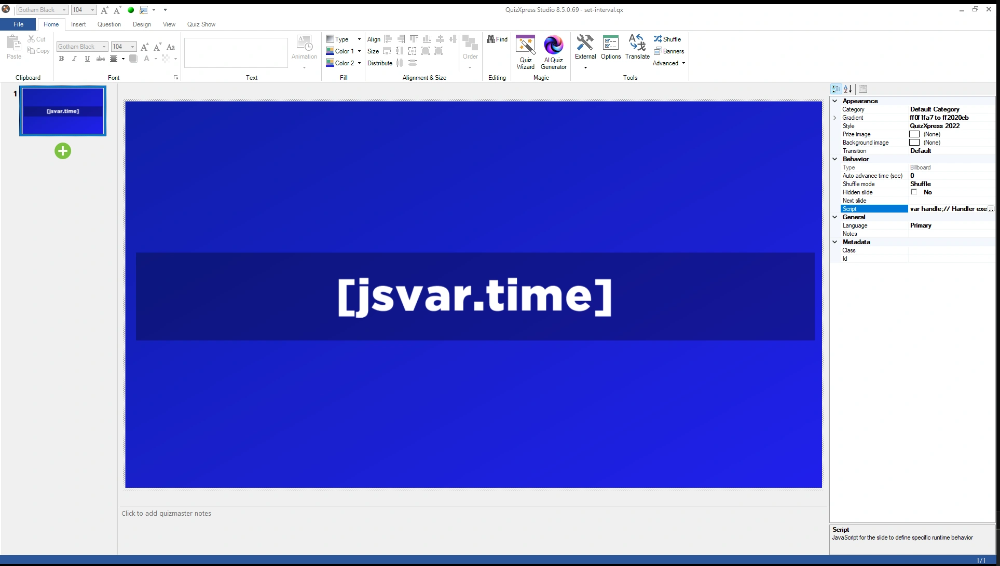
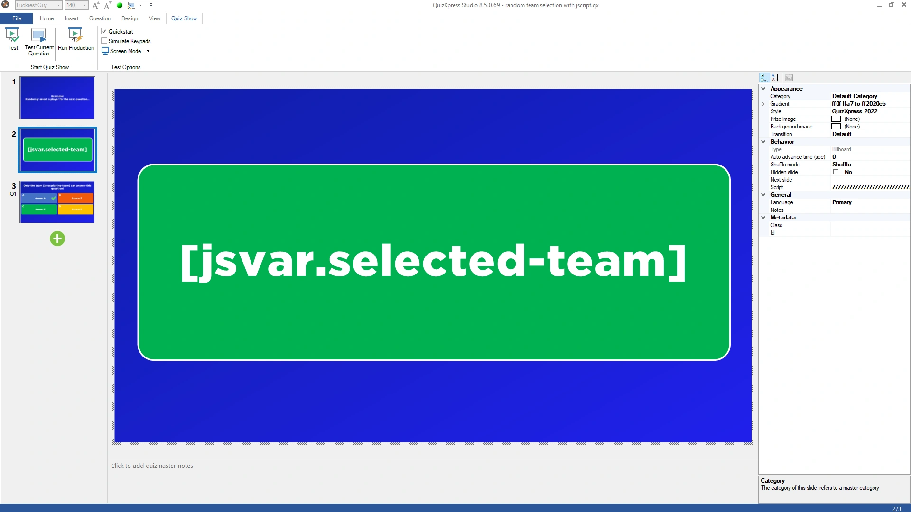

# Ejemplos

## Quizzes de ejemplo

Nuestros [ejemplos de scripts en GitHub](https://github.com/gameshowcrew/samples/tree/main/script) son quizzes listos para ejecutar, cada uno con su script como archivo aparte y una explicación. El editor de scripts también enlaza con ellos: 'Example scripts on GitHub' en la parte superior derecha. De lo más sencillo a lo más elaborado:

| Ejemplo | Qué muestra | Funciones del script |
|---|---|---|
| [Reloj en directo](https://github.com/gameshowcrew/samples/tree/main/script/live_clock) | Un reloj en directo y una cuenta atrás hasta el inicio del quiz en una diapositiva billboard | `setInterval()`, `[jsvar.name]` en una diapositiva |
| [Contador de votos](https://github.com/gameshowcrew/samples/tree/main/script/vote_counter) | "7 de 12 equipos han respondido" mientras corre la cuenta atrás | `onVote()`, `qx.teams` |
| [¡Dense prisa!](https://github.com/gameshowcrew/samples/tree/main/script/countdown_hurry_up) | "¡Dense prisa!" en los últimos segundos, música de tensión opcional, "¡Se acabó el tiempo!" | `onCountdownTick()`, `onTimeout()`, `qx.sink.sound` |
| [Orden aleatorio de preguntas](https://github.com/gameshowcrew/samples/tree/main/script/random_question_order) | 5 preguntas al azar de un conjunto, en orden aleatorio | `onNextSlide()`, valores que se conservan entre diapositivas |
| [Preguntas de la web](https://github.com/gameshowcrew/samples/tree/main/script/fetching_dynamic_content) | Una pregunta nueva de la Open Trivia Database cada vez | `fetch()`, `slide.setQuestion()`/`setAnswers()` |
| [Bono de racha](https://github.com/gameshowcrew/samples/tree/main/script/hot_streak_bonus) | Puntos de bonificación por 3 respuestas correctas seguidas, y un marcador de rachas | todo lo anterior, cambio de puntuaciones |

Para probar uno, descargue el archivo `.qx`, ábralo en Quiz Studio y mire la propiedad 'Script' de sus diapositivas, o ejecútelo.

Los ejemplos siguientes son scripts breves para copiar en su propio quiz.

## Reloj

Muestra la hora actual en una diapositiva, actualizada cada segundo, mediante un [símbolo de texto `[jsvar]`](working-with-quizxpress.md#mostrar-valores-del-script-en-una-diapositiva).

Cree una diapositiva billboard y sustituya el texto de la pregunta por el símbolo `[jsvar.time]`:

{ loading=lazy }

Asigne a la diapositiva este script:

```javascript
function onLoadSlide(slide) {
    showTime();
    setInterval(showTime, 1000);     // llamar a showTime() cada segundo
}

function showTime() {
    qx["time"] = new Date().toLocaleTimeString();
}
```

`onLoadSlide()` muestra la hora e inicia un temporizador que la actualiza cada segundo. El temporizador se detiene por sí solo cuando se abandona la diapositiva.

## Reproducir un MP3

Carga un archivo MP3 y lo reproduce dos segundos después de que termine la cuenta atrás:

```javascript
qx.sink.sound.loadMusic('levels', 'C:\\Music\\Jingles\\Levels.mp3', false);

function onEndCountdown(isPaused) {
    if (isPaused)
        return;
    // empezar después de 2 segundos
    setTimeout(() => {
        qx.sink.sound.playMusic('levels');
    }, 2000);
}

function onUnloadSlide(slide) {
    qx.sink.sound.stopMusic('levels');
    qx.sink.sound.unloadMusic('levels');
}
```

## Saltar a una diapositiva según los votos

Utiliza `onNextSlide()` para continuar con la ronda A o la ronda B, según qué respuesta haya obtenido más votos. La primera diapositiva de cada ronda tiene la clase de diapositiva `roundA` o `roundB`.

!!! tip
    Para casos sencillos, el [enrutamiento de diapositivas](../../studio/other-functionality/slide-routing.md) integrado hace esto sin un script.

```javascript
// Ir a la diapositiva con clase 'roundA' o 'roundB',
// según qué respuesta haya obtenido más votos
function onNextSlide(currentSlideNumber) {
    let slides = qx.slides;
    let roundA = slides.find((slide) => slide.class === 'roundA');
    let roundB = slides.find((slide) => slide.class === 'roundB');

    if (!roundA || !roundB) {
        console.error('round A or round B not found!');
        return;     // simplemente la siguiente diapositiva
    }

    let teams = qx.teams;
    let votedA = teams.filter(t => t.lastVote === 'A').length;
    let votedB = teams.filter(t => t.lastVote === 'B').length;

    if (votedB > votedA)
        return roundB.slideNumber;
    else
        return roundA.slideNumber;
}
```

## Preguntas de la web

Utiliza `fetch()` para obtener una pregunta nueva de la [Open Trivia Database](https://opentdb.com) cada vez que se muestra la diapositiva, y la coloca en la diapositiva. Asigne este script a una diapositiva de opción múltiple con 4 respuestas; lo que escribió en Studio se utiliza cuando no hay conexión a internet.

```javascript
async function onLoadSlide(slide) {
    let response;
    try {
        response = await fetch('https://opentdb.com/api.php?amount=1&type=multiple&encode=url3986');
    } catch (error) {
        console.warn('No question, the slide stays as it is.', error.message);
        return;
    }

    const trivia = JSON.parse(response.text).results[0];
    const answers = trivia.incorrect_answers.map(answer => decodeURIComponent(answer));

    // la respuesta correcta en una posición aleatoria
    const position = Math.floor(Math.random() * 4);
    answers.splice(position, 0, decodeURIComponent(trivia.correct_answer));

    slide.setQuestion(decodeURIComponent(trivia.question));
    slide.setAnswers(answers);
    slide.setCorrectAnswer('ABCD'[position]);

    console.log('Correct answer: ' + 'ABCD'[position]);   // para el presentador del quiz
}
```

QuizXpress Live espera a la descarga antes de mostrar la diapositiva, como máximo 10 segundos. El [ejemplo completo](https://github.com/gameshowcrew/samples/tree/main/script/fetching_dynamic_content) también elige una categoría y una dificultad, y gestiona los errores del servicio.

## Seleccionar un equipo al azar

Elige un equipo al azar, muestra la selección en pantalla como una lotería y luego excluye a todos los demás equipos para la siguiente pregunta.

Cree una diapositiva con el símbolo de texto `[jsvar.selected-team]`, que muestra la selección a medida que ocurre:

{ loading=lazy }

Asigne a la diapositiva este script:

```javascript
function onLoadSlide(slide) {
    // asegurarse de que todos los equipos estén habilitados
    qx.teams.forEach((team) => {
        team.excluded = false;
    });
    qx["selected-team"] = "...";
    randomize(50);
}

function randomize(start) {
    function step(i) {
        if (i >= 0) {
            // elegir un equipo al azar
            var randomIndex = Math.floor(Math.random() * qx.teams.length);
            var selectedTeam = qx.teams[randomIndex];

            if (i === 0) {
                // mostrar al ganador
                qx["selected-team"] = "*** " + selectedTeam.name + " ***";
                qx["playing-team"] = selectedTeam.name;

                // excluir a todos los demás equipos
                qx.teams.forEach((team) => {
                    if (team != selectedTeam)
                        team.excluded = true;
                });
            }
            else {
                // mostrar este equipo y programar el siguiente paso
                qx["selected-team"] = selectedTeam.name;
                setTimeout(() => step(i - 1), 750 * 1 / i);
            }
        }
    }
    step(start);
}
```

La diapositiva muestra un nombre de equipo 50 veces, cada vez más despacio, luego muestra el equipo elegido entre `***` y excluye a todos los demás jugadores para la siguiente pregunta. El nombre del equipo elegido también se almacena en `playing-team`, de modo que puede mostrarlo en la siguiente diapositiva con `[jsvar.playing-team]`.
