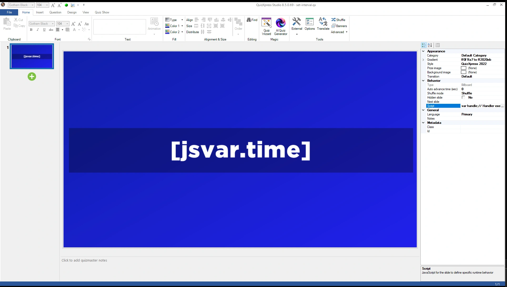
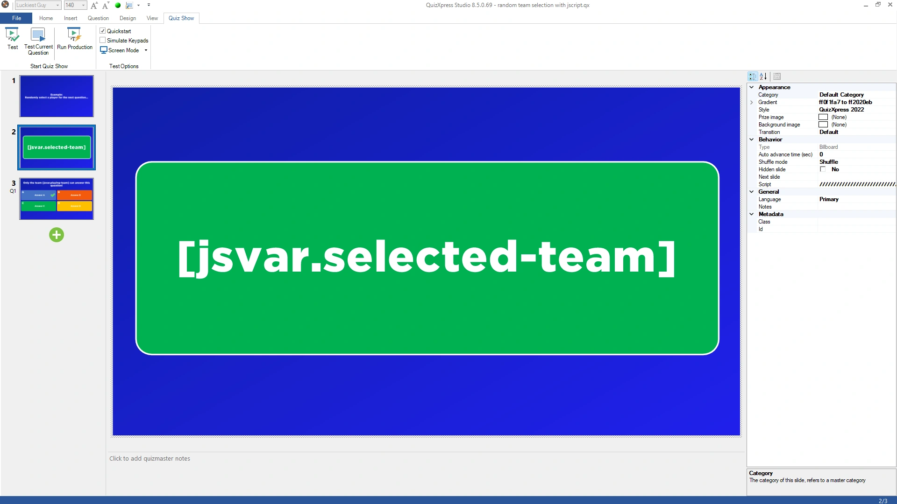

# Voorbeelden

## Voorbeeldquizzen

Onze [scriptvoorbeelden op GitHub](https://github.com/gameshowcrew/samples/tree/main/script) zijn kant-en-klare quizzen, elk met het script als apart bestand en een toelichting. De scripteditor linkt er ook naar: 'Voorbeeldscripts op GitHub' rechtsboven. Van eenvoudig naar uitgebreider:

| Voorbeeld | Wat het laat zien | Scriptfuncties |
|---|---|---|
| [Live klok](https://github.com/gameshowcrew/samples/tree/main/script/live_clock) | Een live klok en een aftelling tot de start van de quiz op een billboard-dia | `setInterval()`, `[jsvar.name]` op een dia |
| [Stemmenteller](https://github.com/gameshowcrew/samples/tree/main/script/vote_counter) | “7 van de 12 teams hebben geantwoord” terwijl het aftellen loopt | `onVote()`, `qx.teams` |
| [Schiet op!](https://github.com/gameshowcrew/samples/tree/main/script/countdown_hurry_up) | “Schiet op!” in de laatste seconden, optionele spanningsmuziek, “De tijd is om!” | `onCountdownTick()`, `onTimeout()`, `qx.sink.sound` |
| [Willekeurige vraagvolgorde](https://github.com/gameshowcrew/samples/tree/main/script/random_question_order) | 5 willekeurige vragen uit een pool, in willekeurige volgorde | `onNextSlide()`, waarden die tussen dia’s behouden blijven |
| [Vragen van het web](https://github.com/gameshowcrew/samples/tree/main/script/fetching_dynamic_content) | Elke keer een nieuwe vraag uit de Open Trivia Database | `fetch()`, `slide.setQuestion()`/`setAnswers()` |
| [Hot streak-bonus](https://github.com/gameshowcrew/samples/tree/main/script/hot_streak_bonus) | Bonuspunten voor 3 juiste antwoorden op rij, en een scorebord met reeksen | alle voorgaande, scores wijzigen |

Om er een uit te proberen, downloadt u het `.qx`-bestand, opent u het in Quiz Studio en bekijkt u de eigenschap 'Script' van de dia’s, of start u het.

De onderstaande voorbeelden zijn korte scripts om in uw eigen quiz te kopiëren.

## Klok

Toont de huidige tijd op een dia, elke seconde bijgewerkt, met een [`[jsvar]`-tekstsymbool](working-with-quizxpress.md#scriptwaarden-op-een-dia-tonen).

Maak een billboard-dia en vervang de vraagtekst door het symbool `[jsvar.time]`:

{ loading=lazy }

Geef de dia dit script:

```javascript
function onLoadSlide(slide) {
    showTime();
    setInterval(showTime, 1000);     // call showTime() every second
}

function showTime() {
    qx["time"] = new Date().toLocaleTimeString();
}
```

`onLoadSlide()` toont de tijd en start een timer die de tijd elke seconde bijwerkt. De timer stopt vanzelf wanneer de dia wordt verlaten.

## Een mp3 afspelen

Laadt een mp3-bestand en speelt het twee seconden nadat het aftellen eindigt af:

```javascript
qx.sink.sound.loadMusic('levels', 'C:\\Music\\Jingles\\Levels.mp3', false);

function onEndCountdown(isPaused) {
    if (isPaused)
        return;
    // start after 2 seconds
    setTimeout(() => {
        qx.sink.sound.playMusic('levels');
    }, 2000);
}

function onUnloadSlide(slide) {
    qx.sink.sound.stopMusic('levels');
    qx.sink.sound.unloadMusic('levels');
}
```

## Naar een dia springen op basis van stemmen

Gebruikt `onNextSlide()` om door te gaan met ronde A of ronde B, afhankelijk van welk antwoord de meeste stemmen kreeg. De eerste dia van elke ronde heeft de diaklasse `roundA` of `roundB`.

!!! tip
    Voor eenvoudige gevallen doet de ingebouwde [diaroutering](../../studio/other-functionality/slide-routing.md) dit zonder script.

```javascript
// Go to the slide with class 'roundA' or 'roundB',
// depending on which answer got the most votes
function onNextSlide(currentSlideNumber) {
    let slides = qx.slides;
    let roundA = slides.find((slide) => slide.class === 'roundA');
    let roundB = slides.find((slide) => slide.class === 'roundB');

    if (!roundA || !roundB) {
        console.error('round A or round B not found!');
        return;     // just the next slide
    }

    let teams = qx.teams;
    let votedA = teams.filter(t => t.lastVote === 'A').length;
    let votedB = teams.filter(t => t.lastVote === 'B').length;

    if (votedB > votedA)
        return roundB.slideNumber;
    else
        return roundA.slideNumber;
}
```

## Vragen van het web

Gebruikt `fetch()` om elke keer dat de dia wordt getoond een nieuwe vraag uit de [Open Trivia Database](https://opentdb.com) op te halen en op de dia te zetten. Geef een meerkeuzedia met 4 antwoorden dit script; wat u in Studio hebt getypt, wordt gebruikt wanneer er geen internetverbinding is.

```javascript
async function onLoadSlide(slide) {
    let response;
    try {
        response = await fetch('https://opentdb.com/api.php?amount=1&type=multiple&encode=url3986');
    } catch (error) {
        console.warn('No question, the slide stays as it is.', error.message);
        return;
    }

    const trivia = JSON.parse(response.text).results[0];
    const answers = trivia.incorrect_answers.map(answer => decodeURIComponent(answer));

    // the correct answer at a random position
    const position = Math.floor(Math.random() * 4);
    answers.splice(position, 0, decodeURIComponent(trivia.correct_answer));

    slide.setQuestion(decodeURIComponent(trivia.question));
    slide.setAnswers(answers);
    slide.setCorrectAnswer('ABCD'[position]);

    console.log('Correct answer: ' + 'ABCD'[position]);   // for the quizmaster
}
```

QuizXpress Live wacht op de download voordat het de dia toont, maximaal 10 seconden. Het [volledige voorbeeld](https://github.com/gameshowcrew/samples/tree/main/script/fetching_dynamic_content) kiest ook een categorie en een moeilijkheidsgraad en handelt de fouten van de dienst af.

## Willekeurig een team selecteren

Kiest een willekeurig team, toont de selectie op het scherm als een loterij en sluit daarna alle andere teams uit voor de volgende vraag.

Maak een dia met het tekstsymbool `[jsvar.selected-team]`, dat de selectie toont terwijl die plaatsvindt:

{ loading=lazy }

Geef de dia dit script:

```javascript
function onLoadSlide(slide) {
    // make sure all teams are enabled
    qx.teams.forEach((team) => {
        team.excluded = false;
    });
    qx["selected-team"] = "...";
    randomize(50);
}

function randomize(start) {
    function step(i) {
        if (i >= 0) {
            // pick a random team
            var randomIndex = Math.floor(Math.random() * qx.teams.length);
            var selectedTeam = qx.teams[randomIndex];

            if (i === 0) {
                // show the winner
                qx["selected-team"] = "*** " + selectedTeam.name + " ***";
                qx["playing-team"] = selectedTeam.name;

                // exclude all other teams
                qx.teams.forEach((team) => {
                    if (team != selectedTeam)
                        team.excluded = true;
                });
            }
            else {
                // show this team and schedule the next step
                qx["selected-team"] = selectedTeam.name;
                setTimeout(() => step(i - 1), 750 * 1 / i);
            }
        }
    }
    step(start);
}
```

De dia toont 50 keer een teamnaam, steeds langzamer, en toont daarna het gekozen team tussen `***` en sluit alle andere spelers uit voor de volgende vraag. De naam van het gekozen team wordt ook opgeslagen in `playing-team`, zodat u deze op de volgende dia kunt tonen met `[jsvar.playing-team]`.
