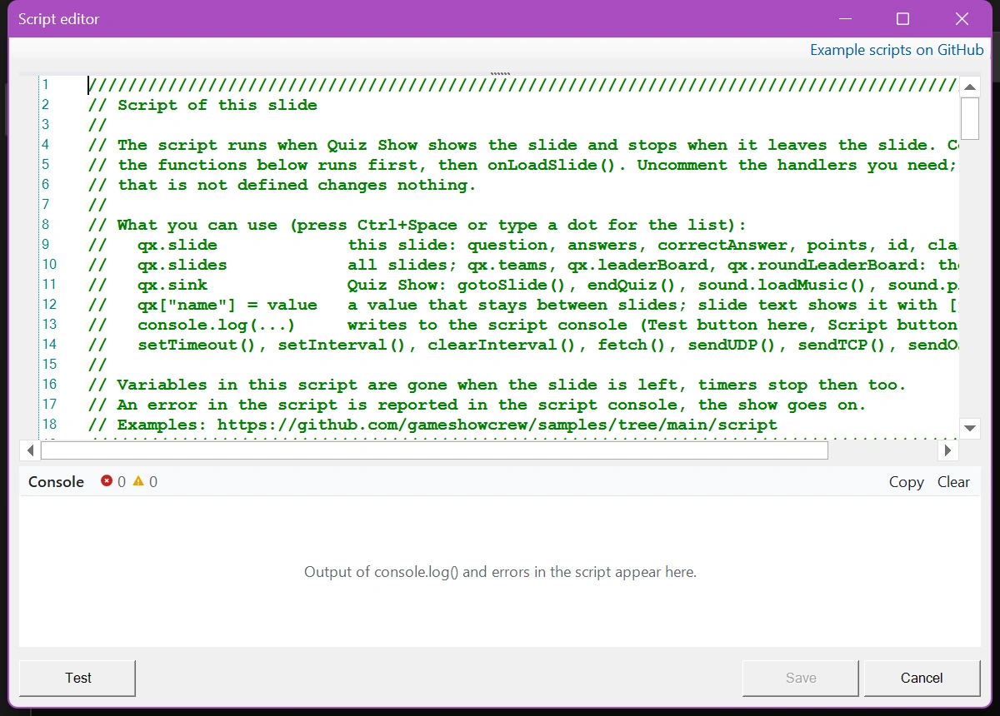
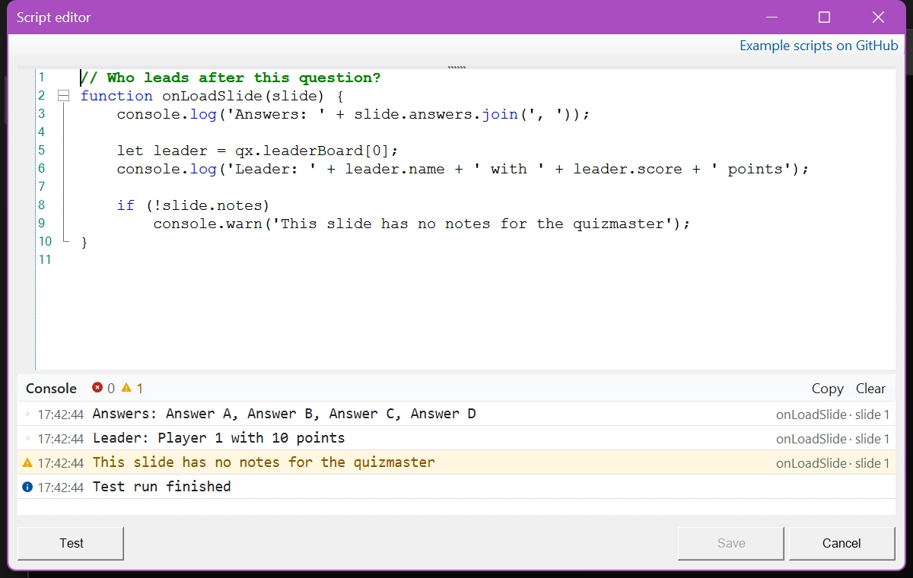

# Scripting

Desde la versión 8.5, QuizXpress incluye un motor de JavaScript integrado. Con los scripts puede crear comportamientos personalizados y elementos de juego que de otro modo no son posibles. Además de todo lo que ofrece el lenguaje JavaScript, un script puede leer información sobre la diapositiva actual, los jugadores, las puntuaciones y los pulsadores, responder a eventos del quiz, cambiar la pregunta y las puntuaciones durante el show, obtener datos de internet y comunicarse con otros equipos.

Esta sección explica cómo funciona el scripting en QuizXpress. No enseña JavaScript en sí: hay mucha información en la web, y los asistentes de IA ayudan bien a escribir scripts. Se presupone un conocimiento básico de programación. Para conocer en detalle qué admite exactamente el motor, consulte [Jint](https://github.com/sebastienros/jint), el motor de JavaScript que utiliza QuizXpress.

!!! warning "Utilizar con precaución"
    El scripting está destinado a usuarios avanzados y no es necesario para el uso normal de QuizXpress. Un script puede corromper las puntuaciones o confundir el desarrollo de su quiz. Un error en un script nunca detiene el show, pero la parte del script posterior al error no se ejecuta. Pruebe a fondo antes de utilizar un script en un show en directo.

    No ofrecemos soporte (gratuito) para escribir scripts.

## Cómo se ejecuta un script

Un script pertenece a una diapositiva. Cuando QuizXpress Live muestra la diapositiva, ejecuta el script: primero el código que está fuera de las funciones y luego el manejador `onLoadSlide()`. Mientras se muestra la diapositiva, QuizXpress llama a los demás manejadores cuando ocurre algo: se inicia la cuenta atrás, un equipo vota, se agota el tiempo… Cuando se abandona la diapositiva, se ejecuta `onUnloadSlide()` y el script se detiene. Sus variables desaparecen y sus temporizadores `setInterval()` se detienen.

Para conservar información de una diapositiva a la siguiente, o para mostrar un valor en la diapositiva, utilice el objeto `qx`: consulte [Trabajar con QuizXpress](working-with-quizxpress.md).

## El editor de scripts

Cada diapositiva tiene una propiedad 'Script'. En QuizXpress Studio, haga clic en los tres puntos de la propiedad 'Script' para abrir el editor de scripts. Cuando una diapositiva aún no tiene script, el editor muestra una plantilla que explica los fundamentos y enumera todos los manejadores, comentados (se muestran en verde). Elimine el `//` delante de un manejador para utilizarlo.

{ loading=lazy }

Los **manejadores** son funciones con un nombre específico a las que QuizXpress llama automáticamente cuando ocurre algo, si existen en el script. Por ejemplo, `onLoadSlide(slide)` se ejecuta cuando se muestra la diapositiva, y `onVote(player, answer, isCorrect)` se ejecuta cada vez que un equipo responde. La [Referencia](reference.md#manejadores) los enumera todos.

También puede colocar código fuera de los manejadores. Se ejecuta en cuanto se carga el script, lo cual resulta útil para los ajustes al principio del script y para cargar música.

El editor le ayuda mientras escribe:

- **Sugerencias**: escriba un punto después de `qx`, `slide` o un jugador, o pulse Ctrl+Espacio, y una lista muestra lo que puede utilizar, con una breve explicación. Entre los paréntesis de una función, una información sobre herramientas muestra sus argumentos.
- **Comprobación de sintaxis**: un error de escritura, como un paréntesis que falta, recibe una línea ondulada roja, y el error se muestra junto al botón 'Test'. Haga clic en el error para ir a su línea.
- **Consola**: debajo del editor, la consola muestra la salida de `console.log()` y los errores de una ejecución de prueba. Consulte [Pruebas y depuración](debugging.md).
- **'Example scripts on GitHub'**, en la parte superior derecha, abre nuestra colección de quizzes de ejemplo listos para usar con sus scripts.

Los botones:

- **'Save'** almacena el script en la diapositiva y, por tanto, en su quiz.
- **'Test'** ejecuta el script como lo hace QuizXpress Live cuando muestra la diapositiva: el código fuera de las funciones y luego `onLoadSlide()`. Se ejecuta en un entorno aislado con esta diapositiva y diez equipos de ejemplo, y no afecta a su quiz. Los demás manejadores no se llaman, porque en el entorno aislado no ocurre nada.

{ loading=lazy }

## Próximos pasos

- [Trabajar con QuizXpress](working-with-quizxpress.md): el objeto `qx`, compartir datos entre diapositivas, mostrar valores del script en una diapositiva y cambiar la pregunta y las puntuaciones.
- [Pruebas y depuración](debugging.md): la consola en Studio y en el Director.
- [Referencia](reference.md): todos los manejadores, objetos, propiedades y funciones disponibles para los scripts.
- [Ejemplos](examples.md): scripts y quizzes de ejemplo listos para usar.
