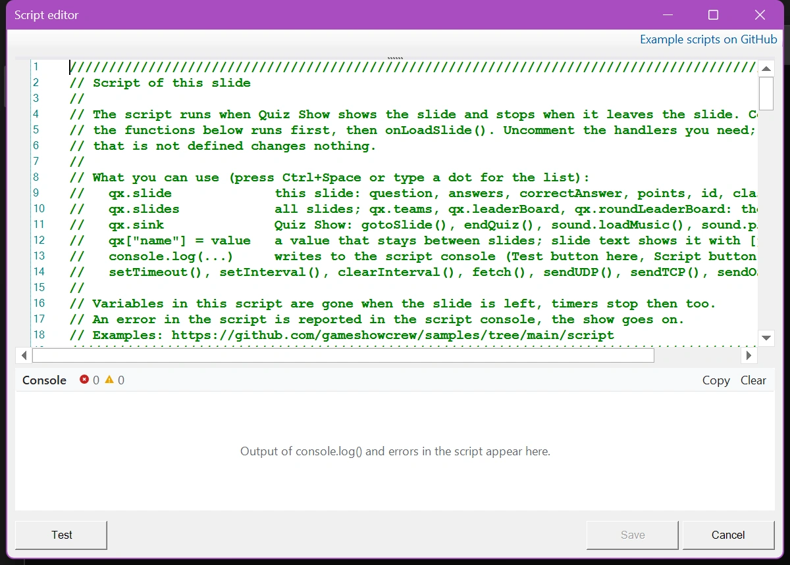
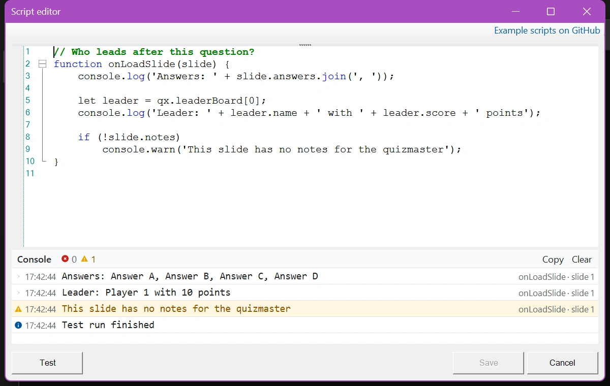

# Scripting

Sinds versie 8.5 heeft QuizXpress een ingebouwde JavaScript-engine. Met scripts bouwt u eigen gedrag en spelelementen die anders niet mogelijk zijn. Naast alles wat de taal JavaScript biedt, kan een script informatie lezen over de huidige dia, de spelers, de scores en de buzzers, reageren op quizgebeurtenissen, de vraag en de scores tijdens de show wijzigen, gegevens van internet ophalen en communiceren met andere apparatuur.

Dit onderdeel legt uit hoe scripting in QuizXpress werkt. Het leert u geen JavaScript: daarover is online genoeg informatie te vinden en AI-assistenten helpen u graag bij het schrijven van scripts. Basiskennis van programmeren wordt verondersteld. Voor details over wat de engine precies ondersteunt, zie [Jint](https://github.com/sebastienros/jint), de JavaScript-engine die QuizXpress gebruikt.

!!! warning "Met zorg gebruiken"
    Scripting is bedoeld voor gevorderde gebruikers en is niet nodig voor normaal gebruik van QuizXpress. Een script kan scores beschadigen of het verloop van uw quiz in de war brengen. Een fout in een script stopt de show nooit, maar het deel van het script na de fout wordt niet uitgevoerd. Test grondig voordat u een script in een live show gebruikt.

    Wij bieden geen (gratis) ondersteuning bij het schrijven van scripts.

## Hoe een script wordt uitgevoerd

Een script hoort bij een dia. Wanneer QuizXpress Live de dia toont, voert het het script uit: eerst de code buiten de functies, daarna de handler `onLoadSlide()`. Zolang de dia in beeld is, roept QuizXpress de andere handlers aan wanneer er iets gebeurt: het aftellen begint, een team stemt, de tijd is om… Wanneer de dia wordt verlaten, wordt `onUnloadSlide()` uitgevoerd en stopt het script. De variabelen zijn dan verdwenen en de `setInterval()`-timers stoppen.

Wilt u informatie van de ene dia naar de volgende meenemen, of een waarde op de dia tonen, gebruik dan het object `qx`: zie [Werken met QuizXpress](working-with-quizxpress.md).

## De scripteditor

Elke dia heeft een eigenschap 'Script'. Klik in QuizXpress Studio op de drie puntjes bij de eigenschap 'Script' om de scripteditor te openen. Als een dia nog geen script heeft, toont de editor een sjabloon dat de basis uitlegt en alle handlers als commentaar weergeeft (in het groen). Verwijder de `//` voor een handler om die te gebruiken.

{ loading=lazy }

**Handlers** zijn functies met een vaste naam die QuizXpress automatisch aanroept wanneer er iets gebeurt, als ze in het script voorkomen. `onLoadSlide(slide)` wordt bijvoorbeeld uitgevoerd wanneer de dia wordt getoond, en `onVote(player, answer, isCorrect)` telkens wanneer een team antwoordt. De [Referentie](reference.md#handlers) somt ze allemaal op.

U kunt ook code buiten de handlers plaatsen. Die wordt uitgevoerd zodra het script is geladen, wat handig is voor instellingen bovenaan het script en voor het laden van muziek.

De editor helpt u tijdens het typen:

- **Suggesties**: typ een punt na `qx`, `slide` of een speler, of druk op Ctrl+Spatie, en een lijst toont wat u kunt gebruiken, met een korte uitleg. Tussen de haakjes van een functie toont een tooltip de argumenten.
- **Syntaxiscontrole**: een typefout zoals een ontbrekend haakje krijgt een rode golflijn en de fout wordt naast de knop 'Testen' getoond. Klik op de fout om naar de regel te gaan.
- **Console**: onder de editor toont de console de uitvoer van `console.log()` en de fouten van een testrun. Zie [Testen en debuggen](debugging.md).
- **'Voorbeeldscripts op GitHub'**, rechtsboven, opent onze verzameling kant-en-klare voorbeeldquizzen met hun scripts.

De knoppen:

- **'Opslaan'** bewaart het script in de dia, en dus in uw quiz.
- **'Testen'** voert het script uit zoals QuizXpress Live dat doet wanneer het de dia toont: de code buiten de functies en daarna `onLoadSlide()`. Het draait in een sandbox met deze dia en tien voorbeeldteams en laat uw quiz ongemoeid. De andere handlers worden niet aangeroepen, omdat er in de sandbox niets gebeurt.

{ loading=lazy }

## Volgende stappen

- [Werken met QuizXpress](working-with-quizxpress.md): het object `qx`, gegevens delen tussen dia's, scriptwaarden op een dia tonen en de vraag en de scores wijzigen.
- [Testen en debuggen](debugging.md): de console in Studio en in de Director.
- [Referentie](reference.md): alle handlers, objecten, eigenschappen en functies die voor scripts beschikbaar zijn.
- [Voorbeelden](examples.md): kant-en-klare scripts en voorbeeldquizzen.
