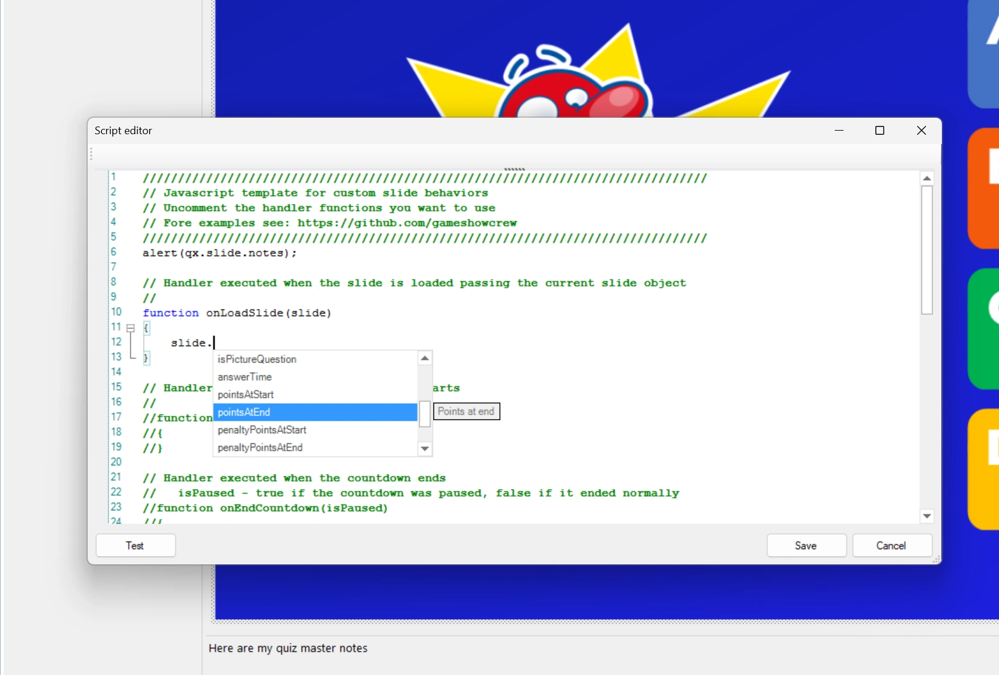
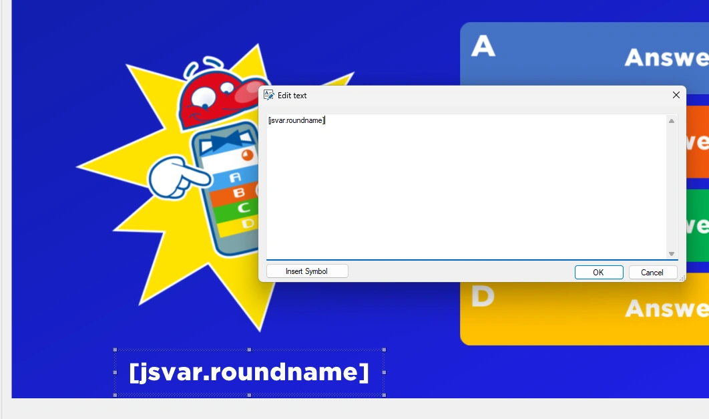
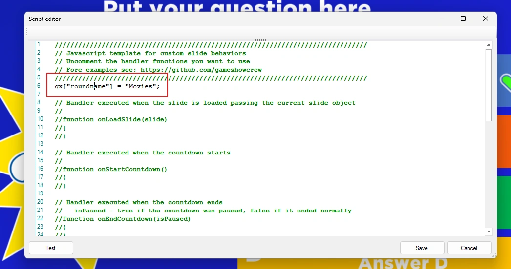
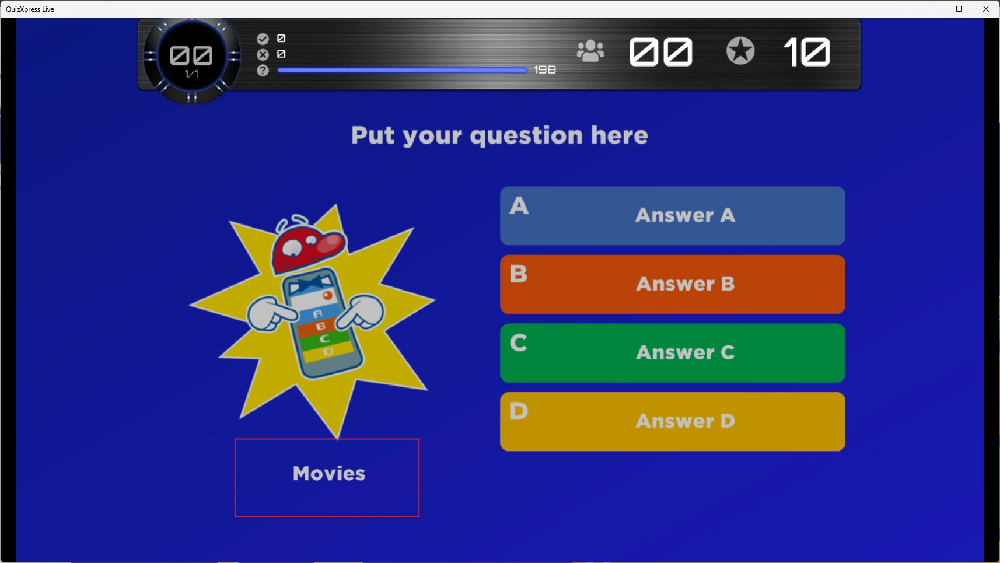

# Lavorare con QuizXpress

## L'oggetto qx

QuizXpress espone i propri elementi interni agli script tramite un oggetto globale chiamato `qx`. Ad esempio, `qx.slide` restituisce la diapositiva corrente, e la diapositiva a sua volta ha proprietà come `notes`. Questo script scrive le note della diapositiva nella console quando si fa clic su 'Test' in Studio:

```javascript
console.log(qx.slide.notes);
```

L'editor aiuta a trovare le proprietà: digitando `qx.` o `slide.` compare un elenco di tutte le proprietà disponibili, con una breve spiegazione di ciascuna.

{ loading=lazy }

Le parti più usate di `qx`:

| | |
|---|---|
| `qx.slide` | La diapositiva corrente: domanda, risposte, risposta corretta, punti, id, classe… |
| `qx.slides` | Tutte le diapositive del quiz. |
| `qx.teams` | Tutte le squadre, con nome, keypad, punteggio e ultimo voto. |
| `qx.leaderBoard` | Le squadre ordinate per punteggio, la prima in testa. |
| `qx.roundLeaderBoard` | I punteggi del round corrente. |
| `qx.sink` | QuizXpress Live stesso: passare a una diapositiva, terminare il quiz, riprodurre musica… |
| `qx["name"]` | Un valore che resta tra una diapositiva e l'altra, vedere sotto. |

Il [Riferimento](reference.md) elenca ogni oggetto, proprietà e funzione con il suo significato.

## Reagire allo show

I gestori sono il modo in cui uno script partecipa allo show. Alcuni esempi:

```javascript
// ogni secondo del conto alla rovescia
function onCountdownTick(secondsLeft) {
    if (secondsLeft === 10)
        qx['message'] = 'Ten seconds left!';
}

// una squadra ha risposto con il proprio keypad
function onVote(player, answer, isCorrect) {
    console.log(player.name + ' answered ' + answer);
}

// si lascia la diapositiva: ripulire
function onUnloadSlide(slide) {
    qx.sink.sound.stopMusic('tension');
}
```

!!! note "La fine di una domanda"
    A seconda delle impostazioni della domanda, QuizXpress Live chiama `onEndCountdown()` quando il tempo è scaduto o tutti hanno risposto, oppure solo `onTimeout()`. Uno script che deve fare qualcosa una sola volta alla fine di una domanda gestisce entrambi, e ricorda di averlo già fatto:

    ```javascript
    let done = false;

    function onTimeout() { endOfQuestion(); }
    function onEndCountdown(isPaused) { if (!isPaused) endOfQuestion(); }

    function endOfQuestion() {
        if (done)
            return;
        done = true;
        // ...
    }
    ```

## Condividere dati tra le diapositive

Le variabili di uno script scompaiono quando si lascia la sua diapositiva, quindi le normali variabili JavaScript non sopravvivono fino alla diapositiva successiva. Per conservare i dati tra le diapositive, usare l'archivio globale dell'oggetto `qx`.

Nella prima diapositiva di un round si potrebbe scrivere:

```javascript
qx["roundname"] = "Movies";
```

e in qualsiasi diapositiva successiva:

```javascript
let roundName = qx["roundname"];   // "Movies"
```

I valori restano finché QuizXpress Live non viene chiuso, anche quando il quiz viene riavviato. Per ripartire da zero con un quiz riavviato, cancellare i valori nello script della prima diapositiva.

Per conservare una lista o un oggetto, memorizzarlo come testo con `JSON.stringify()` e riconvertirlo con `JSON.parse()`:

```javascript
let played = JSON.parse(qx['played'] || '[]');   // una lista vuota la prima volta
played.push(qx.slide.slideNumber);
qx['played'] = JSON.stringify(played);
```

## Mostrare i valori dello script su una diapositiva

È possibile mostrare questi valori con nome su una diapositiva con il simbolo di testo `[jsvar.<name>]`. Aggiungere una forma di testo alla diapositiva e inserire il simbolo, ad esempio `[jsvar.roundname]`:

{ width="560" loading=lazy }

Impostare la variabile nello script:

{ width="560" loading=lazy }

Quando il quiz è in esecuzione, la diapositiva mostra il valore:

{ loading=lazy }

Funziona anche in tempo reale: ogni volta che lo script modifica il valore, la diapositiva mostra subito il nuovo valore, anche quando cambia in un timer. L'[esempio Orologio](examples.md#orologio) lo usa per mostrare l'ora corrente.

## Modificare la domanda

Uno script può modificare la domanda, le risposte e la risposta corretta della diapositiva corrente, ad esempio con una domanda scaricata:

```javascript
function onLoadSlide(slide) {
    slide.setQuestion('What is the capital of Australia?');
    slide.setAnswers(['Sydney', 'Canberra', 'Melbourne', 'Perth']);
    slide.setCorrectAnswer('B');
}
```

- `setAnswers()` sostituisce le risposte in ordine (A, B, C…). La diapositiva deve avere già quel numero di risposte; non può aggiungerne.
- `setCorrectAnswer()` accetta la lettera della risposta corretta, o più lettere (`'AC'`) quando più risposte sono corrette.
- Farlo in `onLoadSlide()`, prima che la diapositiva venga mostrata.

Queste modifiche valgono solo per lo show: il file del quiz resta com'è. Con 'Test' in Studio nemmeno la diapositiva cambia. Vedere l'esempio [Domande dal web](examples.md#domande-dal-web).

## Modificare i punteggi

Il punteggio di un giocatore può essere letto e modificato:

```javascript
team.score += 50;   // 50 punti bonus
```

Il bonus viene aggiunto al punteggio della squadra. In Analyzer, i risultati di una domanda mostrano solo i punti di quella domanda. In una domanda di test il punteggio non cambia. Vedere l'esempio [Bonus serie vincente](examples.md#quiz-di-esempio).

## Scegliere la diapositiva successiva

`onNextSlide(currentSlideNumber)` decide quale diapositiva viene dopo, quando la diapositiva non ha un 'Next slide' impostato. Restituire un numero di diapositiva (a partire da 0), un id di diapositiva come `'#final'`, o una diapositiva da `qx.slides`. Non restituire nulla per passare semplicemente alla diapositiva successiva.

```javascript
function onNextSlide(currentSlideNumber) {
    let leader = qx.leaderBoard[0];
    if (leader && leader.score >= 100)
        return '#final';
}
```

Assegnare alle diapositive un id o una classe nella sezione 'Metadata' delle proprietà della diapositiva, in modo che lo script possa trovarle. L'esempio [Ordine casuale delle domande](examples.md#quiz-di-esempio) sceglie a caso la domanda successiva.
