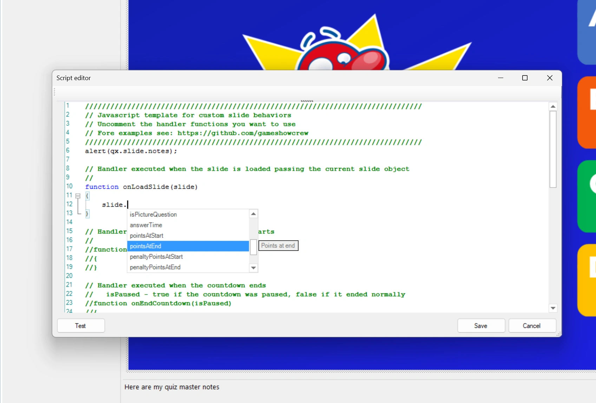
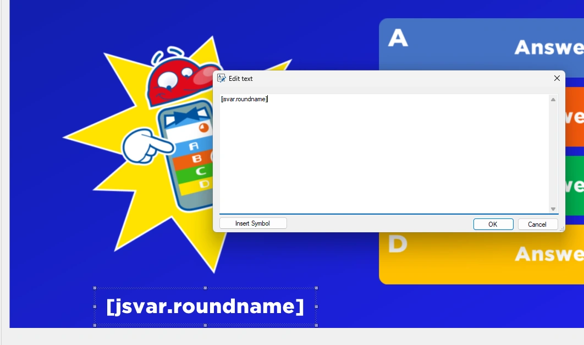
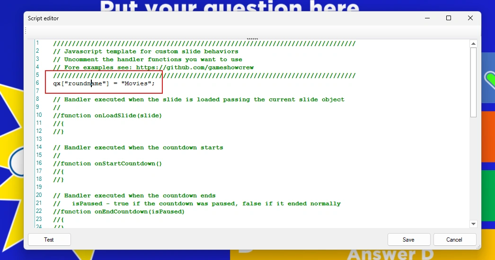
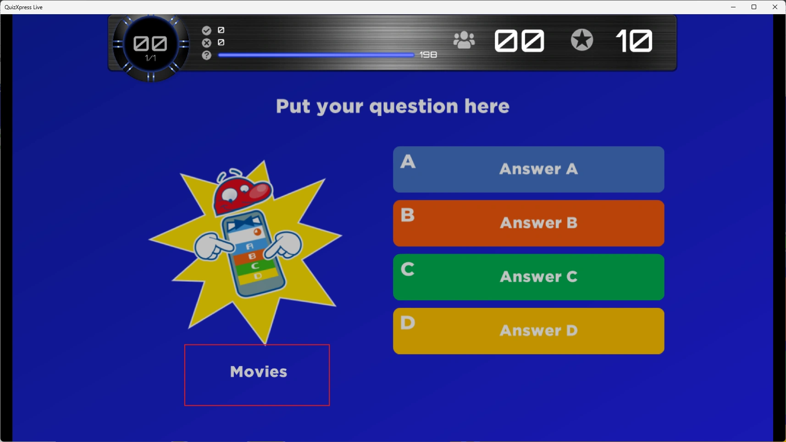

# Werken met QuizXpress

## Het object qx

QuizXpress stelt zijn interne onderdelen aan scripts beschikbaar via een globaal object met de naam `qx`. `qx.slide` geeft bijvoorbeeld de huidige dia, en de dia heeft op zijn beurt eigenschappen zoals `notes`. Dit script schrijft de dianotities naar de console wanneer u in Studio op 'Testen' klikt:

```javascript
console.log(qx.slide.notes);
```

De editor helpt u eigenschappen te vinden: typ `qx.` of `slide.` en er verschijnt een lijst met alle beschikbare eigenschappen, elk met een korte uitleg.

{ loading=lazy }

De meest gebruikte onderdelen van `qx`:

| | |
|---|---|
| `qx.slide` | De huidige dia: vraag, antwoorden, juist antwoord, punten, id, klasse… |
| `qx.slides` | Alle dia's van de quiz. |
| `qx.teams` | Alle teams, met hun naam, keypad, score en laatste stem. |
| `qx.leaderBoard` | De teams gesorteerd op score, de leider eerst. |
| `qx.roundLeaderBoard` | De scores van de huidige ronde. |
| `qx.sink` | QuizXpress Live zelf: naar een dia gaan, de quiz beëindigen, muziek afspelen… |
| `qx["name"]` | Een waarde die behouden blijft tussen dia's, zie hieronder. |

De [Referentie](reference.md) somt elk object, elke eigenschap en elke functie op met hun betekenis.

## Reageren op de show

Handlers zijn de manier waarop een script deelneemt aan de show. Enkele voorbeelden:

```javascript
// every second of the countdown
function onCountdownTick(secondsLeft) {
    if (secondsLeft === 10)
        qx['message'] = 'Ten seconds left!';
}

// a team answered with its keypad
function onVote(player, answer, isCorrect) {
    console.log(player.name + ' answered ' + answer);
}

// the slide is left: clean up
function onUnloadSlide(slide) {
    qx.sink.sound.stopMusic('tension');
}
```

!!! note "Het einde van een vraag"
    Afhankelijk van de instellingen van de vraag roept QuizXpress Live `onEndCountdown()` aan wanneer de tijd om was of iedereen heeft geantwoord, of alleen `onTimeout()`. Een script dat aan het einde van een vraag één keer iets moet doen, handelt beide af en onthoudt dat het al is gebeurd:

    ```javascript
    let done = false;

    function onTimeout() { endOfQuestion(); }
    function onEndCountdown(isPaused) { if (!isPaused) endOfQuestion(); }

    function endOfQuestion() {
        if (done)
            return;
        done = true;
        // ...
    }
    ```

## Gegevens delen tussen dia's

De variabelen van een script zijn verdwenen wanneer de dia wordt verlaten, dus gewone JavaScript-variabelen blijven niet bestaan tot de volgende dia. Gebruik de globale opslag op het object `qx` om gegevens over dia's heen te bewaren.

Op de eerste dia van een ronde kunt u schrijven:

```javascript
qx["roundname"] = "Movies";
```

en op elke latere dia:

```javascript
let roundName = qx["roundname"];   // "Movies"
```

De waarden blijven bestaan tot QuizXpress Live wordt afgesloten, ook wanneer de quiz opnieuw wordt gestart. Wilt u bij een opnieuw gestarte quiz weer opnieuw beginnen, wis dan de waarden in het script van de eerste dia.

Wilt u een lijst of een object bewaren, sla het dan op als tekst met `JSON.stringify()` en zet het terug met `JSON.parse()`:

```javascript
let played = JSON.parse(qx['played'] || '[]');   // an empty list the first time
played.push(qx.slide.slideNumber);
qx['played'] = JSON.stringify(played);
```

## Scriptwaarden op een dia tonen

U kunt deze benoemde waarden op een dia tonen met het tekstsymbool `[jsvar.<name>]`. Voeg een tekstvorm toe aan de dia en voer het symbool in, bijvoorbeeld `[jsvar.roundname]`:

{ width="560" loading=lazy }

Stel de variabele in het script in:

{ width="560" loading=lazy }

Wanneer de quiz draait, toont de dia de waarde:

{ loading=lazy }

Dit werkt ook in realtime: telkens wanneer het script de waarde wijzigt, toont de dia direct de nieuwe waarde, ook wanneer die in een timer verandert. Het [Klok-voorbeeld](examples.md#klok) gebruikt dit om de actuele tijd te tonen.

## De vraag wijzigen

Een script kan de vraag, de antwoorden en het juiste antwoord van de huidige dia wijzigen, bijvoorbeeld met een vraag die het van internet heeft gedownload:

```javascript
function onLoadSlide(slide) {
    slide.setQuestion('What is the capital of Australia?');
    slide.setAnswers(['Sydney', 'Canberra', 'Melbourne', 'Perth']);
    slide.setCorrectAnswer('B');
}
```

- `setAnswers()` vervangt de antwoorden op volgorde (A, B, C…). De dia moet al zoveel antwoorden hebben; er kunnen geen antwoorden worden toegevoegd.
- `setCorrectAnswer()` neemt de letter van het juiste antwoord, of meerdere letters (`'AC'`) wanneer meer antwoorden juist zijn.
- Doe dit in `onLoadSlide()`, voordat de dia wordt getoond.

Deze wijzigingen gelden alleen voor de show: het quizbestand blijft zoals het is. Met 'Testen' in Studio verandert de dia ook niet. Zie het voorbeeld [Vragen van het web](examples.md#vragen-van-het-web).

## Scores wijzigen

De score van een speler kan worden gelezen en gewijzigd:

```javascript
team.score += 50;   // 50 bonus points
```

De bonus wordt bij de score van het team opgeteld. In Analyzer tonen de resultaten van een vraag alleen de punten van die vraag. Bij een testvraag verandert de score niet. Zie het voorbeeld [Bonus voor een reeks goede antwoorden](examples.md#voorbeeldquizzen).

## De volgende dia kiezen

`onNextSlide(currentSlideNumber)` bepaalt welke dia er volgt, wanneer de dia geen 'Volgende slide' heeft ingesteld. Geef een diagnummer terug (beginnend bij 0), een dia-id zoals `'#final'` of een dia uit `qx.slides`. Geef niets terug om gewoon naar de volgende dia te gaan.

```javascript
function onNextSlide(currentSlideNumber) {
    let leader = qx.leaderBoard[0];
    if (leader && leader.score >= 100)
        return '#final';
}
```

Geef dia's een id of een klasse in de sectie 'Metagegevens' van de diaeigenschappen, zodat uw script ze kan vinden. Het voorbeeld [Willekeurige vraagvolgorde](examples.md#voorbeeldquizzen) kiest de volgende vraag willekeurig.
