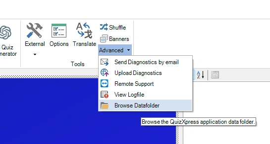
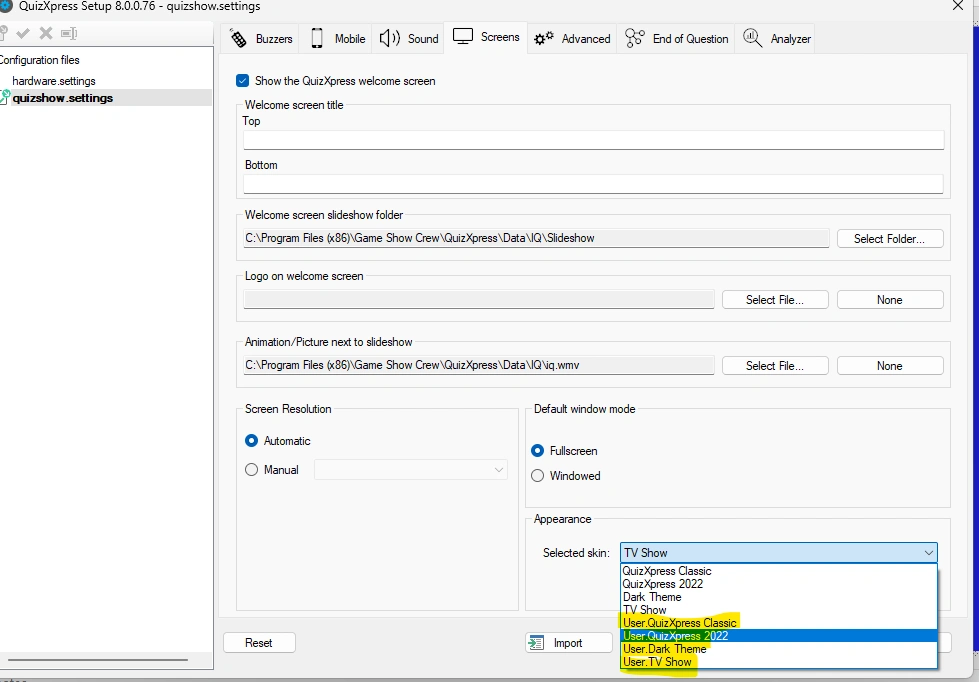
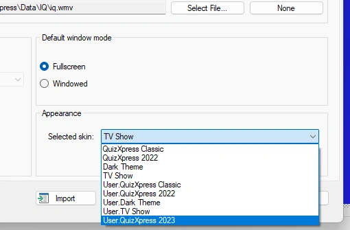
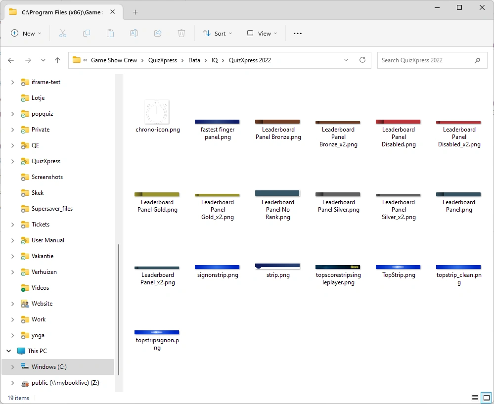

# Crear un skin personalizado

En los pasos siguientes creamos un skin llamado 'QuizXpress 2023', basado en el skin integrado 'QuizXpress 2022'. Sustituya los nombres por los suyos. Si aún no lo ha leído, [Skinning](index.md) explica cómo funcionan los skins.

## Paso 1: abra la carpeta de datos de QuizXpress

En QuizXpress Studio, vaya a la pestaña 'HOME', abra el menú 'Advanced' y elija 'Browse Datafolder'. Se abre una ventana del Explorador de Windows en la carpeta de datos. También puede escribir `%appdata%\QuizXpress` en la barra de direcciones del Explorador de Windows.

{ width="400" loading=lazy }

## Paso 2: copie skin.config en la carpeta de datos

Copie `skin.config` de la carpeta de instalación (`C:\Program Files (x86)\Game Show Crew\QuizXpress`) en la carpeta de datos. Cópielo; no lo mueva.

Abra Quiz Setup, vaya a la pestaña 'Screens' y abra la lista 'Selected skin' en la sección 'Appearance'. Ahora cada skin integrado aparece una segunda vez con el prefijo 'User.': proceden de su copia.

{ loading=lazy }

!!! tip
    Para mantener la lista ordenada, añada `hidden="true"` a los elementos `<skin>` de los skins integrados en **su copia**. Los skins ocultos dejan de aparecer en Quiz Setup, pero siguen funcionando como padre de su propio skin.

## Paso 3: cree una carpeta para sus imágenes

En la carpeta de datos, cree una carpeta `Skins` y, dentro de ella, una carpeta con el nombre de su skin: `%appdata%\QuizXpress\Skins\QuizXpress 2023`. Déjela vacía por ahora.

## Paso 4: añada la definición de su skin

Abra en su editor el `skin.config` copiado (el de la carpeta de datos). Al final del archivo, justo encima de la etiqueta de cierre `</skins>`, añada:

```xml
<skin name="QuizXpress 2023"
      displayname="QuizXpress 2023"
      dir="Skins\QuizXpress 2023"
      parent="QuizXpress 2022">

</skin>
```

Los atributos del elemento `<skin>`:

| Atributo | Significado |
|---|---|
| `name` | Nombre interno. Debe ser único en el archivo; es el nombre que otros skins usan como 'parent'. |
| `displayname` | El nombre que se muestra en Quiz Setup (con el prefijo 'User.'). Opcional; si se omite, se muestra el 'name'. |
| `dir` | La carpeta de recursos del skin. Utilice la ruta relativa `Skins\<su skin>`: se busca dentro de su carpeta de datos y funciona sin cambios en otro equipo u otra cuenta de usuario. También funciona una ruta completa. |
| `parent` | El 'name' (no el nombre mostrado) del skin del que se hereda, por ejemplo `QuizXpress 2022`, `DarkMode`, `TVShow` o `Techno`. Opcional, pero muy recomendable. |
| `hidden` | `true` oculta el skin en Quiz Setup. Opcional. |

Guarde el archivo.

## Paso 5: seleccione el skin en Quiz Setup

Vuelva a abrir Quiz Setup (lee la lista de skins al iniciarse), seleccione 'User.QuizXpress 2023' en la lista 'Selected skin' y guarde la configuración. A partir de ahora el reproductor del quiz utiliza su skin. Como el skin todavía está vacío, tiene exactamente el mismo aspecto que su padre.

{ width="400" loading=lazy }

## Paso 6: sobrescriba la configuración

Ahora realice los cambios que definen su skin. Busque el elemento que desea modificar en el skin padre, o en 'QuizXpress' (el skin raíz, que contiene todos los ajustes con su documentación), cópielo en su propio skin y conserve solo los atributos que cambia.

Por ejemplo, queremos un fondo morado para el indicador de PIN (el panel que muestra el PIN del juego durante el quiz). En el skin raíz encontramos:

```xml
<pinindicator
    background-color="#01539F"
    text-font-family="default"
    pin-font-family="default"
/>
```

Solo queremos cambiar el color de fondo, así que añadimos únicamente ese atributo a nuestro skin:

```xml
<skin name="QuizXpress 2023" displayname="QuizXpress 2023"
      dir="Skins\QuizXpress 2023" parent="QuizXpress 2022">

    <pinindicator background-color="Purple" />

</skin>
```

Las fuentes conservan los valores heredados del padre. Inicie un quiz y el indicador de PIN ya es morado:

{ width="220" loading=lazy }

Siga el mismo patrón para cualquier otro cambio: añada el elemento una sola vez a su skin y ponga en él todos los atributos que modifique para ese elemento.

!!! note
    El reproductor del quiz lee `skin.config` al iniciarse. Después de guardar un cambio, detenga el quiz y vuelva a iniciarlo para ver el resultado.

## Paso 7: sustituya las imágenes

Las imágenes integradas de un skin están en su carpeta dentro de `Data\IQ`, en la carpeta de instalación. Las imágenes de QuizXpress 2022, el padre en nuestro ejemplo, están en `Data\IQ\QuizXpress 2022`:

{ loading=lazy }

Hay dos formas de usar sus propias imágenes.

**Sustituir una imagen por su nombre.** Es la forma más sencilla y no requiere ningún cambio en `skin.config`:

- Busque la imagen que desea cambiar en la carpeta del padre. Si no está allí, busque en la carpeta del abuelo, por ejemplo `Data\IQ\QuizXpress`.
- Cópiela en la carpeta de su skin, `%appdata%\QuizXpress\Skins\QuizXpress 2023`, conservando el nombre del archivo.
- Edite la copia con su editor de imágenes favorito. Mantenga las mismas dimensiones en píxeles y guárdela como PNG (con transparencia donde la tenga el original).

Como la carpeta de su skin se busca antes que la del padre, su imagen se utiliza automáticamente.

**Hacer referencia a una imagen de forma explícita.** Si prefiere usar sus propios nombres de archivo, defina el atributo en su skin. Por ejemplo, para el fondo del panel de información:

```xml
<infopanel background-image="infopanel_bg.png" />
```

Ahora el reproductor del quiz busca `infopanel_bg.png` en la carpeta de su skin. También puede introducir una ruta completa. Para volver a la imagen integrada, utilice el valor `default`.

Inicie un quiz y compruebe que se muestran sus imágenes. Si no se encuentra una imagen, el reproductor del quiz muestra la imagen integrada, o ninguna: consulte [Solución de problemas](maintaining-a-custom-skin.md#solucion-de-problemas).
