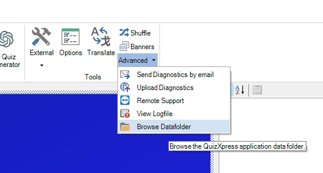
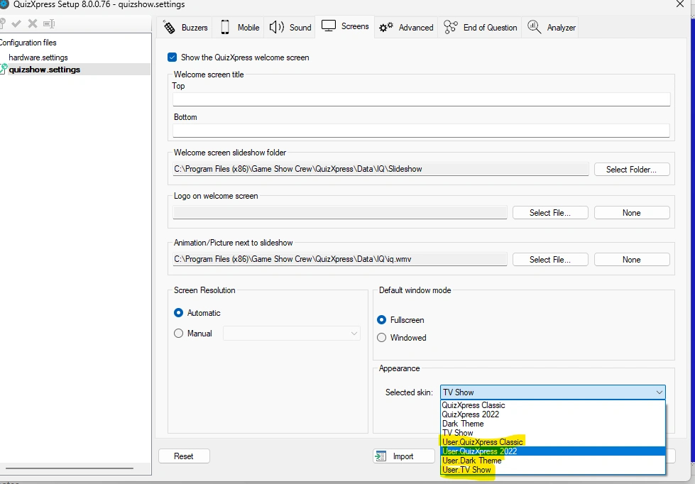
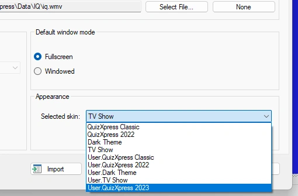
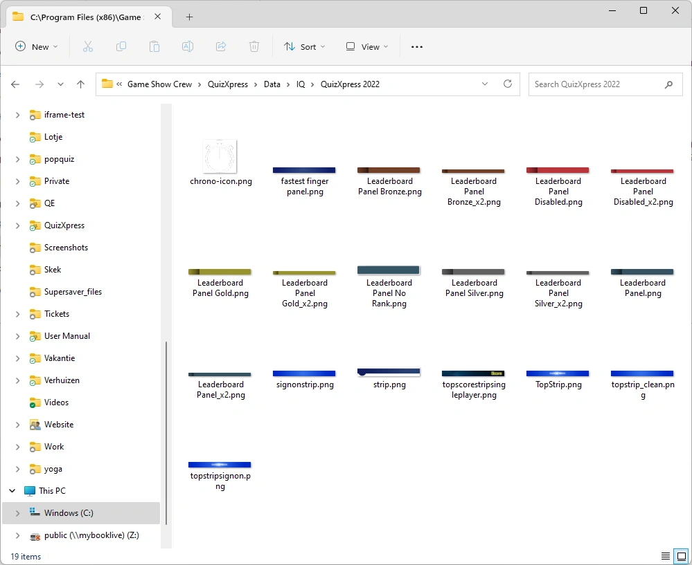

# Een eigen skin maken

In de onderstaande stappen maken we een skin met de naam 'QuizXpress 2023', gebaseerd op de ingebouwde skin 'QuizXpress 2022'. Vervang de namen door uw eigen namen. Als u het nog niet hebt gelezen: [Skinning](index.md) legt uit hoe skins werken.

## Stap 1: open de gegevensmap van QuizXpress

Ga in QuizXpress Studio naar het tabblad 'START', open het menu 'Geavanceerd' en kies 'Datafolder verkennen'. Er opent een Windows Verkenner-venster op de gegevensmap. U kunt ook `%appdata%\QuizXpress` typen in de adresbalk van Windows Verkenner.

{ width="400" loading=lazy }

## Stap 2: kopieer skin.config naar de gegevensmap

Kopieer `skin.config` uit de installatiemap (`C:\Program Files (x86)\Game Show Crew\QuizXpress`) naar de gegevensmap. Kopieer het; verplaats het niet.

Open Quiz Setup, ga naar het tabblad 'Schermen' en open de lijst 'Geselecteerde skin:' in de sectie 'Weergave'. Elke ingebouwde skin verschijnt nu een tweede keer met het voorvoegsel 'User.': deze komen uit uw kopie.

{ loading=lazy }

!!! tip
    Om de lijst overzichtelijk te houden, voegt u `hidden="true"` toe aan de `<skin>`-elementen van de ingebouwde skins in **uw kopie**. Verborgen skins verschijnen niet meer in Quiz Setup, maar werken nog wel als parent voor uw eigen skin.

## Stap 3: maak een map voor uw artwork

Maak in de gegevensmap een map `Skins` en daarin een map met de naam van uw skin: `%appdata%\QuizXpress\Skins\QuizXpress 2023`. Laat die voorlopig leeg.

## Stap 4: voeg uw skindefinitie toe

Open de gekopieerde `skin.config` (die in de gegevensmap) in uw editor. Voeg onderaan het bestand, vlak boven de afsluitende tag `</skins>`, het volgende toe:

```xml
<skin name="QuizXpress 2023"
      displayname="QuizXpress 2023"
      dir="Skins\QuizXpress 2023"
      parent="QuizXpress 2022">

</skin>
```

De attributen van het element `<skin>`:

| Attribuut | Betekenis |
|---|---|
| `name` | Interne naam. Moet uniek zijn in het bestand; dit is de naam die andere skins gebruiken als 'parent'. |
| `displayname` | De naam die in Quiz Setup wordt getoond (met het voorvoegsel 'User.'). Optioneel; als u het weglaat, wordt de 'name' getoond. |
| `dir` | De bestandsmap van de skin. Gebruik het relatieve pad `Skins\<your skin>`: dat wordt gevonden onder uw gegevensmap en werkt ongewijzigd op een andere computer of gebruikersaccount. Een volledig pad werkt ook. |
| `parent` | De 'name' (niet de weergavenaam) van de skin waarvan u erft, bijvoorbeeld `QuizXpress 2022`, `DarkMode`, `TVShow` of `Techno`. Optioneel, maar sterk aanbevolen. |
| `hidden` | `true` verbergt de skin in Quiz Setup. Optioneel. |

Sla het bestand op.

## Stap 5: selecteer de skin in Quiz Setup

Open Quiz Setup opnieuw (het leest de lijst met skins bij het opstarten), selecteer 'User.QuizXpress 2023' in de lijst 'Geselecteerde skin:' en sla de instellingen op. Vanaf nu gebruikt de quizspeler uw skin. Omdat de skin nog leeg is, ziet hij er precies zo uit als zijn parent.

{ width="400" loading=lazy }

## Stap 6: instellingen overschrijven

Maak nu de wijzigingen die uw skin kenmerken. Zoek het element dat u wilt wijzigen in de parent-skin, of in 'QuizXpress' (de rootskin, die elke instelling met documentatie bevat), kopieer het naar uw eigen skin en houd alleen de attributen die u wijzigt.

We willen bijvoorbeeld een paarse achtergrond voor de PIN-indicator (het paneel dat tijdens de quiz de spel-PIN toont). In de rootskin vinden we:

```xml
<pinindicator
    background-color="#01539F"
    text-font-family="default"
    pin-font-family="default"
/>
```

We willen alleen de achtergrondkleur wijzigen, dus voegen we alleen dat attribuut toe aan onze skin:

```xml
<skin name="QuizXpress 2023" displayname="QuizXpress 2023"
      dir="Skins\QuizXpress 2023" parent="QuizXpress 2022">

    <pinindicator background-color="Purple" />

</skin>
```

De lettertypen behouden de waarden die van de parent zijn geërfd. Start een quiz en de PIN-indicator is nu paars:

{ width="220" loading=lazy }

Volg hetzelfde patroon voor al het andere: voeg het element één keer toe aan uw skin en zet alle attributen die u voor dat element wijzigt erin.

!!! note
    De quizspeler leest `skin.config` bij het opstarten. Stop na het opslaan van een wijziging de quiz en start hem opnieuw om het resultaat te zien.

## Stap 7: afbeeldingen vervangen

De ingebouwde afbeeldingen van een skin staan in zijn map onder `Data\IQ` in de installatiemap. De afbeeldingen van QuizXpress 2022, de parent in ons voorbeeld, staan in `Data\IQ\QuizXpress 2022`:

{ loading=lazy }

Er zijn twee manieren om uw eigen artwork te gebruiken.

**Een afbeelding op naam vervangen.** Dit is de eenvoudigste manier en vereist geen wijziging in `skin.config`:

- Zoek de afbeelding die u wilt wijzigen in de map van de parent. Staat die er niet, kijk dan in de map van de grootparent, bijvoorbeeld `Data\IQ\QuizXpress`.
- Kopieer hem naar de map van uw skin, `%appdata%\QuizXpress\Skins\QuizXpress 2023`, en behoud de bestandsnaam.
- Bewerk de kopie in uw favoriete afbeeldingseditor. Houd dezelfde afmetingen in pixels aan en sla hem op als PNG (met transparantie waar het origineel die heeft).

Omdat de map van uw skin vóór de map van de parent wordt doorzocht, wordt uw afbeelding automatisch gebruikt.

**Een afbeelding expliciet aanduiden.** Als u liever uw eigen bestandsnamen gebruikt, stelt u het attribuut in uw skin in. Bijvoorbeeld voor de achtergrond van het infopaneel:

```xml
<infopanel background-image="infopanel_bg.png" />
```

De quizspeler zoekt nu naar `infopanel_bg.png` in de map van uw skin. U kunt ook een volledig pad invoeren. Om terug te gaan naar de ingebouwde afbeelding gebruikt u de waarde `default`.

Start een quiz en controleer of uw afbeeldingen worden getoond. Als een afbeelding niet kan worden gevonden, toont de quizspeler de ingebouwde afbeelding, of geen: zie [Probleemoplossing](maintaining-a-custom-skin.md#probleemoplossing).
