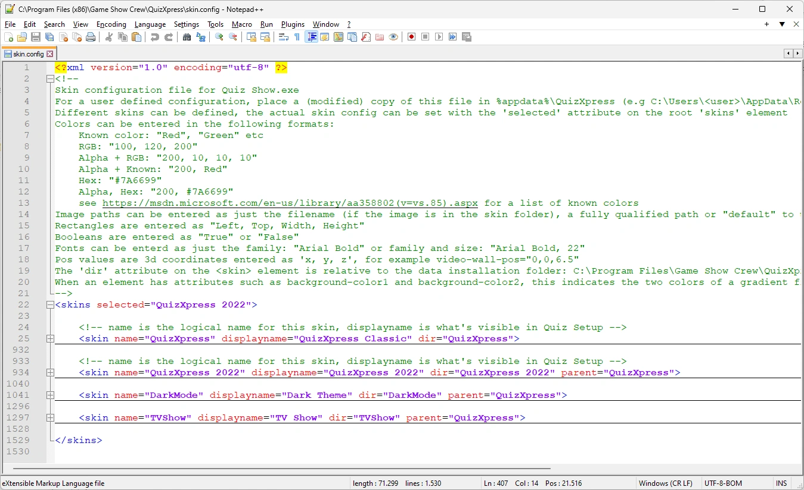
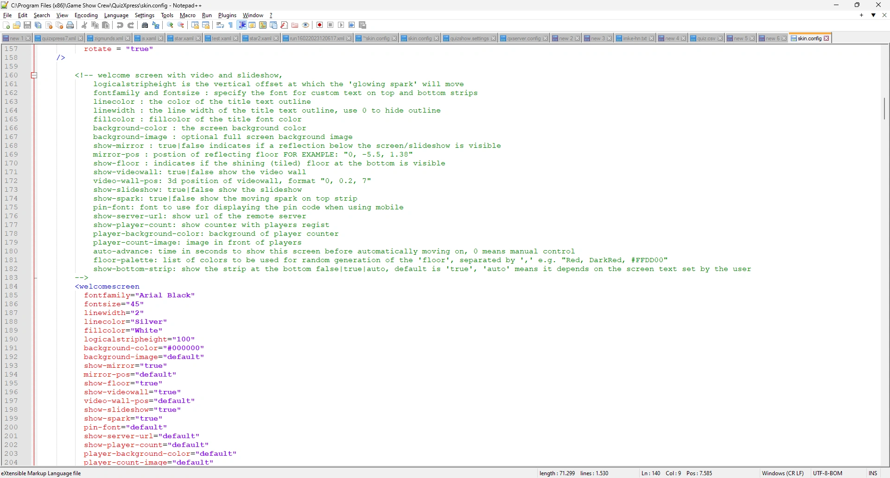

# Skinning

El aspecto del reproductor de quizzes de QuizXpress, QuizXpress Live, puede cambiarse por completo para adaptarlo a sus preferencias o a su imagen corporativa mediante la creación de un 'skin' personalizado. QuizXpress incluye cinco skins integrados (QuizXpress Classic, QuizXpress 2022, Dark Theme, TV Show y Techno), que puede seleccionar en Quiz Setup, en la pestaña 'Screens', en la sección 'Appearance'. Consulte [Personalizar el aspecto](../../setup/customizing-the-look-the-screens-tab-page.md).

Crear su propio skin se reduce a cuatro cosas:

1. copiar el archivo estándar `skin.config` en su carpeta de datos de QuizXpress;
2. añadir su propia definición de skin que herede de uno de los skins integrados;
3. sobrescribir solo los ajustes que desea cambiar;
4. colocar sus propias imágenes (PNG) en una carpeta que pertenezca a su skin.

Esta página explica cómo funcionan los skins. [Crear un skin personalizado](creating-a-custom-skin.md) le guía paso a paso, y [Compartir, actualizar y solucionar problemas](maintaining-a-custom-skin.md) trata lo que viene después.

Los ajustes individuales (colores, fuentes, imágenes, tamaños) no se describen en este manual: cada uno está documentado en un comentario justo encima de su elemento en el propio `skin.config`.

!!! warning "Not in the Home edition"
    Los skins personalizados no están disponibles en la edición Home de QuizXpress. En la edición Home el reproductor del quiz siempre utiliza los skins integrados, incluso cuando se selecciona un skin 'User.'.

## El archivo skin.config

Gran parte del aspecto del reproductor del quiz se define en un archivo de texto XML llamado `skin.config`. Cada skin que puede elegir en Quiz Setup es un elemento `<skin>` de ese archivo. Cada skin contiene elementos para las partes del espectáculo, como `<welcomescreen>`, `<quizscreen>`, `<scorescreen>`, `<infopanel>` o `<pinindicator>`, y sus atributos contienen los colores, fuentes, imágenes y dimensiones.

{ loading=lazy }

Cada elemento está documentado en el comentario (que se muestra en verde en Notepad++) situado justo encima. El comentario al principio del archivo explica cómo introducir los valores: colores (nombres, RGB, ARGB o hexadecimal como `#7A6699`), fuentes (`"Arial Bold"` o `"Arial Bold, 22"`), rectángulos, booleanos y posiciones 3D.

{ loading=lazy }

Para editar el archivo recomendamos [Notepad++](https://notepad-plus-plus.org/), un editor gratuito con coloreado de sintaxis XML. Sirve cualquier editor de texto sin formato, pero nunca utilice un procesador de textos.

## El archivo instalado y su propia copia

QuizXpress conoce dos ubicaciones para `skin.config`:

| Ubicación | Qué es |
|---|---|
| `C:\Program Files (x86)\Game Show Crew\QuizXpress\skin.config` | Los skins integrados. **No edite este archivo**: cada actualización de QuizXpress lo sustituye. |
| `%appdata%\QuizXpress\skin.config` (por ejemplo `C:\Users\<usted>\AppData\Roaming\QuizXpress`) | Su propia copia. Quiz Setup muestra cada skin de este archivo con el prefijo 'User.', de modo que nunca entran en conflicto con los skins integrados. |

!!! note
    Cuando selecciona un skin 'User.', el reproductor del quiz lee **solo su copia** de `skin.config`, incluidos los skins integrados de los que hereda su skin. Por eso se copia el archivo completo en lugar de escribir un archivo que contenga únicamente su propio skin. Consulte [Después de una actualización de QuizXpress](maintaining-a-custom-skin.md#despues-de-una-actualizacion-de-quizxpress) para saber qué implica esto al actualizar.

## Herencia: cambie solo lo que es diferente

Un skin puede indicar un skin 'parent' (padre). Cuando el reproductor del quiz carga un skin, primero carga el padre completo (y el padre del padre, y así sucesivamente) y después aplica encima los elementos del propio skin. Esto funciona por atributo: un atributo que usted incluye sustituye al valor heredado, y un atributo que omite conserva el valor heredado. El valor `default` también conserva el valor heredado.

Los skins integrados ya funcionan así. Techno hereda de Dark Theme, que hereda de QuizXpress Classic:

```text
QuizXpress (QuizXpress Classic)   - the root skin, defines every setting
├── QuizXpress 2022
├── TVShow (TV Show)
└── DarkMode (Dark Theme)
    └── Techno
```

Por tanto, elija como padre de su skin el skin integrado que más se acerque a lo que desea, y ponga en su propio skin solo los elementos y atributos que quiera cambiar. Así se mantiene pequeño y fácil de mantener.

## Dónde busca imágenes el reproductor del quiz

Las imágenes y otros recursos se referencian en `skin.config` por nombre de archivo, por ejemplo `background-image="strip.png"`. Cada skin tiene un atributo 'dir' que indica su carpeta de recursos. El reproductor del quiz busca una imagen en este orden y utiliza el primer archivo que encuentra:

1. Si el atributo contiene una ruta completa (`C:\...\logo.png`): exactamente ese archivo.
2. La carpeta de recursos de su propio skin.
3. La carpeta de recursos de su padre, después la del abuelo, y así sucesivamente.
4. La carpeta predeterminada general `Data\IQ\default` en la carpeta de instalación.

Un 'dir' puede ser una ruta completa o relativa. Un 'dir' relativo se busca primero dentro de `Data\IQ` en la carpeta de instalación (aquí es donde los skins integrados guardan sus imágenes, por ejemplo `Data\IQ\QuizXpress 2022`) y después dentro de su carpeta de datos `%appdata%\QuizXpress`.

El resultado práctico: **una imagen que coloque en la carpeta de su skin con el mismo nombre de archivo que una imagen del skin padre la sustituye automáticamente**, y toda imagen que no sustituya sigue procediendo del padre.
