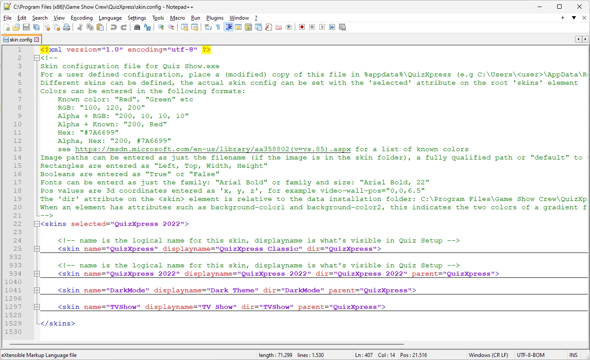
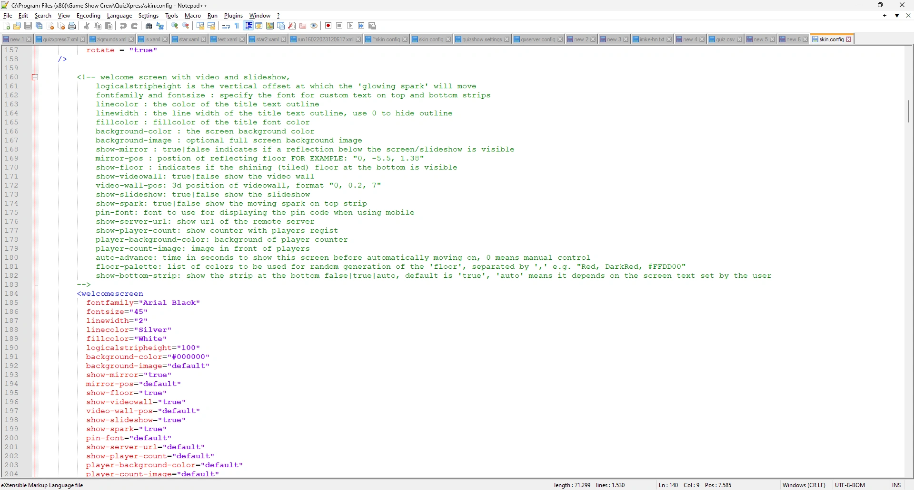

# Skinning

De look van de QuizXpress-quizspeler, QuizXpress Live, kan volledig worden aangepast aan uw voorkeuren of huisstijl door een eigen 'skin' te maken. QuizXpress wordt geleverd met vijf ingebouwde skins (QuizXpress Classic, QuizXpress 2022, Dark Theme, TV Show en Techno), die u in Quiz Setup kunt selecteren op het tabblad 'Schermen', in de sectie 'Weergave'. Zie [De look aanpassen](../../setup/customizing-the-look-the-screens-tab-page.md).

Een eigen skin maken komt neer op vier dingen:

1. kopieer het standaardbestand `skin.config` naar de gegevensmap van QuizXpress;
2. voeg uw eigen skindefinitie toe die erft van een van de ingebouwde skins;
3. overschrijf alleen de instellingen die u wilt wijzigen;
4. zet uw eigen artwork (PNG-afbeeldingen) in een map die bij uw skin hoort.

Deze pagina legt uit hoe skins werken. [Een eigen skin maken](creating-a-custom-skin.md) leidt u door de stappen, en [Delen, bijwerken en probleemoplossing](maintaining-a-custom-skin.md) behandelt wat daarna komt.

De afzonderlijke instellingen (kleuren, lettertypen, afbeeldingen, afmetingen) worden niet in deze handleiding beschreven: elke instelling is gedocumenteerd in een opmerking direct boven het element in `skin.config` zelf.

!!! warning "Niet in de Home-editie"
    Eigen skins zijn niet beschikbaar in de Home-editie van QuizXpress. In de Home-editie gebruikt de quizspeler altijd de ingebouwde skins, ook wanneer een 'User.'-skin is geselecteerd.

## Het bestand skin.config

Een groot deel van de look-and-feel van de quizspeler is vastgelegd in een XML-tekstbestand met de naam `skin.config`. Elke skin die u in Quiz Setup kunt kiezen, is een `<skin>`-element in dat bestand. Elke skin bevat elementen voor de onderdelen van de show, zoals `<welcomescreen>`, `<quizscreen>`, `<scorescreen>`, `<infopanel>` of `<pinindicator>`, en hun attributen bevatten de kleuren, lettertypen, afbeeldingen en afmetingen.

{ loading=lazy }

Elk element is gedocumenteerd in de opmerking (groen weergegeven in Notepad++) direct erboven. De opmerking bovenaan het bestand legt uit hoe u waarden invoert: kleuren (namen, RGB, ARGB of hex zoals `#7A6699`), lettertypen (`"Arial Bold"` of `"Arial Bold, 22"`), rechthoeken, booleans en 3D-posities.

{ loading=lazy }

Om het bestand te bewerken raden wij [Notepad++](https://notepad-plus-plus.org/) aan, een gratis editor met XML-syntaxiskleuring. Elke platte-teksteditor volstaat, maar gebruik nooit een tekstverwerker.

## Het geïnstalleerde bestand en uw eigen kopie

QuizXpress kent twee locaties voor `skin.config`:

| Locatie | Wat het is |
|---|---|
| `C:\Program Files (x86)\Game Show Crew\QuizXpress\skin.config` | De ingebouwde skins. **Bewerk dit bestand niet**: elke QuizXpress-update vervangt het. |
| `%appdata%\QuizXpress\skin.config` (bijvoorbeeld `C:\Users\<you>\AppData\Roaming\QuizXpress`) | Uw eigen kopie. Quiz Setup toont elke skin in dit bestand met het voorvoegsel 'User.', zodat ze nooit conflicteren met de ingebouwde skins. |

!!! note
    Wanneer u een 'User.'-skin selecteert, leest de quizspeler **alleen uw kopie** van `skin.config`, inclusief de ingebouwde skins waarvan uw skin erft. Daarom kopieert u het hele bestand in plaats van een bestand te schrijven met alleen uw eigen skin erin. Zie [Na een QuizXpress-update](maintaining-a-custom-skin.md#na-een-quizxpress-update) voor wat dit betekent wanneer u bijwerkt.

## Overerving: wijzig alleen wat anders is

Een skin kan een 'parent'-skin (bovenliggende skin) opgeven. Wanneer de quizspeler een skin laadt, laadt hij eerst de complete parent (en de parent van de parent, enzovoort) en past daarna de elementen van de skin zelf erbovenop toe. Dit werkt per attribuut: een attribuut dat u opneemt, vervangt de geërfde waarde, een attribuut dat u weglaat, behoudt de geërfde waarde. Ook de waarde `default` behoudt de geërfde waarde.

De ingebouwde skins werken al zo. Techno erft van Dark Theme, dat erft van QuizXpress Classic:

```text
QuizXpress (QuizXpress Classic)   - the root skin, defines every setting
├── QuizXpress 2022
├── TVShow (TV Show)
└── DarkMode (Dark Theme)
    └── Techno
```

Kies dus de ingebouwde skin die het dichtst bij uw wensen ligt als parent van uw skin, en zet alleen de elementen en attributen die u wilt wijzigen in uw eigen skin. Zo blijft hij klein en eenvoudig te onderhouden.

## Waar de quizspeler naar afbeeldingen zoekt

Afbeeldingen en andere bestanden worden in `skin.config` op bestandsnaam aangeduid, bijvoorbeeld `background-image="strip.png"`. Elke skin heeft een attribuut 'dir' dat zijn bestandsmap aanduidt. De quizspeler zoekt een afbeelding in deze volgorde en gebruikt het eerste bestand dat hij vindt:

1. Als het attribuut een volledig pad bevat (`C:\...\logo.png`): precies dat bestand.
2. De bestandsmap van uw eigen skin.
3. De bestandsmap van de parent, dan van de grootparent, enzovoort.
4. De algemene standaardmap `Data\IQ\default` in de installatiemap.

Een 'dir' kan een volledig of een relatief pad zijn. Een relatieve 'dir' wordt eerst gezocht onder `Data\IQ` in de installatiemap (daar bewaren de ingebouwde skins hun afbeeldingen, bijvoorbeeld `Data\IQ\QuizXpress 2022`) en daarna onder uw gegevensmap `%appdata%\QuizXpress`.

Het praktische gevolg: **een afbeelding die u in de map van uw skin plaatst onder dezelfde bestandsnaam als een afbeelding van de parent-skin, vervangt die automatisch**, en elke afbeelding die u niet vervangt, komt nog steeds van de parent.
