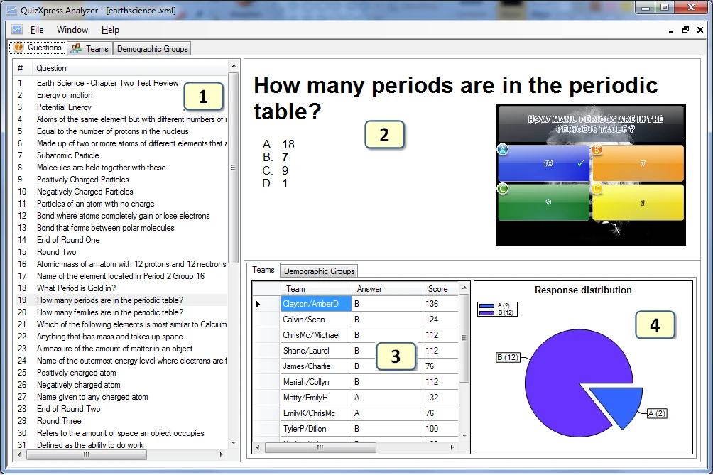
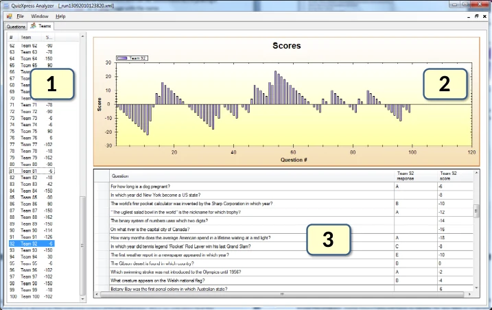

# Analyser les résultats d'un quiz avec QuizXpress Analyzer

QuizXpress est livré avec un outil d'analyse graphique nommé Analyzer. Analyzer vous aide à comprendre et à visualiser les données collectées pendant le quiz. Vous pouvez ouvrir plusieurs jeux de données, ce qui permet de comparer des données collectées au fil du temps. Trois vues sont disponibles :

- Question view

- Team view

- Demographic Groups (si des groupes démographiques étaient présents pendant un quiz)

La vue centrée sur les questions se présente ainsi :

{ width="604" loading=lazy }

1)  La liste de toutes les questions du jeu de données

2)  La question elle-même avec les réponses possibles (si le fichier de quiz .qx est disponible sur le système, une image de la diapositive est affichée ; s'il n'est plus disponible, vous ne verrez qu'une représentation textuelle)

3)  Les réponses et les scores (pour la question sélectionnée) par équipe/joueur. Lorsque des groupes démographiques sont disponibles, un onglet ‘Demographic Groups’ s'affiche en bas à droite. Dans cet onglet, pour chaque groupe, le nombre de votes par réponse pour la question sélectionnée est présenté dans un tableau.

4)  Un graphique en secteurs montrant la répartition des réponses pour la question sélectionnée. Lorsque des groupes démographiques sont disponibles, dans l'onglet Demographic Groups, la répartition des réponses d'un groupe peut être affichée en sélectionnant ce groupe dans la liste déroulante située au-dessus du graphique de répartition des réponses.

La vue par équipe présente la disposition suivante :

{ width="547" loading=lazy }

1)  La liste des noms d'équipes/joueurs. Notez que vous pouvez sélectionner plusieurs équipes ici.

2)  Un graphique montrant l'évolution du score au fil du temps

3)  Les questions et les réponses pour la ou les équipes sélectionnées

La vue des groupes démographiques a la même disposition. Dans le tableau, pour chaque question, toutes les réponses sont affichées. Pour chaque groupe sélectionné, le nombre de votes pour chaque réponse est affiché. L'évolution du score au fil du temps pour le ou les groupes sélectionnés est également présentée.

Toutes les données affichées dans Analyzer sont enregistrées pendant un quiz par QuizXpress Live sous forme de documents XML dans le dossier de données de l'application QuizXpress (sous Windows 7, l'emplacement de ce dossier est ‘C:\Users\\username>\AppData\Roaming\QuizXpress\Scores’). Notez que vous pouvez ouvrir ce dossier depuis QuizXpress Studio via le menu Tools->Advanced.
