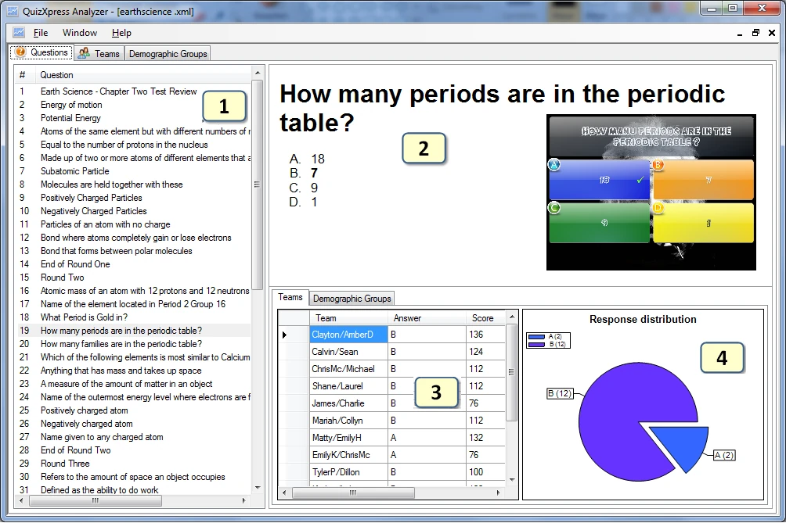
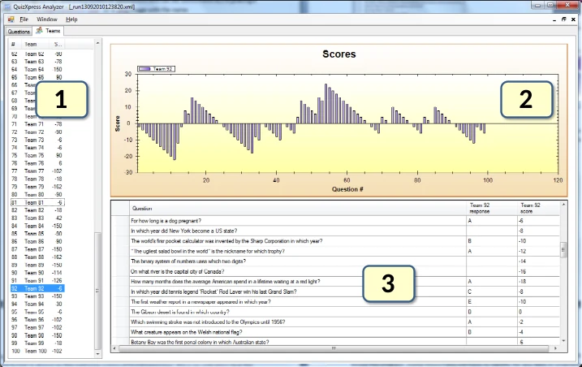

# Quizresultaten analyseren met QuizXpress Analyzer

QuizXpress wordt geleverd met een grafisch analysehulpmiddel met de naam Analyzer. Analyzer helpt u de gegevens te begrijpen en te visualiseren die tijdens de quiz zijn verzameld. U kunt meerdere gegevenssets openen, zodat u gegevens kunt vergelijken die over een langere periode zijn verzameld. Er zijn drie weergaven beschikbaar:

- Vraagweergave

- Teamweergave

- Demografische groepen (als er tijdens een quiz demografische groepen aanwezig waren)

De weergave die om de vragen draait, ziet er als volgt uit:

{ width="604" loading=lazy }

1)  De lijst met alle vragen in de gegevensset

2)  De vraag zelf met de mogelijke antwoorden (als het quizbestand .qx op het systeem beschikbaar is, wordt een afbeelding van de dia weergegeven; als het niet meer beschikbaar is, ziet u alleen een tekstuele weergave)

3)  De antwoorden en scores (voor de geselecteerde vraag) per team/speler. Wanneer er demografische groepen beschikbaar zijn, wordt rechtsonder een tabblad ‘Demografische groep’ getoond. In dit tabblad wordt voor elke groep het aantal stemmen per antwoord voor de geselecteerde vraag in een tabel getoond.

4)  Een cirkeldiagram met de verdeling van de antwoorden voor de geselecteerde vraag. Wanneer er demografische groepen beschikbaar zijn, kunt u in het tabblad Demografische groep de verdeling van de antwoorden voor een groep tonen door die groep te selecteren in de keuzelijst boven de grafiek met de antwoordverdeling.

De teamweergave heeft de volgende indeling:

{ width="547" loading=lazy }

1)  De lijst met team-/spelernamen. Let op: u kunt hier meerdere teams selecteren.

2)  Een grafiek met de ontwikkeling van de score in de tijd

3)  De vragen en antwoorden voor het geselecteerde team of de geselecteerde teams

De weergave van de demografische groepen heeft dezelfde indeling. In de tabel worden voor elke vraag alle antwoorden getoond. Voor elke geselecteerde groep wordt het aantal stemmen voor elk antwoord getoond. Ook de ontwikkeling van de score in de tijd voor de geselecteerde groep(en) wordt getoond.

Alle gegevens die Analyzer toont, worden tijdens een quiz door QuizXpress Live opgeslagen in de vorm van XML-documenten in de toepassingsgegevensmap van QuizXpress (onder Windows 7 is de locatie van deze map ‘C:\Users\\username>\AppData\Roaming\QuizXpress\Scores’). Houd er rekening mee dat u deze map kunt openen vanuit QuizXpress Studio via het menu Tools->Geavanceerd.
