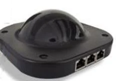
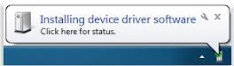

# Tastierini e buzzer QuizXpress

{ width="148" loading=lazy }

Procedere come segue per installare il ricevitore QuizXpress e configurare QuizXpress per l'uso con i buzzer.

Per installare il ricevitore QuizXpress, collegarlo a una porta USB disponibile. Windows installerà il ricevitore automaticamente al primo utilizzo. Nella barra delle applicazioni di Windows verranno visualizzati i messaggi seguenti.

{ width="264" loading=lazy }{ width="261" loading=lazy }

Ora è possibile configurare QuizXpress per l'uso dei buzzer QuizXpress (fare riferimento anche a [Tastierini di base QuizXpress](../setup/configuring-your-hardware-the-buzzers-tab-page.md#keypad-base-quizxpress)).

- Avviare Quiz Setup

- Nella pagina della scheda ‘Buzzers’ di Quiz Setup, selezionare *QuizXpress Keypad*.

- Quando il ricevitore è collegato, è possibile premere il pulsante ‘Test’, dopodiché viene stabilita una connessione. In caso di esito positivo compare un segno di spunta verde.

- Chiudere ora Quiz Setup e avviare QuizXpress Buzzer Test, che si trova nel menu Start sotto QuizXpress. Premendo uno dei buzzer, la casella numerata corrispondente dovrebbe illuminarsi sullo schermo e mostrare la risposta scelta.

- Quando i passaggi precedenti sono stati eseguiti con successo, QuizXpress Live è pronto a funzionare con i buzzer QuizXpress.

!!! note

    I tastierini QuizXpress funzionano con due batterie AAA.

Il ricevitore QuizXpress ha tre LED. Quello rosso indica se è alimentato, quello giallo indica la comunicazione e quello verde indica l'attività di polling RF. Durante il quiz il LED verde dovrebbe lampeggiare. In caso contrario, è necessario riavviare il dispositivo con F12.
