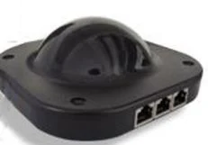
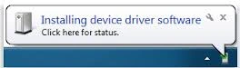
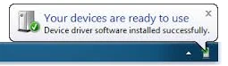

# QuizXpress-keypads en -buzzers

{ width="148" loading=lazy }

Ga als volgt te werk om de QuizXpress-ontvanger te installeren en QuizXpress te configureren voor gebruik met de buzzers.

Om de QuizXpress-ontvanger te installeren, steekt u hem in een vrije USB-poort. Windows installeert de ontvanger de eerste keer dat hij wordt gebruikt automatisch. U ziet de volgende meldingen in de Windows-taakbalk.

{ width="264" loading=lazy }{ width="261" loading=lazy }

Nu kunt u QuizXpress configureren voor gebruik met de QuizXpress-buzzers (zie ook [Standaard QuizXpress-keypads](../setup/configuring-your-hardware-the-buzzers-tab-page.md#basis-keypads-van-quizxpress)).

- Start Quiz Setup

- Selecteer op het tabblad ‘Buzzers’ van Quiz Setup *QuizXpress Keypad*.

- Wanneer de ontvanger is aangesloten, kunt u op de knop ‘Testen’ drukken, waarna een verbinding wordt gemaakt. Als dat lukt, verschijnt een groen vinkje.

- Sluit nu Quiz Setup en start QuizXpress Buzzer Test, te vinden in het Start-menu onder QuizXpress. Wanneer u op een van de buzzers drukt, moet het bijbehorende genummerde vak op het scherm oplichten en het gekozen antwoord tonen.

- Als de voorgaande stappen met succes zijn uitgevoerd, is QuizXpress Live klaar voor gebruik met QuizXpress-buzzers.

!!! note

    QuizXpress-keypads werken op twee AAA-batterijen.

De QuizXpress-ontvanger heeft drie leds. De rode geeft aan of hij stroom heeft, de gele geeft communicatie aan en de groene geeft RF-pollingactiviteit aan. Tijdens de quizshow moet de groene knipperen. Zo niet, start het apparaat dan opnieuw op met F12.
