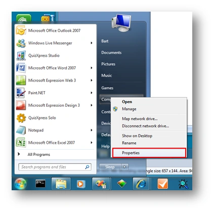
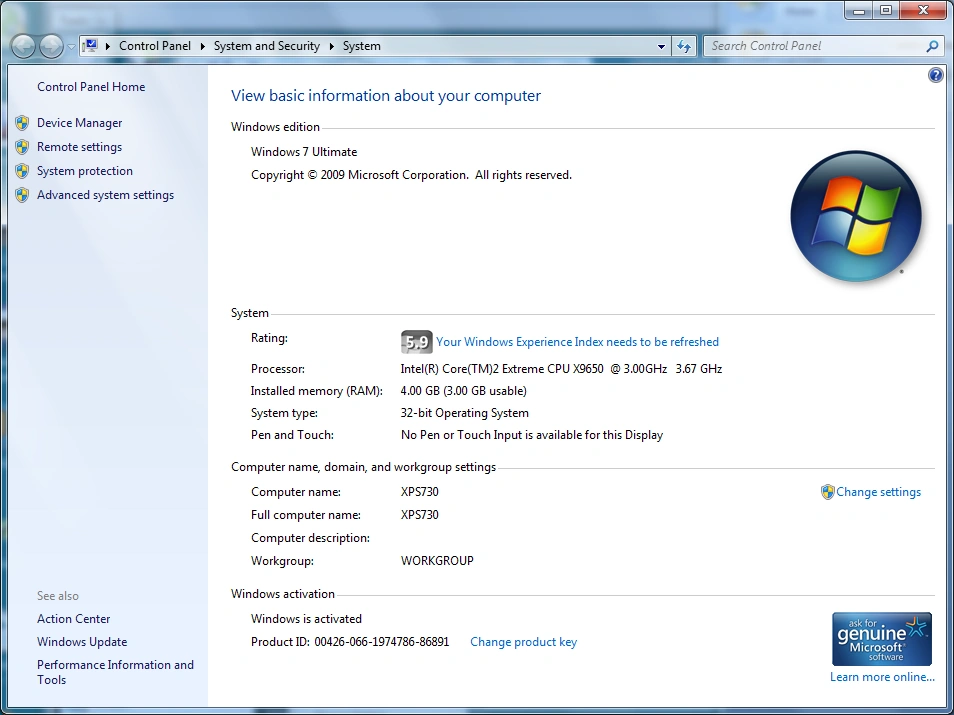
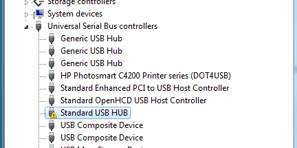
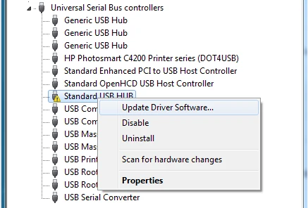
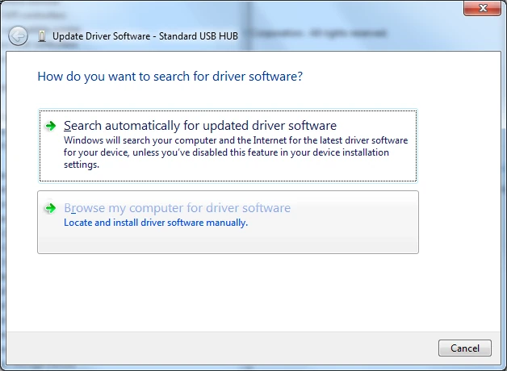
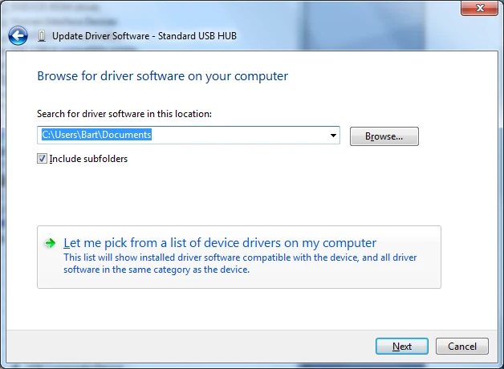
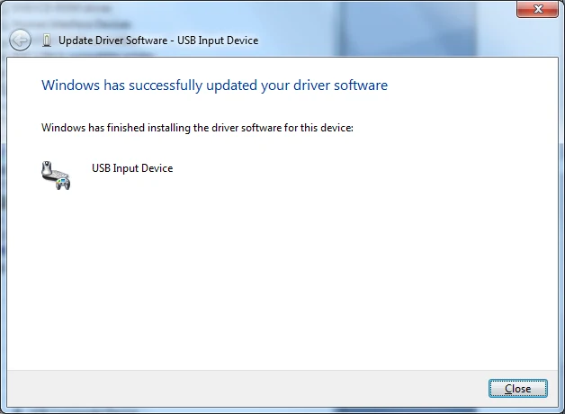
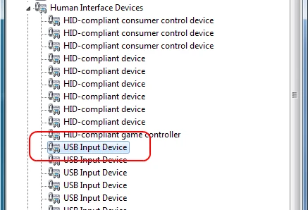
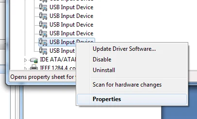
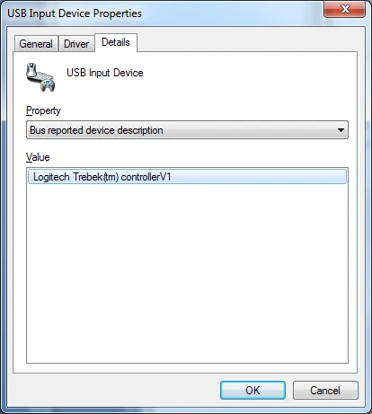

# Buzzer Sony Buzz in Windows 7 e versioni successive

L'ultima revisione dei buzzer Sony Buzz™ richiede una procedura speciale per funzionare con QuizXpress in Windows Vista o Windows 7. Questa appendice descrive i passaggi per installare correttamente il ricevitore USB Sony Buzz™ in questi sistemi operativi.

È possibile riconoscere questa nuova revisione dal testo “Manufactured by Logitech…” sul ricevitore USB. I buzzer non hanno il pulsante di accensione sul lato destro e manca il LED blu presente nelle revisioni precedenti. Questo modello di buzzer si accende premendo una volta il grande pulsante rosso.

Collegare il ricevitore a una porta USB del computer. Dopo un po' compare un messaggio che indica l'errore di installazione del dispositivo:

Passare al menu Start e selezionare Computer->Proprietà:

{ width="330" loading=lazy }

Nella finestra che appare, selezionare *Gestione dispositivi*:

{ width="360" loading=lazy }

Nella finestra Gestione dispositivi, espandere il nodo Controller USB (Universal Serial Bus):

{ width="364" loading=lazy }

Selezionare il nodo che indica un errore, fare clic con il pulsante destro del mouse e selezionare Aggiorna driver dal menu:

{ width="365" loading=lazy }

Nella procedura guidata, selezionare “Cerca il software del driver nel computer”:

{ width="362" loading=lazy }

Nella schermata successiva, selezionare ‘Scegli da un elenco di driver di dispositivo nel computer’ e selezionare Avanti:

{ width="397" loading=lazy }

Nella schermata successiva, selezionare “Dispositivo di input USB” e premere Avanti:

Il ricevitore Buzz™ è ora installato correttamente e pronto per l'uso.

{ width="317" loading=lazy }

Chiudere la finestra; in Gestione dispositivi il ricevitore dei buzzer wireless apparirà ora come “Dispositivo di input USB”.

{ width="317" loading=lazy }

Per individuare il dispositivo buzzer *dopo* che è stato installato, ad esempio per disinstallarlo, è necessario aprire le proprietà di ciascuna delle voci *Dispositivo di input USB* (clic con il pulsante destro; Proprietà)

{ width="291" loading=lazy }

Quindi, nella finestra *Proprietà - Dispositivo di input USB*, selezionare la scheda ‘Dettagli’ e impostare l'elenco a discesa ‘Proprietà’ su *Descrizione dispositivo segnalata dal bus*. Se il campo ‘Valore’ mostra il testo *Logitech Trebek(tm) controllerV1*, si è trovato il dispositivo buzzer Sony.

{ width="289" loading=lazy }
