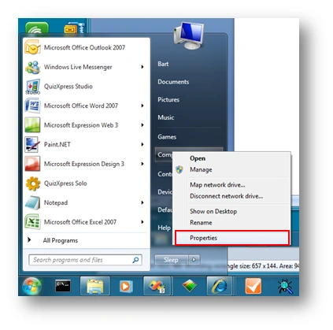
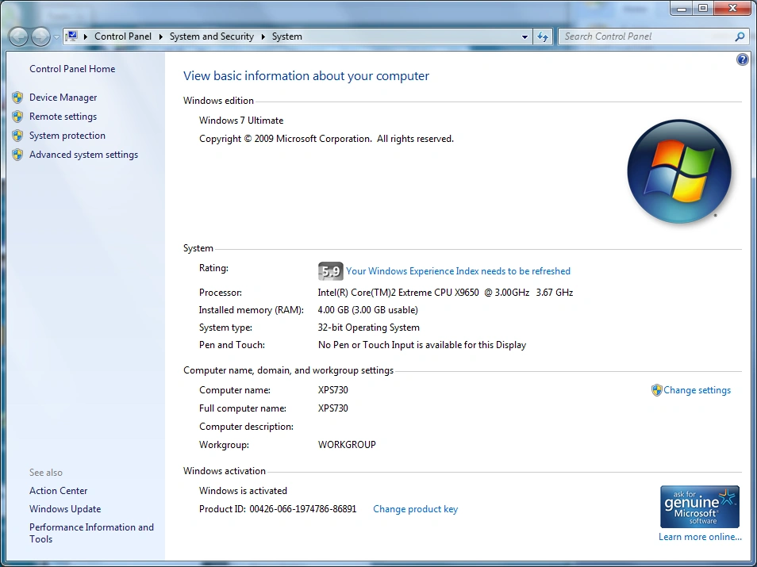
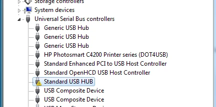
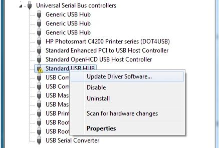
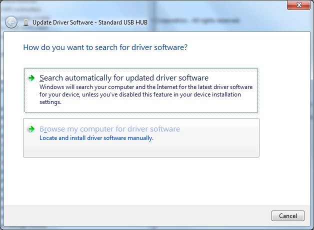
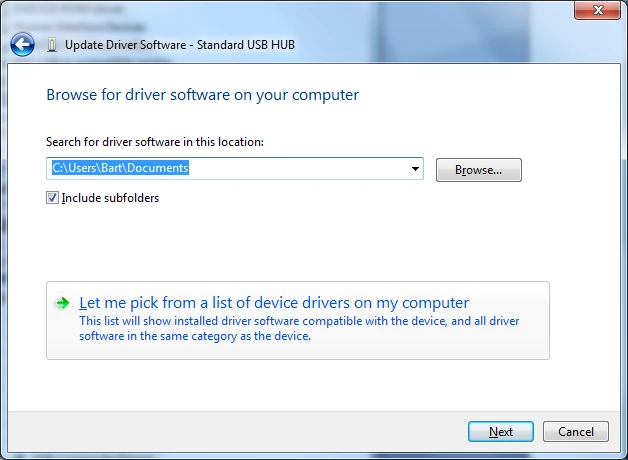
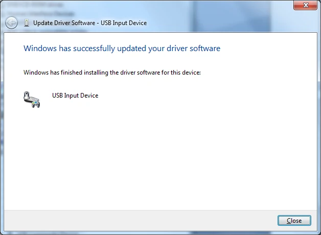
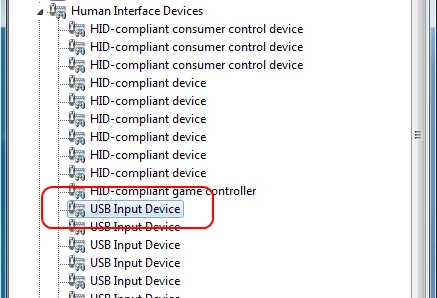
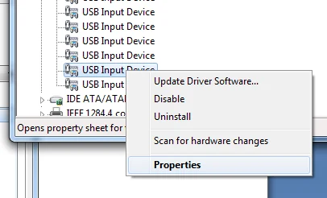
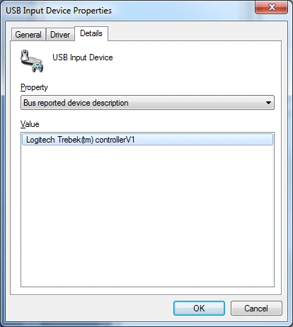

# Sony Buzz-buzzers op Windows 7 en later

De nieuwste revisie van de Sony Buzz™-buzzers vereist een speciale procedure om ze met QuizXpress te laten werken onder Windows Vista of Windows 7. Deze bijlage beschrijft de stappen om de Sony Buzz™ USB-ontvanger op deze besturingssystemen correct te installeren.

U herkent deze nieuwe revisie aan de tekst “Manufactured by Logitech…” op de USB-ontvanger. De buzzers hebben geen aan/uit-knop aan de rechterkant en de blauwe led die op eerdere revisies aanwezig is, ontbreekt. Dit model buzzer wordt ingeschakeld door één keer op de grote rode knop te drukken.

Sluit de ontvanger aan op een USB-poort van uw computer. Na een tijdje verschijnt een melding dat het apparaat niet kon worden geïnstalleerd:

Ga naar het Start-menu en selecteer Computer->Eigenschappen:

{ width="330" loading=lazy }

Selecteer in het venster dat verschijnt *Apparaatbeheer*:

{ width="360" loading=lazy }

Vouw in het venster Apparaatbeheer het knooppunt Universal Serial Bus-controllers uit:

{ width="364" loading=lazy }

Selecteer het knooppunt dat een fout aangeeft, klik er met de rechtermuisknop op en kies Stuurprogramma bijwerken in het menu:

{ width="365" loading=lazy }

Selecteer in de wizard “Op mijn computer naar stuurprogramma's zoeken”:

{ width="362" loading=lazy }

Selecteer op het volgende scherm ‘Laat me kiezen uit een lijst…’ en kies Volgende:

{ width="397" loading=lazy }

Selecteer op het volgende scherm “USB-invoerapparaat” en klik op Volgende:

De Buzz™-ontvanger is nu met succes geïnstalleerd en klaar voor gebruik.

{ width="317" loading=lazy }

Sluit het venster; in Apparaatbeheer verschijnt de draadloze buzzerontvanger nu als “USB-invoerapparaat”.

{ width="317" loading=lazy }

Om het buzzerapparaat te vinden *nadat* het is geïnstalleerd, bijvoorbeeld om het te verwijderen, moet u de eigenschappen openen van elk van de items *USB-invoerapparaat* (klik met de rechtermuisknop; Eigenschappen)

{ width="291" loading=lazy }

Selecteer vervolgens in het venster *Eigenschappen van USB-invoerapparaat* het tabblad ‘Details’ en wijzig de keuzelijst ‘Eigenschap’ in *Door bus gerapporteerde apparaatbeschrijving*. Als het veld ‘Waarde’ de tekst *Logitech Trebek(tm) controllerV1* toont, hebt u het Sony-buzzerapparaat gevonden.

{ width="289" loading=lazy }
