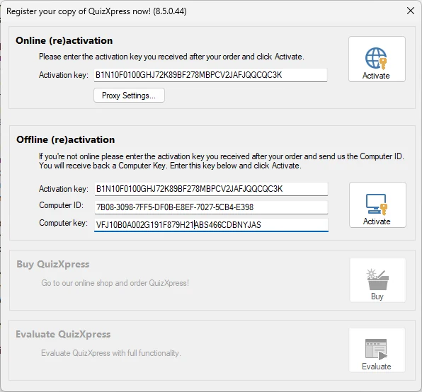
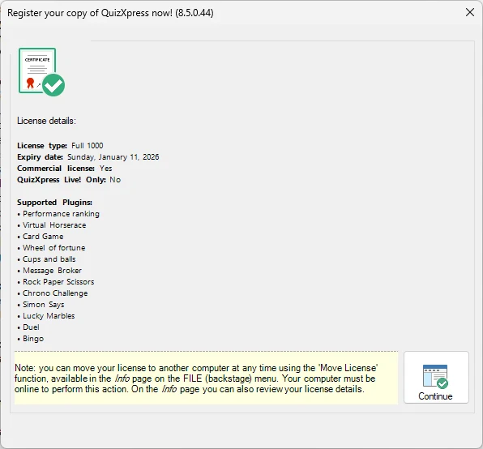
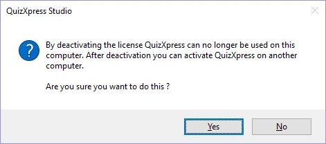
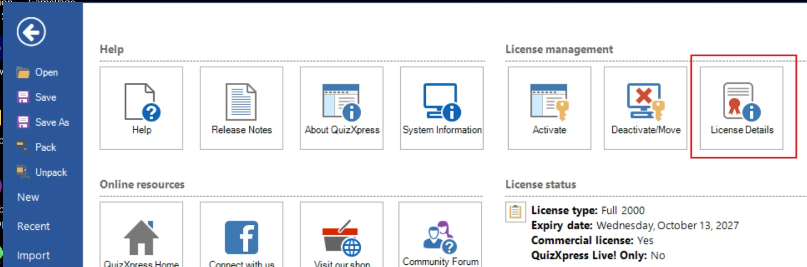

# Licenze

La suite software QuizXpress è protetta da una chiave di licenza. La versione demo, scaricabile dal nostro sito web, dispone di una modalità di prova di 2 settimane pienamente funzionante. La chiave di licenza contiene informazioni sul numero di dispositivi (buzzer/tastierini/dispositivi mobili) utilizzabili e sulla data di scadenza della licenza.

## Attivazione

La finestra di attivazione compare automaticamente all'avvio di QuizXpress Studio se la licenza è scaduta o non è presente. In alternativa, è possibile aprire la finestra manualmente dalla scheda HOME facendo clic su ‘Info’ e poi su ‘Activate’.

{ width="324" loading=lazy }

QuizXpress può essere attivato sia online sia offline. L'attivazione online è semplice; basta inserire la chiave ricevuta dopo l'acquisto nella casella di testo ‘Activation key’ e fare clic su ‘Activate’. Se l'attivazione riesce, la finestra mostra quanto segue:

{ width="313" loading=lazy }

Dopo l'attivazione, questo modulo mostra ciò che è incluso nella licenza (i minigiochi supportati e l'hardware aggiuntivo come le tabelle punteggi e i dispositivi Galaxy RGB)

Per l'attivazione *offline* (nel caso in cui il PC non sia connesso a Internet), è necessario inviare a Game Show Crew il proprio ‘Computer ID’ e la propria ‘Computer key’; si riceverà quindi via e-mail una chiave di attivazione offline da inserire nella casella di testo di attivazione offline.

## Disattivare e spostare le licenze

È possibile spostare una licenza su un altro computer. Per farlo, assicurarsi innanzitutto di avere una copia della propria chiave. In QuizXpress Studio, premere il tasto F1, quindi fare clic sul pulsante ‘Deactivate/Move’ e confermare il messaggio:

{ width="283" loading=lazy }

Ora è possibile passare all'altra macchina e attivare QuizXpress con la stessa chiave. A seconda del tipo di licenza, le chiavi di attivazione possono essere utilizzate su più macchine.

## Informazioni sulla licenza

Per vedere dove è in uso la licenza (su quali computer), premere F1, quindi aprire la scheda **Info** e fare clic sul pulsante **License Details**:

{ loading=lazy }

Si aprirà un nuovo browser web (è necessario essere online) e verrà visualizzata una pagina con i dettagli della chiave di licenza, compresi i computer su cui la chiave è attualmente in uso.
