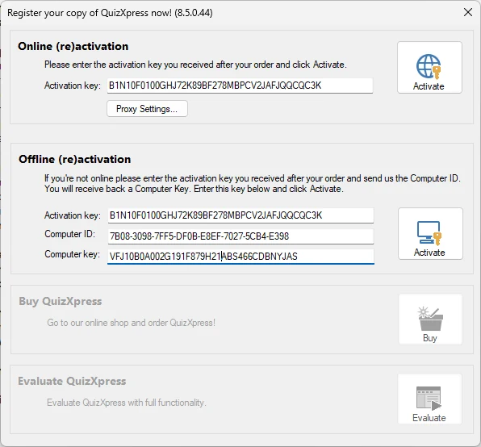
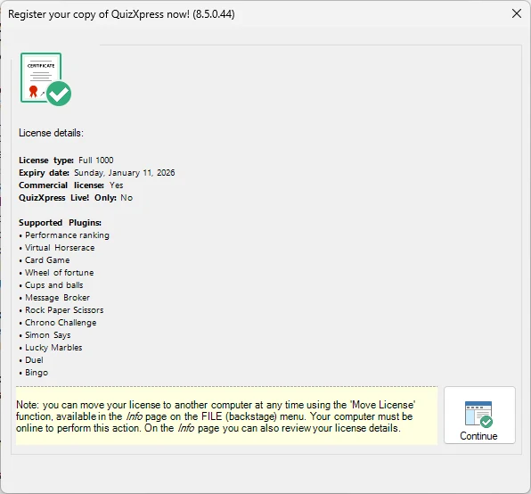
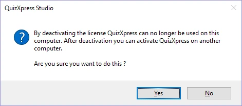
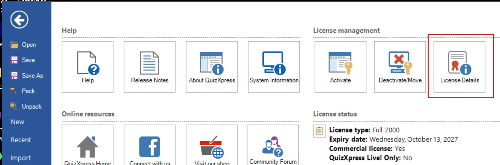

# Licenties

De QuizXpress-softwaresuite wordt beschermd door een licentiesleutel. De demoversie, die u kunt downloaden van onze website, heeft een volledig functionele proefperiode van 2 weken. De licentiesleutel bevat informatie over het aantal apparaten (buzzers/keypads/mobiele apparaten) dat u kunt gebruiken en de vervaldatum van de licentie.

## Activering

Het activeringsvenster verschijnt automatisch bij het starten van QuizXpress Studio als de licentie is verlopen of ontbreekt. U kunt het venster ook handmatig openen vanuit het menu BESTAND door op ‘Info’ en daarna op ‘Activeren’ te klikken.

{ width="324" loading=lazy }

QuizXpress kan zowel online als offline worden geactiveerd. Online activeren is eenvoudig; voer de sleutel die u na uw aankoop hebt ontvangen in het tekstvak ‘Activatie sleutel’ in en klik op ‘Activeren’. Als de activering is gelukt, toont het venster het volgende:

{ width="313" loading=lazy }

Na de activering toont dit formulier wat uw licentie omvat (de ondersteunde minigames en de aanvullende hardware zoals de scoreborden en Galaxy RGB-apparaten)

Voor *offline* activering (als uw pc niet met internet is verbonden) moet u uw ‘Computer ID’ en ‘Computer sleutel’ naar Game Show Crew sturen; u ontvangt dan per e-mail een offline activeringssleutel die u invoert in het tekstvak voor offline activering.

## Licenties deactiveren en verplaatsen

Het is mogelijk een licentie naar een andere computer te verplaatsen. Zorg er eerst voor dat u een kopie van uw sleutel hebt. Druk in QuizXpress Studio op de toets F1, klik op de knop ‘Deactiveren Verplaatsen’ en bevestig de melding:

{ width="283" loading=lazy }

Nu kunt u naar uw andere computer gaan en QuizXpress activeren met dezelfde sleutel. Afhankelijk van het type licentie kunnen activeringssleutels op meerdere computers worden gebruikt.

## Licentie-informatie

Om te zien waar uw licentie in gebruik is (op welke computers), drukt u op F1, opent u het tabblad **Info** en klikt u op de knop **Licentie details**:

{ loading=lazy }

Hiermee opent een nieuwe webbrowser (u moet online zijn) en gaat u naar een pagina met de details van uw licentiesleutel, waaronder de computers waarop de sleutel momenteel in gebruik is.
