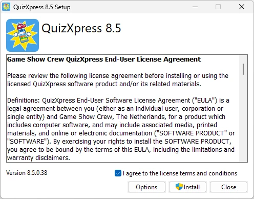

# Configuration requise

| Composant        | Exigence                                                                                      |
|------------------|-----------------------------------------------------------------------------------------------|
| Système d'exploitation | Windows 10 ou Windows 11                                                                |
| Espace disque libre | ~1 Go, un disque SSD est préférable                                                        |
| Mémoire          | 8 Go minimum, 16 Go recommandés                                                               |
| Carte vidéo      | Carte vidéo compatible DirectX 9C                                                             |
| Carte son        | N'importe quelle carte son standard convient                                                  |
| Processeur       | Pour de bonnes performances avec des vidéos HD, nous recommandons un processeur i5 à 2,4 GHz ou plus. |

Pour installer le logiciel, exécutez le package d'installation QuizXpress8.exe. Un lien vers la section de téléchargement de notre site web figure dans l'e-mail que vous avez reçu avec votre clé de licence.

{ width="321" loading=lazy }

Le processus d'installation lui-même est simple. Veuillez lire attentivement le contrat de licence et, une fois que vous l'acceptez, cochez la case ‘I agree…’ puis cliquez sur ‘Install’.
