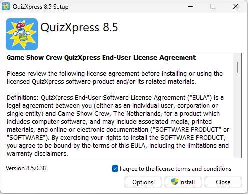

# Systeemvereisten

| Onderdeel        | Vereiste                                                                                      |
|------------------|-----------------------------------------------------------------------------------------------|
| Besturingssysteem | Windows 10 of Windows 11                                                                     |
| Vrije schijfruimte | ~1 GB, een SSD heeft de voorkeur                                                            |
| Geheugen         | 8 GB minimaal, 16 GB aanbevolen                                                               |
| Videokaart       | DirectX 9C-compatibele videokaart                                                             |
| Geluidskaart     | Elke standaard geluidskaart volstaat                                                          |
| CPU              | Voor goede prestaties bij het gebruik van HD-video's raden wij een i5-processor van 2,4 GHz of hoger aan. |

Om de software te installeren, voert u het installatiepakket QuizXpress8.exe uit. Een link naar de downloadsectie op onze website vindt u in de e-mail die u met uw licentiesleutel hebt ontvangen.

{ width="321" loading=lazy }

Het installatieproces zelf is eenvoudig. Lees de licentieovereenkomst zorgvuldig door en vink, zodra u akkoord gaat, het selectievakje ‘Ik ga akkoord…’ aan en klik op ‘Installeren’.
