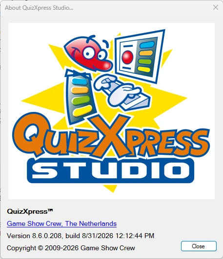
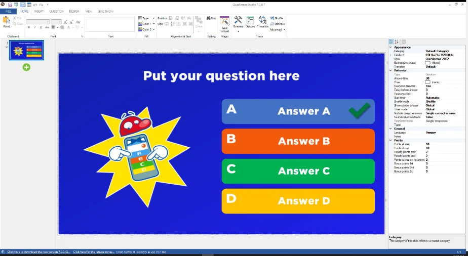
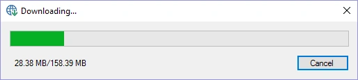

# Aggiornamenti e numerazione delle versioni

Per verificare la propria versione di QuizXpress, è possibile aprire la finestra Informazioni in QuizXpress Studio. Mostra informazioni sulla versione attualmente installata:

| { width="293" loading=lazy } | Un numero di versione di QuizXpress è composto da 4 cifre, ad esempio 8.5.0.4, formate da un numero principale (major), uno secondario (minor), uno di build e uno di revisione. Il numero principale cambia solo per aggiornamenti significativi; il numero secondario indica le diverse release all'interno della versione principale. Il numero di build e la revisione distinguono le patch (correzioni di bug). QuizXpress Studio cerca aggiornamenti online all'avvio. |
|-------------------------------------------------------------------------------|---------------------------------------------------------------------------------------------------------------------------------------------------------------------------------------------------------------------------------------------------------------------------------------------------------------------------------------------------------------------------------------------------|

Se sul nostro sito web è disponibile una versione più recente, si riceverà una notifica:

{ width="592" loading=lazy }

Per passare a una nuova versione, è sufficiente fare clic sul collegamento di download nella barra di stato di QuizXpress Studio per scaricare l'ultima versione:

> { width="279" loading=lazy }

Al termine del download, il programma di installazione si avvia. Non è necessario disinstallare la versione attualmente installata.

Durante l'aggiornamento, la chiave di licenza, le impostazioni speciali, i quiz e le altre personalizzazioni vengono mantenuti, poiché sono archiviati al di fuori della cartella di installazione di QuizXpress. Sarà sempre possibile aprire i vecchi quiz. Tuttavia, quando si condivide il proprio quiz con altri, assicurarsi che abbiano la stessa versione.

Le note di rilascio di QuizXpress si trovano nel file *ReleaseNotes.txt* nella cartella di installazione. È possibile aprire questo file da Studio tramite *FILE->Info->Release Notes* oppure dalla voce QuizXpress del menu Start di Windows.
