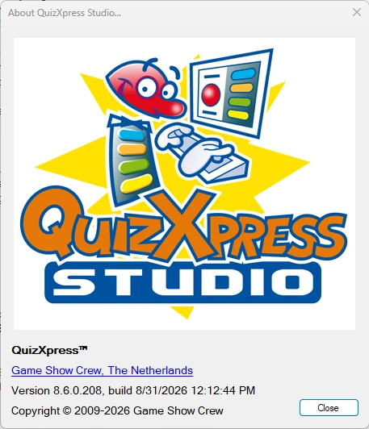
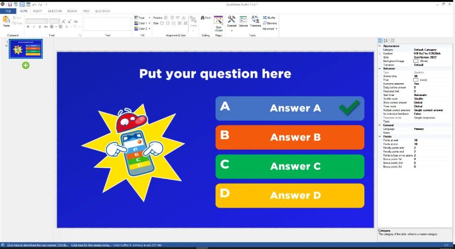
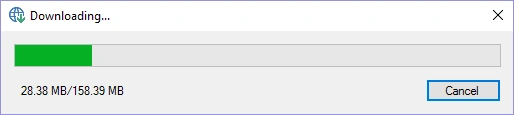

# Updates en versienummering

Om uw versie van QuizXpress te controleren, opent u het Info-venster in QuizXpress Studio. Dit toont informatie over uw momenteel geïnstalleerde versie:

| { width="293" loading=lazy } | Een QuizXpress-versienummer bestaat uit 4 cijfers, bijvoorbeeld 8.5.0.4, opgebouwd uit een hoofd-, een sub-, een build- en een revisienummer. Het hoofdnummer verandert alleen bij belangrijke updates; het subnummer geeft verschillende releases binnen de hoofdversie aan. Het buildnummer en de revisie onderscheiden patches (bugfixes). QuizXpress Studio controleert bij het opstarten online op updates. |
|-------------------------------------------------------------------------------|---------------------------------------------------------------------------------------------------------------------------------------------------------------------------------------------------------------------------------------------------------------------------------------------------------------------------------------------------------------------------------------------------|

Als er op onze website een nieuwere versie beschikbaar is, wordt u daarvan op de hoogte gesteld:

{ width="592" loading=lazy }

Om naar een nieuwe versie te upgraden, klikt u eenvoudig op de downloadlink in de statusbalk van QuizXpress Studio om de nieuwste versie te downloaden:

> { width="279" loading=lazy }

Na het downloaden start het installatieprogramma. U hoeft de momenteel geïnstalleerde versie niet eerst te verwijderen.

Bij het upgraden blijven uw licentiesleutel, speciale instellingen, quizzen en andere aanpassingen behouden, omdat ze buiten de installatiemap van QuizXpress worden bewaard. U kunt uw oude quizzen altijd openen. Wanneer u uw quiz met anderen deelt, zorg er dan wel voor dat zij dezelfde versie hebben.

De release notes van QuizXpress vindt u in het bestand *ReleaseNotes.txt* in de installatiemap. U kunt dit bestand openen vanuit Studio via *BESTAND->Info->Release Notes* of via het item QuizXpress in het Windows Start-menu.
