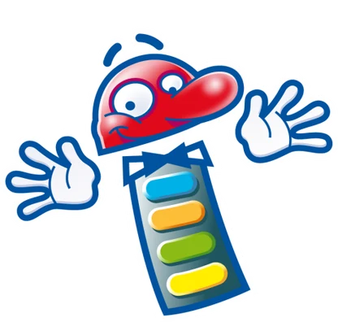

# Contrato de licencia de software

**1. DEFINICIONES**

El Contrato de licencia de software para el usuario final de QuizXpress ("EULA") es un acuerdo legal entre usted (ya sea como usuario individual, empresa o entidad única) y Game Show Crew, Países Bajos, para un producto que incluye software informático y que puede incluir medios asociados, materiales impresos y documentación en línea o electrónica ("PRODUCTO DE SOFTWARE" o "SOFTWARE"). Al ejercer sus derechos de instalar el PRODUCTO DE SOFTWARE, usted acepta quedar vinculado por los términos de este EULA, incluidas las limitaciones y las exenciones de garantía.

Si NO está de acuerdo con los términos de este EULA, devuelva el PRODUCTO DE SOFTWARE y destruya inmediatamente todas las copias del PRODUCTO DE SOFTWARE que obren en su poder.

**2. LICENCIA DEL PRODUCTO DE SOFTWARE**

El PRODUCTO DE SOFTWARE está protegido por las leyes de derechos de autor y los tratados internacionales de derechos de autor, así como por otras leyes y tratados de propiedad intelectual.

**2.1 CONCESIÓN DE LICENCIA**

Este es un contrato de licencia, y NO un contrato de venta. Game Show Crew conserva la propiedad de la copia del SOFTWARE que obra en su poder y de todas las copias que se le autorice a realizar. Game Show Crew se reserva todos los derechos que no se le concedan expresamente en esta LICENCIA. Por la presente, Game Show Crew le concede, y usted acepta, una licencia no exclusiva e intransferible para utilizar, copiar y modificar EL SOFTWARE únicamente según se autoriza a continuación.

Siempre que haya aceptado los términos aquí contenidos, este EULA le concede los siguientes derechos:

A\) Licencia estándar: Se le concede una licencia intransferible para instalar el PRODUCTO DE SOFTWARE en un único ordenador.

B\) Licencia múltiple: Se le concede una licencia intransferible para instalar el PRODUCTO DE SOFTWARE en varios ordenadores.

C\) Todas las licencias: Independientemente del tipo de licencia adquirida, si el PRODUCTO DE SOFTWARE incluye software reutilizable como controles, componentes, complementos, hojas de estilo, etc., no podrá utilizar ninguno de ellos de forma independiente del PRODUCTO DE SOFTWARE.

D\) Licencia Home: La edición QuizXpress Home solo puede utilizarse para uso doméstico personal no comercial.

E\) Licencia comercial: Tiene derecho a explotar el software comercialmente alquilándolo u organizando eventos de concursos.

En ningún caso podrá alquilar, arrendar, prestar, redistribuir ni volver a licenciar EL PRODUCTO DE SOFTWARE o el código fuente a un tercero, ya sea persona o entidad, salvo lo indicado anteriormente. En ningún caso podrá conceder derechos de redistribución adicionales del PRODUCTO DE SOFTWARE a los usuarios finales de su solución.

**2.2 RESCISIÓN**

Sin perjuicio de cualesquiera otros derechos, Game Show Crew podrá rescindir este EULA si usted incumple los términos y condiciones del mismo. En tal caso, deberá destruir todas las copias del PRODUCTO DE SOFTWARE y de todos sus componentes, el código fuente, la documentación asociada y los materiales relacionados.

Game Show Crew podrá además suspender o deshabilitar el acceso a funciones específicas del PRODUCTO DE SOFTWARE si dichas funciones se utilizan de una manera que infrinja este EULA, la legislación aplicable o los términos de licencia de terceros.

**3. DERECHOS DE AUTOR**

Todos los títulos y derechos de autor del PRODUCTO DE SOFTWARE (excluido el Contenido del usuario aportado por el usuario) (incluidos, entre otros, las imágenes, fotografías, animaciones, vídeo, audio, música, texto y "applets" incorporados al PRODUCTO DE SOFTWARE), de los materiales impresos que lo acompañan y de cualquier copia del PRODUCTO DE SOFTWARE son propiedad de Game Show Crew, salvo ciertas partes para las que Game Show Crew ha obtenido derechos de redistribución. El PRODUCTO DE SOFTWARE está protegido por las leyes europeas de derechos de autor y por las disposiciones de los tratados internacionales.

QuizXpress es una marca protegida, registrada con el número de marca 013678537.

**3A. CONTENIDO APORTADO POR EL USUARIO Y RESPONSABILIDAD SOBRE LOS DERECHOS DE AUTOR**

El PRODUCTO DE SOFTWARE permite a los usuarios importar, referenciar, enlazar o reproducir audio, vídeo, imágenes y otros medios (“Contenido del usuario”).

Todo el Contenido del usuario es aportado, seleccionado y controlado exclusivamente por el usuario. Game Show Crew no proporciona, licencia, selecciona, verifica ni controla ningún Contenido del usuario utilizado con el PRODUCTO DE SOFTWARE.

Usted reconoce y acepta que es el único responsable de asegurarse de haber obtenido todos los derechos, licencias, permisos y consentimientos necesarios para utilizar, reproducir, almacenar, interpretar, mostrar o explotar de cualquier otro modo cualquier Contenido del usuario en relación con el PRODUCTO DE SOFTWARE, incluidos, entre otros, los derechos de autor y los derechos de comunicación pública.

Game Show Crew no concede ningún derecho sobre obras protegidas por derechos de autor de terceros y no declara que el uso del PRODUCTO DE SOFTWARE con Contenido del usuario cumpla la legislación de derechos de autor o los términos de licencia aplicables.

La disponibilidad de funciones para importar, referenciar o reproducir medios no constituye fomento, respaldo ni autorización de ninguna fuente o uso concreto de contenido protegido por derechos de autor.

**3B. COMUNICACIÓN PÚBLICA Y USO COMERCIAL**

Usted reconoce que el uso de contenido de audio o vídeo en eventos de quiz públicos, semipúblicos o comerciales puede requerir licencias adicionales, incluidas licencias de comunicación pública, de los titulares de derechos o de las sociedades de gestión colectiva.

Obtener y mantener dichas licencias es responsabilidad exclusiva suya. Game Show Crew no proporciona derechos de comunicación pública y no asume ninguna responsabilidad por la comunicación pública no autorizada de obras protegidas por derechos de autor.

**3C. SIN OBLIGACIÓN DE SUPERVISIÓN**

Game Show Crew no tiene ninguna obligación de supervisar, revisar ni vigilar el Contenido del usuario utilizado con el PRODUCTO DE SOFTWARE y no asume ninguna responsabilidad de determinar si el Contenido del usuario cumple las leyes aplicables o los términos de licencia de terceros.

**3D. SERVICIOS Y CONTENIDO DE TERCEROS**

El PRODUCTO DE SOFTWARE puede permitir la interacción con contenido o servicios proporcionados por terceros, el enlace a ellos o su referencia, incluidas, entre otras, las plataformas de música en streaming.

Game Show Crew no está afiliada a ningún servicio de terceros, ni cuenta con su respaldo, ni actúa en su nombre, salvo que se indique explícitamente lo contrario. Cualquier uso de servicios de terceros se rige exclusivamente por los términos, condiciones y licencias de dichos terceros.

Usted reconoce que Game Show Crew no es responsable de la disponibilidad, legalidad, licencias o uso permitido del contenido o de los servicios de terceros a los que se acceda o que se referencien a través del PRODUCTO DE SOFTWARE.

**4. GARANTÍA LIMITADA**

SIN GARANTÍAS. Game Show Crew rechaza expresamente cualquier garantía para el PRODUCTO DE SOFTWARE. El PRODUCTO DE SOFTWARE y cualquier documentación relacionada se proporcionan "tal cual", sin garantía de ningún tipo, ya sea expresa o implícita, incluidas, entre otras, las garantías implícitas de comerciabilidad, idoneidad para un fin determinado o no infracción. Todo el riesgo derivado del uso o del rendimiento del PRODUCTO DE SOFTWARE corre por su cuenta.

**5. LIMITACIÓN DE RESPONSABILIDAD**

SIN RESPONSABILIDAD POR DAÑOS CONSECUENTES. En ningún caso Game Show Crew ni sus distribuidores serán responsables de daño alguno (incluidos, entre otros, los daños por pérdida de beneficios empresariales, interrupción de la actividad, pérdida de información empresarial o cualquier otra pérdida económica) derivado del uso o de la imposibilidad de utilizar este producto QuizXpress y los materiales relacionados, incluso si Game Show Crew ha sido advertida de la posibilidad de tales daños.

**6. PRIVACIDAD Y RECOPILACIÓN DE DATOS**

Para mejorar la calidad, la estabilidad y el rendimiento del software QuizXpress, pueden recopilarse ciertos datos de uso y diagnóstico. Esto incluye informes de errores y fallos anonimizados que se envían automáticamente a un servicio de terceros, Sentry (https://sentry.io/).

Los datos recopilados pueden incluir:  
- Información sobre la versión del software  
- Detalles del sistema operativo  
- Acciones anonimizadas del usuario que condujeron a un fallo  
- Trazas de pila y registros de diagnóstico

Esta información se utiliza exclusivamente con fines de depuración, mejora del producto y soporte técnico. No recopilamos ninguna información de identificación personal (PII) salvo que el usuario la proporcione explícitamente (por ejemplo, en una incidencia de soporte).

Al utilizar el PRODUCTO DE SOFTWARE, usted consiente que estos datos se recopilen y traten para los fines descritos anteriormente.

**7. LEY APLICABLE Y JURISDICCIÓN**

Este acuerdo se regirá e interpretará de conformidad con las leyes de los Países Bajos. Usted acepta someterse a la jurisdicción exclusiva de los tribunales situados en los Países Bajos para resolver cualquier asunto jurídico derivado de los términos de este acuerdo.

**8. DIVISIBILIDAD**

Si alguna disposición de este EULA se considera inaplicable, las disposiciones restantes seguirán en pleno vigor y efecto.

**9. CONTACTO**

Si tiene alguna pregunta sobre este Contrato de licencia para el usuario final, envíe un correo electrónico a: info@gameshowcrew.com

{ width="208" loading=lazy }
