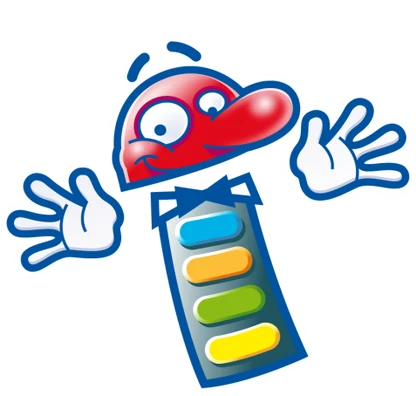

# Softwarelicentieovereenkomst

**1. DEFINITIES**

De QuizXpress End-User Software License Agreement ("EULA") is een juridische overeenkomst tussen u (als individuele gebruiker, bedrijf of afzonderlijke entiteit) en Game Show Crew, Nederland, voor een product dat computersoftware omvat en bijbehorende media, gedrukte materialen en online of elektronische documentatie kan omvatten ("SOFTWAREPRODUCT" of "SOFTWARE"). Door uw rechten uit te oefenen om het SOFTWAREPRODUCT te installeren, gaat u ermee akkoord gebonden te zijn aan de voorwaarden van deze EULA, inclusief de beperkingen en garantiedisclaimers.

Als u NIET akkoord gaat met de voorwaarden van deze EULA, retourneer dan het SOFTWAREPRODUCT en vernietig onmiddellijk alle exemplaren van het SOFTWAREPRODUCT die u in uw bezit hebt.

**2. LICENTIE VOOR HET SOFTWAREPRODUCT**

Het SOFTWAREPRODUCT wordt beschermd door auteursrechtwetten en internationale auteursrechtverdragen, evenals andere wetten en verdragen op het gebied van intellectueel eigendom.

**2.1 VERLENING VAN LICENTIE**

Dit is een licentieovereenkomst en GEEN koopovereenkomst. Game Show Crew blijft eigenaar van het exemplaar van DE SOFTWARE dat u in bezit hebt en van alle exemplaren die u mogelijk mag maken. Game Show Crew behoudt alle rechten die u in deze LICENTIE niet uitdrukkelijk zijn verleend. Game Show Crew verleent u hierbij, en u aanvaardt, een niet-exclusieve, niet-overdraagbare licentie om DE SOFTWARE te gebruiken, te kopiëren en te wijzigen, uitsluitend zoals hieronder is toegestaan.

Op voorwaarde dat u de hierin opgenomen voorwaarden hebt aanvaard, verleent deze EULA u de volgende rechten:

A\) Standaardlicentie: u krijgt een niet-overdraagbare licentie om het SOFTWAREPRODUCT op één computer te installeren.

B\) Meervoudige licentie: u krijgt een niet-overdraagbare licentie om het SOFTWAREPRODUCT op meerdere computers te installeren.

C\) Alle licenties: ongeacht het type licentie dat is gekocht, mag u, indien het SOFTWAREPRODUCT herbruikbare software bevat zoals besturingselementen, componenten, plug-ins, stijlbladen, enzovoort, geen van deze onderdelen los van het SOFTWAREPRODUCT gebruiken.

D\) Homelicentie: de QuizXpress Home-editie mag uitsluitend worden gebruikt voor persoonlijk, niet-commercieel gebruik thuis.

E\) Commerciële licentie: u mag de software commercieel exploiteren door deze te verhuren of quizshowevenementen te organiseren.

In geen geval mag u het SOFTWAREPRODUCT of de broncode verhuren, leasen, uitlenen, herdistribueren of opnieuw in licentie geven aan een derde persoon of entiteit, behalve zoals hierboven beschreven. In geen geval mag u de eindgebruikers van uw oplossing verdere distributierechten voor het SOFTWAREPRODUCT verlenen.

**2.2 BEËINDIGING**

Onverminderd andere rechten kan Game Show Crew deze EULA beëindigen als u de voorwaarden van deze EULA niet naleeft. In dat geval moet u alle exemplaren van het SOFTWAREPRODUCT en al zijn onderdelen, broncode, bijbehorende documentatie en gerelateerde materialen vernietigen.

Game Show Crew kan bovendien de toegang tot bepaalde functies van het SOFTWAREPRODUCT opschorten of uitschakelen als die functies worden gebruikt op een manier die in strijd is met deze EULA, de toepasselijke wetgeving of de licentievoorwaarden van derden.

**3. AUTEURSRECHT**

Alle rechten van eigendom en auteursrechten op het SOFTWAREPRODUCT (met uitzondering van de door de gebruiker aangeleverde Gebruikersinhoud) (inclusief maar niet beperkt tot alle afbeeldingen, foto's, animaties, video, audio, muziek, tekst en "applets" die in het SOFTWAREPRODUCT zijn opgenomen), de bijbehorende gedrukte materialen en alle exemplaren van het SOFTWAREPRODUCT zijn eigendom van Game Show Crew, behalve voor bepaalde onderdelen waarvoor Game Show Crew distributierechten heeft verkregen. Het SOFTWAREPRODUCT wordt beschermd door Europese auteursrechtwetten en bepalingen van internationale verdragen.

QuizXpress is een beschermd handelsmerk, geregistreerd onder merknummer 013678537.

**3A. DOOR DE GEBRUIKER AANGELEVERDE INHOUD EN VERANTWOORDELIJKHEID VOOR AUTEURSRECHT**

Het SOFTWAREPRODUCT stelt gebruikers in staat audio, video, afbeeldingen en andere media ("Gebruikersinhoud") te importeren, ernaar te verwijzen, ernaar te linken of ze af te spelen.

Alle Gebruikersinhoud wordt uitsluitend door de gebruiker aangeleverd, gekozen en beheerd. Game Show Crew levert, licentieert, kiest, controleert of beheert geen Gebruikersinhoud die met het SOFTWAREPRODUCT wordt gebruikt.

U erkent en aanvaardt dat u als enige verantwoordelijk bent voor het verkrijgen van alle benodigde rechten, licenties, toestemmingen en instemmingen die vereist zijn om Gebruikersinhoud in verband met het SOFTWAREPRODUCT te gebruiken, te reproduceren, op te slaan, uit te voeren, weer te geven of anderszins te exploiteren, inclusief maar niet beperkt tot auteursrechten en rechten voor openbare uitvoering.

Game Show Crew verleent geen rechten op auteursrechtelijk beschermde werken van derden en geeft geen garantie dat het gebruik van het SOFTWAREPRODUCT met Gebruikersinhoud voldoet aan het toepasselijke auteursrecht of de licentievoorwaarden.

De beschikbaarheid van functies voor het importeren van, verwijzen naar of afspelen van media vormt geen aanmoediging, goedkeuring of autorisatie van een bepaalde bron of een bepaald gebruik van auteursrechtelijk beschermde inhoud.

**3B. OPENBARE UITVOERING EN COMMERCIEEL GEBRUIK**

U erkent dat het gebruik van audio- of videoinhoud bij openbare, semi-openbare of commerciële quizevenementen aanvullende licenties kan vereisen, waaronder licenties voor openbare uitvoering, van rechthebbenden of collectieve beheersorganisaties.

Het verkrijgen en onderhouden van dergelijke licenties is uitsluitend uw verantwoordelijkheid. Game Show Crew verleent geen rechten voor openbare uitvoering en aanvaardt geen aansprakelijkheid voor ongeoorloofde openbare uitvoering van auteursrechtelijk beschermde werken.

**3C. GEEN VERPLICHTING TOT TOEZICHT**

Game Show Crew is niet verplicht toezicht te houden op Gebruikersinhoud die met het SOFTWAREPRODUCT wordt gebruikt, deze te beoordelen of te controleren, en aanvaardt geen verantwoordelijkheid voor het vaststellen of Gebruikersinhoud voldoet aan de toepasselijke wetgeving of de licentievoorwaarden van derden.

**3D. DIENSTEN EN INHOUD VAN DERDEN**

Het SOFTWAREPRODUCT kan interactie toestaan met, linken naar of verwijzen naar inhoud of diensten die door derden worden aangeboden, waaronder maar niet beperkt tot muziekstreamingplatforms.

Game Show Crew is niet gelieerd aan, wordt niet onderschreven door en treedt niet op namens enige dienst van derden, tenzij uitdrukkelijk anders vermeld. Elk gebruik van diensten van derden wordt uitsluitend beheerst door de voorwaarden en licenties van die derden.

U erkent dat Game Show Crew niet verantwoordelijk is voor de beschikbaarheid, rechtmatigheid, licentiëring of toegestane gebruiksmogelijkheden van inhoud of diensten van derden waartoe via het SOFTWAREPRODUCT toegang wordt verkregen of waarnaar daarin wordt verwezen.

**4. BEPERKTE GARANTIE**

GEEN GARANTIES. Game Show Crew wijst uitdrukkelijk elke garantie voor het SOFTWAREPRODUCT af. Het SOFTWAREPRODUCT en alle gerelateerde documentatie worden geleverd "in de huidige staat" zonder enige garantie, noch uitdrukkelijk noch stilzwijgend, met inbegrip van, maar niet beperkt tot, de stilzwijgende garanties van verkoopbaarheid, geschiktheid voor een bepaald doel of het niet-inbreukmaken op rechten van derden. Het volledige risico dat voortvloeit uit het gebruik of de prestaties van het SOFTWAREPRODUCT blijft bij u.

**5. BEPERKING VAN AANSPRAKELIJKHEID**

GEEN AANSPRAKELIJKHEID VOOR GEVOLGSCHADE. In geen geval zijn Game Show Crew of zijn distributeurs aansprakelijk voor enige schade (met inbegrip van, maar niet beperkt tot, schade door gederfde bedrijfswinst, bedrijfsonderbreking, verlies van bedrijfsinformatie of enig ander financieel verlies) voortvloeiend uit het gebruik van of het onvermogen om dit QuizXpress-product en gerelateerde materialen te gebruiken, zelfs als Game Show Crew op de hoogte is gesteld van de mogelijkheid van dergelijke schade.

**6. PRIVACY EN GEGEVENSVERZAMELING**

Om de kwaliteit, stabiliteit en prestaties van de QuizXpress-software te verbeteren, kunnen bepaalde gebruiks- en diagnosegegevens worden verzameld. Dit omvat geanonimiseerde fout- en crashrapporten die automatisch worden verzonden naar een externe dienst, Sentry (https://sentry.io/).

De verzamelde gegevens kunnen het volgende omvatten:  
- Informatie over de softwareversie  
- Details over het besturingssysteem  
- Geanonimiseerde gebruikersacties die tot een crash leiden  
- Stacktraces en diagnostische logbestanden

Deze informatie wordt uitsluitend gebruikt voor het opsporen van fouten, productverbetering en technische ondersteuning. Wij verzamelen geen persoonlijk identificeerbare informatie (PII), tenzij die uitdrukkelijk door de gebruiker wordt verstrekt (bijvoorbeeld in een supportticket).

Door het SOFTWAREPRODUCT te gebruiken, gaat u ermee akkoord dat deze gegevens worden verzameld en verwerkt voor de hierboven beschreven doeleinden.

**7. TOEPASSELIJK RECHT EN BEVOEGDE RECHTER**

Op deze overeenkomst is het recht van Nederland van toepassing en zij wordt overeenkomstig dat recht uitgelegd. U stemt ermee in u te onderwerpen aan de exclusieve bevoegdheid van de rechtbanken in Nederland voor het beslechten van elke juridische kwestie die voortvloeit uit de voorwaarden van deze overeenkomst.

**8. SCHEIDBAARHEID**

Als een bepaling van deze EULA niet afdwingbaar blijkt te zijn, blijven de overige bepalingen onverminderd van kracht.

**9. CONTACT**

Als u vragen hebt over deze End User License Agreement, stuur dan een e-mail naar: info@gameshowcrew.com

{ width="208" loading=lazy }
