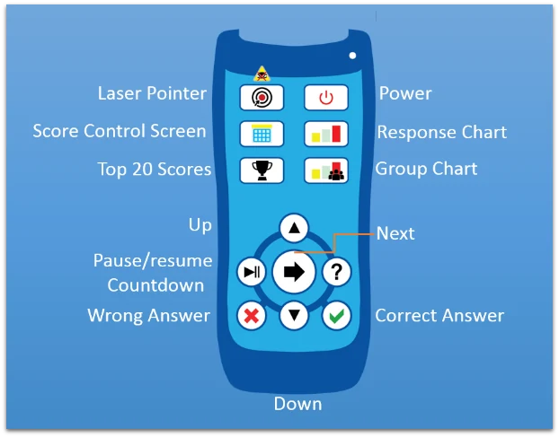
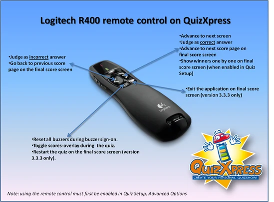
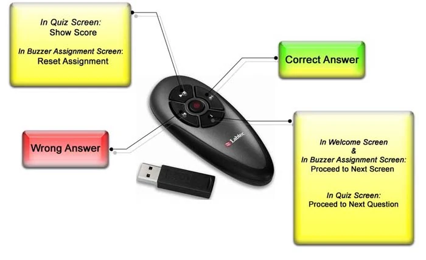
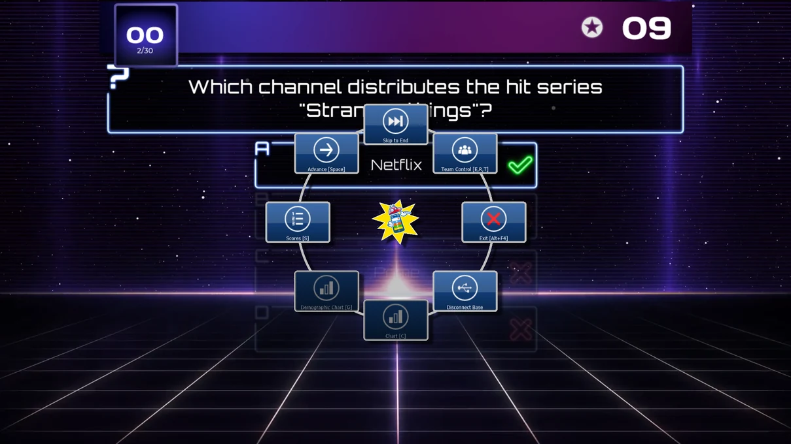

# Control del quiz

En las distintas fases de un quiz, el presentador del quiz tiene que realizar (o puede optar por realizar) diversas acciones, por ejemplo:

- Mostrar un gráfico

- Mostrar un resumen de puntuaciones o desplazarse por las puntuaciones

- Pasar a la siguiente pregunta

- Juzgar las respuestas dadas (correcta/incorrecta)

Estas instrucciones se pueden dar a QuizXpress Live de varias maneras: con el teclado o con un mando a distancia inalámbrico, como un presentador inalámbrico de PowerPoint o el mando del presentador de QuizXpress.

Como función de aprendizaje, pueden mostrarse sugerencias para el presentador del quiz después de cada pregunta, que se configuran en Quiz Setup. Puede obtener más información sobre las sugerencias para el presentador del quiz en [Menú de ayuda del presentador del quiz](#menu-de-ayuda-del-presentador-del-quiz).

## Uso del teclado

QuizXpress Live se puede manejar con el teclado. Están disponibles los siguientes comandos de teclado:

<table>
<colgroup>
<col style="width: 52%" />
<col style="width: 47%" />
</colgroup>
<thead>
<tr class="header">
<th>Función</th>
<th>Tecla</th>
</tr>
</thead>
<tbody>
<tr class="odd">
<td>Siguiente pregunta/pantalla</td>
<td>Space</td>
</tr>
<tr class="even">
<td>
Pantalla de asignación de pulsadores: registro automático de pulsadores para todos los pulsadores; solo pulsadores Reply/QuizXpress.

En la pantalla del quiz, F1 muestra el menú de ayuda del presentador del quiz (solo cuando la cuenta atrás está inactiva).
</td>
<td>F1</td>
</tr>
<tr class="odd">
<td>Pantalla de asignación de pulsadores: registro automático de pulsadores para todos los pulsadores definidos en la cadena de mandos de Quiz Setup; solo pulsadores Reply/QuizXpress</td>
<td>F2</td>
</tr>
<tr class="even">
<td>Pantalla de asignación de pulsadores: restablecer; solo pulsadores Sony</td>
<td>Escape</td>
</tr>
<tr class="odd">
<td>Juzgar la respuesta dada a una pregunta abierta: correcta</td>
<td>Y/J</td>
</tr>
<tr class="even">
<td>Juzgar la respuesta dada a una pregunta abierta: incorrecta</td>
<td>N</td>
</tr>
<tr class="odd">
<td>Mostrar la clasificación</td>
<td>S o Shift+S (para invertir el orden de la clasificación); utilice las teclas de flecha o PageUp/PageDown para desplazarse</td>
</tr>
<tr class="even">
<td>Mostrar las puntuaciones de la ronda</td>
<td>Ctrl-S o Shift-Ctrl-S (para invertir el orden); utilice las teclas de flecha o PageUp/PageDown para desplazarse</td>
</tr>
<tr class="odd">
<td>Mostrar los ganadores de la ronda</td>
<td>Ctrl-E</td>
</tr>
<tr class="even">
<td>Mostrar el gráfico de respuestas</td>
<td>C (pulse de nuevo para cerrar el gráfico)</td>
</tr>
<tr class="odd">
<td>Mostrar el gráfico de puntuación por grupo demográfico</td>
<td>G (pulse de nuevo para cerrar el gráfico)</td>
</tr>
<tr class="even">
<td>Mostrar la cuadrícula de aciertos/errores para preguntas de opción múltiple en las que responden todos</td>
<td>A o F6</td>
</tr>
<tr class="odd">
<td>Seleccionar el participante que se va a eliminar en la pantalla de fin de ronda</td>
<td>Teclas de flecha arriba/abajo</td>
</tr>
<tr class="even">
<td>Confirmar el participante que se va a eliminar en la pantalla de fin de ronda</td>
<td>Space</td>
</tr>
<tr class="odd">
<td>Cancelar la eliminación de un participante en la pantalla de fin de ronda (no se eliminará a nadie)</td>
<td>Escape</td>
</tr>
<tr class="even">
<td>Cerrar QuizXpress Live (atención: ¡no se pedirá confirmación!)</td>
<td>Alt – F4</td>
</tr>
<tr class="odd">
<td>Pausar la cuenta atrás</td>
<td>P (en pausa, puede omitir la pregunta pasando a la siguiente con la barra espaciadora)</td>
</tr>
<tr class="even">
<td>Mostrar las pantallas de control de puntuación</td>
<td>E o F7, R o F8, T, W (‘Escape’ para cancelar los cambios, ‘Enter’ para confirmarlos); utilice ‘+’ y ‘-‘ para aumentar/disminuir la puntuación del equipo seleccionado. Pulse la tecla ‘Control’ junto con la tecla ‘+’ o ‘-‘ para aumentar/disminuir 10 puntos, o ‘Alt’ para aumentar/disminuir 100 puntos. Pulse la pantalla de pausa cuando haya un equipo seleccionado para eliminarlo de la partida.</td>
</tr>
<tr class="odd">
<td>Alternar entre modo exclusivo de pantalla completa y modo ventana</td>
<td>F</td>
</tr>
<tr class="even">
<td>Alternar entre maximizado/normal en modo ventana</td>
<td>M</td>
</tr>
<tr class="odd">
<td>Restablecer y reconectar el sistema de pulsadores. Utilice esta función si ha desenchufado accidentalmente el sistema de pulsadores o en caso de un fallo general del hardware</td>
<td>F12</td>
</tr>
</tbody>
</table>

## Uso del teléfono móvil o la tableta

Si dispone de una licencia para utilizar las aplicaciones móviles con QuizXpress, puede usar la aplicación Mobile Director para controlar el quiz desde su smartphone o tableta. Consulte [Aplicación de control remoto – Mobile Director](using-mobile-keypads/using-the-mobile-apps.md#aplicacion-de-control-remoto-mobile-director) para obtener más información.

## Uso del mando a distancia

El sistema de hardware de QuizXpress incluye un mando inalámbrico especial para el presentador del quiz, que le permite emitir los comandos más importantes.

La siguiente imagen muestra los comandos disponibles en el mando a distancia de QuizXpress:

{ width="397" loading=lazy }

*Tenga en cuenta que el alcance del mando a distancia es distinto del de los mandos de los participantes y se limita a unos 10 metros.*

Como alternativa, si no utiliza el hardware de QuizXpress sino, por ejemplo, los pulsadores de Sony, también puede utilizar un presentador genérico de PowerPoint —como un presentador inalámbrico para portátil Labtec® de 2,4 GHz, un Logitech R400 o un dispositivo similar— con las siguientes funciones:

| { loading=lazy } | { width="328" loading=lazy } |
|------------------------------------------------------------------------------------------------------------------------------------------|---------------------------------------------------------------------------------|

## Menú de ayuda del presentador del quiz

Al dirigir un quiz en QuizXpress Live, hay múltiples comandos disponibles en las distintas fases: mostrar gráficos, pasar a la siguiente diapositiva, mostrar resúmenes de puntuaciones o juzgar preguntas. Como se ha visto en las secciones anteriores, todos estos comandos tienen teclas de acceso directo en el teclado, y algunos también se pueden manejar con un mando a distancia del presentador.

Para guiar a los usuarios principiantes, se pueden mostrar sugerencias para el presentador del quiz durante el quiz, con todos los comandos disponibles a medida que son aplicables. Cuando el presentador del quiz ya domine el sistema, puede desactivar este ajuste para que el público deje de ver las sugerencias.

De forma predeterminada, las sugerencias para el presentador del quiz están activadas (‘on’) en la pestaña ‘Advanced’ de la aplicación Quiz Setup.

A continuación se muestran dos ejemplos de sugerencias para el presentador del quiz tal como aparecen en QuizXpress Live durante un quiz.

{ loading=lazy }

En la pantalla de sugerencias para el presentador del quiz anterior, que se muestra, por ejemplo, cuando ha terminado una pregunta, vemos los siguientes botones con los distintos comandos y sus ‘teclas de acceso directo’ opcionales:

- **Advance \[Space\]**: pasa a la siguiente diapositiva

- **Skip to End:** pasa al final del quiz (la pantalla de puntuación final)

- **Team Control \[E, R, T\]: muestra los resúmenes de puntuación de los equipos. En estos resúmenes se pueden modificar los puntos de los equipos y eliminar equipos.**

- **Exit \[Alt-F4\]: sale de QuizXpress Live**

- **Disconnect/Reconnect Base: desconecta/reconecta la estación base inalámbrica (receptor)**

- **Chart \[C\]: muestra un gráfico de todas las respuestas dadas (desactivado aquí, ya que la pregunta era de dedo más rápido)**

- **Demographic Chart \[G\]: muestra los porcentajes de respuesta de todos los grupos (solo aplicable si hay grupos demográficos)**

- **Scores \[S\]: muestra la pantalla de puntuación intermedia (los 20 primeros)**

!!! note

    Cuando QuizXpress está ‘inactivo’ (en pausa, al final de una pregunta o esperando la cuenta atrás), el menú de sugerencias para el presentador del quiz siempre se puede mostrar pulsando ‘F1’.
