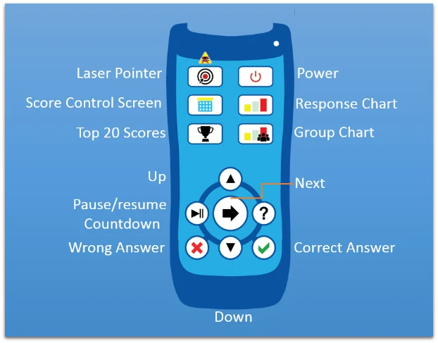
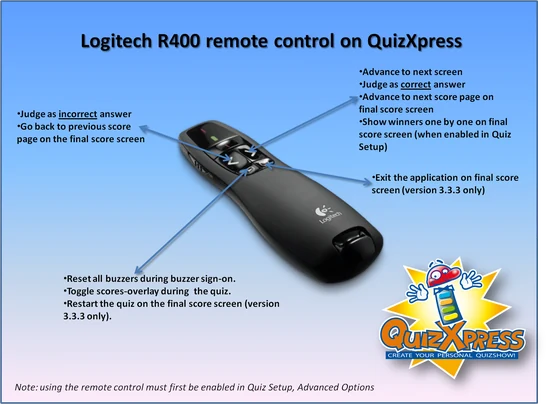
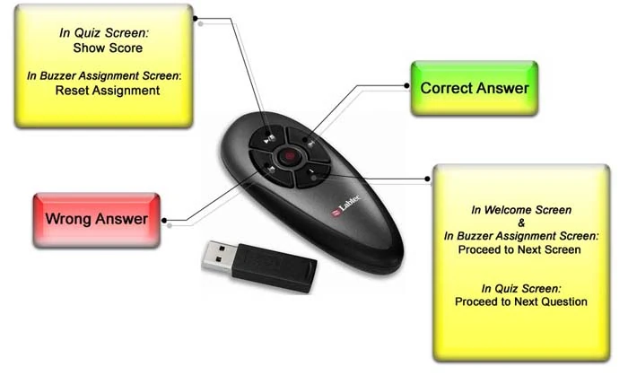
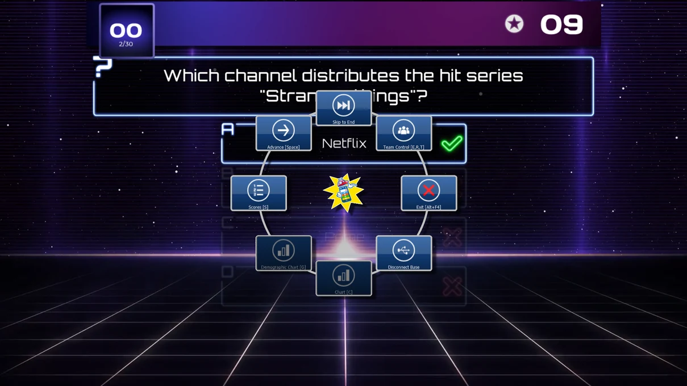

# De quiz bedienen

In verschillende fasen van een quiz moet de quizmaster verschillende acties uitvoeren (of kan hij ervoor kiezen die uit te voeren), bijvoorbeeld:

- Een grafiek tonen

- Een scoreoverzicht tonen/door de scores scrollen

- Doorgaan naar de volgende vraag

- Gegeven antwoorden beoordelen (juist/onjuist)

Deze opdrachten kunt u op een paar manieren aan QuizXpress Live geven: met het toetsenbord, of met een draadloze afstandsbediening zoals een draadloze PowerPoint-presenter of de QuizXpress-quizmasterafstandsbediening.

Als leerhulp kunnen na elke vraag quizmasterhints worden getoond, die u instelt in Quiz Setup. Meer over quizmasterhints leest u in [Quizmaster-hulpmenu](#quizmaster-hulpmenu).

## Het toetsenbord gebruiken

QuizXpress Live kan met het toetsenbord worden bediend. De volgende toetsenbordopdrachten zijn beschikbaar:

<table>
<colgroup>
<col style="width: 52%" />
<col style="width: 47%" />
</colgroup>
<thead>
<tr class="header">
<th>Functie</th>
<th>Toets</th>
</tr>
</thead>
<tbody>
<tr class="odd">
<td>Volgende vraag/volgend scherm</td>
<td>Spatie</td>
</tr>
<tr class="even">
<td>
Buzzer-toewijzingsscherm: automatisch aanmelden van alle buzzers; alleen Reply/QuizXpress-buzzers.

In het quizscherm toont F1 het quizmaster-hulpmenu (alleen wanneer het aftellen niet actief is).
</td>
<td>F1</td>
</tr>
<tr class="odd">
<td>Buzzer-toewijzingsscherm: automatisch aanmelden van alle buzzers die in de keypadreeks in Quiz Setup zijn gedefinieerd; alleen Reply/QuizXpress-buzzers</td>
<td>F2</td>
</tr>
<tr class="even">
<td>Buzzer-toewijzingsscherm: resetten; alleen Sony-buzzers</td>
<td>Escape</td>
</tr>
<tr class="odd">
<td>Gegeven antwoord op een open vraag beoordelen: juist</td>
<td>Y/J</td>
</tr>
<tr class="even">
<td>Gegeven antwoord op een open vraag beoordelen: onjuist</td>
<td>N</td>
</tr>
<tr class="odd">
<td>Ranglijst tonen</td>
<td>S of Shift+S (voor omgekeerde rangorde), gebruik de pijltjestoetsen of PageUp/PageDown om te scrollen</td>
</tr>
<tr class="even">
<td>Rondescores tonen</td>
<td>Ctrl-S of Shift-Ctrl-S (voor omgekeerde volgorde), gebruik de pijltjestoetsen of PageUp/PageDown om te scrollen</td>
</tr>
<tr class="odd">
<td>Rondewinnaars tonen</td>
<td>Ctrl-E</td>
</tr>
<tr class="even">
<td>Grafiek van de antwoorden tonen</td>
<td>C (nogmaals drukken om de grafiek te sluiten)</td>
</tr>
<tr class="odd">
<td>Scoregrafiek van de demografische groepen tonen</td>
<td>G (nogmaals drukken om de grafiek te sluiten)</td>
</tr>
<tr class="even">
<td>Het juist/onjuist-raster tonen voor meerkeuzevragen waarop iedereen antwoordt</td>
<td>A of F6</td>
</tr>
<tr class="odd">
<td>De deelnemer selecteren die in het scherm Einde ronde afvalt</td>
<td>Pijl omhoog/omlaag</td>
</tr>
<tr class="even">
<td>De deelnemer bevestigen die in het scherm Einde ronde afvalt</td>
<td>Spatie</td>
</tr>
<tr class="odd">
<td>Het afvallen van een deelnemer in het scherm Einde ronde annuleren (er valt niemand af)</td>
<td>Escape</td>
</tr>
<tr class="even">
<td>QuizXpress Live sluiten (let op: er wordt geen bevestiging gevraagd!)</td>
<td>Alt – F4</td>
</tr>
<tr class="odd">
<td>Het aftellen pauzeren</td>
<td>P (tijdens de pauze kunt u de vraag overslaan door met de spatiebalk naar de volgende vraag te gaan)</td>
</tr>
<tr class="even">
<td>Scorebeheerschermen tonen</td>
<td>E of F7, R of F8, T, W (‘Escape’ om wijzigingen te annuleren, ‘Enter’ om wijzigingen door te voeren) gebruik ‘+’ en ‘-‘ om de score van het geselecteerde team te verhogen/verlagen. Houd de ‘Control’-toets ingedrukt met de ‘+’- of ‘-‘-toets om met 10 punten te verhogen/verlagen, of ‘Alt’ om met 100 punten te verhogen/verlagen. Druk op het pauzescherm wanneer een team is geselecteerd om het team uit het spel te zetten.</td>
</tr>
<tr class="odd">
<td>Schakelen tussen exclusieve volledig-schermmodus en vensterweergave</td>
<td>F</td>
</tr>
<tr class="even">
<td>Schakelen tussen gemaximaliseerd/normaal in vensterweergave</td>
<td>M</td>
</tr>
<tr class="odd">
<td>Het buzzersysteem resetten en opnieuw verbinden. Gebruik deze functie nadat het buzzersysteem per ongeluk is losgekoppeld, of bij een algemene hardwarestoring</td>
<td>F12</td>
</tr>
</tbody>
</table>

## Uw mobiele telefoon of tablet gebruiken

Als u een licentie voor de mobiele apps van QuizXpress heeft, kunt u de Mobile Director-app gebruiken om de quiz te bedienen vanaf uw smartphone of tablet. Zie [Afstandsbedieningsapp – Mobile Director](using-mobile-keypads/using-the-mobile-apps.md#afstandsbedieningsapp-mobile-director) voor meer informatie.

## De afstandsbediening gebruiken

Het QuizXpress-hardwaresysteem bevat een speciale draadloze quizmasterafstandsbediening waarmee u de belangrijkste opdrachten kunt geven.

De volgende afbeelding toont de opdrachten die beschikbaar zijn op de QuizXpress-afstandsbediening:

{ width="397" loading=lazy }

*Houd er rekening mee dat het bereik van de afstandsbediening afwijkt van dat van de keypads en beperkt is tot ongeveer 10 meter.*

Als u geen QuizXpress-hardware gebruikt maar bijvoorbeeld de Sony-buzzers, kunt u ook een gewone PowerPoint-presenter gebruiken — zoals een Labtec® 2,4 GHz draadloze notebookpresenter, een Logitech R400 of een vergelijkbaar apparaat — met de volgende functies:

| { loading=lazy } | { width="328" loading=lazy } |
|------------------------------------------------------------------------------------------------------------------------------------------|---------------------------------------------------------------------------------|

## Quizmaster-hulpmenu

Tijdens een quizshow in QuizXpress Live zijn in verschillende fasen meerdere opdrachten beschikbaar — denk aan het tonen van grafieken, doorgaan naar de volgende dia, het tonen van scoreoverzichten of het beoordelen van vragen. Zoals in de vorige paragrafen te zien was, hebben al deze opdrachten sneltoetsen op het toetsenbord, en sommige zijn ook te bedienen met een quizmasterafstandsbediening.

Om beginnende gebruikers te begeleiden, kunnen tijdens een quiz quizmasterhints worden getoond, waarin alle beschikbare opdrachten verschijnen zodra ze van toepassing zijn. Zodra de quizmaster het systeem vertrouwd vindt, kan hij deze instelling uitschakelen, zodat het publiek de hints niet meer ziet.

Standaard staan de quizmasterhints ‘aan’ op het tabblad ‘Geavanceerd’ van de toepassing Quiz Setup.

Hieronder ziet u twee voorbeelden van quizmasterhints zoals die tijdens een quiz in QuizXpress Live worden getoond.

{ loading=lazy }

In het scherm met quizmasterhints hierboven, dat bijvoorbeeld wordt getoond als een vraag is afgelopen, zien we de volgende knoppen met de verschillende opdrachten en hun optionele ‘sneltoetsen’:

- **Volgende \[Spatie\]**: ga naar de volgende dia

- **Naar einde:** ga naar het einde van de quiz (het eindscorescherm)

- **Teambeheer \[E, R, T\]: toon de teamscoreoverzichten. In deze overzichten kunnen teampunten worden aangepast en kunnen teams worden uitgesloten.**

- **Afsluiten \[Alt-F4\]: QuizXpress Live afsluiten**

- **Basis verbreken/opnieuw verbinden: het draadloze basisstation (de ontvanger) loskoppelen/opnieuw verbinden**

- **Grafiek \[C\]: een grafiek tonen van alle gegeven antwoorden (hier uitgeschakeld, omdat de vraag een snelste-drukkervraag was)**

- **Demografische grafiek \[G\]: antwoordpercentages tonen voor alle groepen (alleen van toepassing als er demografische groepen zijn)**

- **Scores \[S\]: het tussentijdse scorescherm tonen (top 20)**

!!! note

    Wanneer QuizXpress ‘idle’ is (gepauzeerd, einde van de vraag of wachtend op het aftellen), kunt u het menu met quizmasterhints altijd tonen door op ‘F1’ te drukken.
