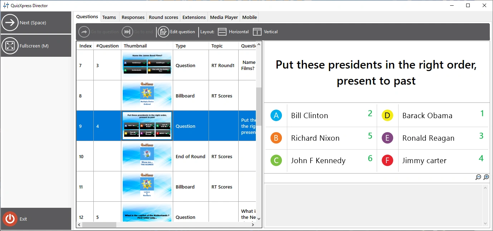

# QuizXpress Director

QuizXpress Director es una herramienta que le ofrece un control avanzado sobre el show del quiz en curso. Tiene una interfaz de usuario independiente que puede ejecutarse en su pantalla principal mientras el show del quiz se ejecuta en el proyector, el televisor o la pantalla LED conectados. Para ello debe configurar el escritorio de Windows en ‘modo extendido’ (en Windows 10, pulse la tecla Windows + P).

{ loading=lazy }

La interfaz de usuario de QuizXpress Director consta de un área de comandos (panel izquierdo), donde se enumeran todos los botones de comando disponibles en ese momento, y un conjunto de vistas con pestañas, cada una con una función distinta.

Las vistas disponibles en Director son:

| **Questions**    | Vista general del quiz cargado y controles para navegar entre diapositivas |
|------------------|---------------------------------------------------------------------------|
| **Teams**        | Vista general de todos los equipos/jugadores y sus puntuaciones |
| **Responses**    | Vista general de las respuestas en tiempo real |
| **Round scores** | Vista general de las puntuaciones y los ganadores por ronda *(solo visible si el archivo del quiz utiliza rondas)* |
| **Extensions**   | Lista de ‘plugins’ de QuizXpress instalados y controles para iniciar, detener y configurar estos plugins |
| **Media Player** | Una lista de archivos multimedia (sonido y vídeo) y controles para añadir, iniciar, detener o pausar un archivo multimedia (también puede reiniciar un vídeo o un sonido de la diapositiva actual, si los hay), además de una [mesa de sonido](the-media-player-tab.md#la-mesa-de-sonido) para reproducir archivos con un solo clic |
| **Mobile**       | Una lista de los dispositivos móviles conectados y diversos comandos para controlar las conexiones móviles |

Hay dos formas de abrir la ventana de Director:

1)  Marque la casilla *Enable QuizXpress Director* en la pestaña Advanced de Quiz Setup para abrir Director de forma predeterminada al iniciar.

2)  En cualquier momento durante el show del quiz, pulse la tecla ‘D’.

En configuraciones de varias pantallas, Director se abre en la pantalla opuesta a aquella en la que se ejecuta el show del quiz. Así, si el show del quiz se ejecuta en el proyector y ha extendido su escritorio en Windows, Director se abrirá en la pantalla de su portátil. También puede establecer explícitamente la pantalla de destino del show del quiz en Quiz Setup (sección ‘Screens’).

Siempre puede cerrar Director si ya no lo necesita y volver a él con la tecla ‘D’ en cualquier momento (atención: si ha iniciado un minijuego desde Director, primero debe finalizar ese juego o perderá el control sobre él).

También existe una aplicación para teléfono móvil llamada QuizXpress Director con (casi) la misma funcionalidad. Le permite controlar el quiz durante la ejecución de forma similar al Director de escritorio, pero le da la libertad de moverse e interactuar con su público con mayor soltura.
