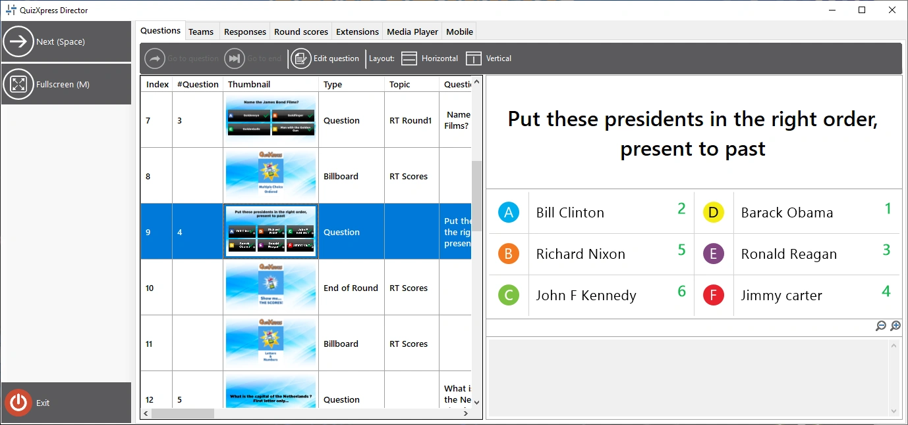

# QuizXpress Director

QuizXpress Director è uno strumento che offre un controllo avanzato dello show di quiz in corso. Dispone di un’interfaccia utente separata che può essere eseguita sullo schermo principale mentre lo show di quiz viene visualizzato sul proiettore, sul televisore o sullo schermo LED collegato. A tal fine è necessario impostare il desktop di Windows in modalità ‘Estendi’ (in Windows 10 e 11, premere il tasto Windows + P e scegliere ‘Estendi’).

{ loading=lazy }

L’interfaccia utente di QuizXpress Director è composta da un’area dei comandi (pannello a sinistra), in cui sono elencati tutti i pulsanti di comando attualmente disponibili, e da un insieme di viste a schede, ciascuna con una funzione distinta.

Le schede disponibili in Director sono:

| **Domande** | Panoramica del quiz caricato e controlli per spostarsi tra le diapositive |
|---|---|
| **Giocatori / Squadre** | Panoramica di tutti i giocatori o squadre e dei loro punteggi |
| **Punteggio Manuale** | Aggiunta o sottrazione rapida di punti a uno o più giocatori o squadre, ad esempio per attività che si svolgono al di fuori del quiz |
| **Risposte** | Panoramica delle risposte in tempo reale |
| **Analyzer** | Cronologia di tutte le domande svolte, con la risposta di ogni giocatore, l’esito e i punti vinti o persi |
| **Punteggi Round** | Panoramica dei punteggi e dei vincitori per round *(visibile solo se nel file del quiz vengono usati i round)* |
| **Moduli** | Elenco dei moduli aggiuntivi QuizXpress installati e controlli per avviare, arrestare e configurare tali moduli |
| **Media Player** | Un elenco di file multimediali (audio e video) e controlli per aggiungere, avviare, arrestare o mettere in pausa un file (è anche possibile riavviare un video o un audio della diapositiva corrente, se presente), più una [Sound Board](the-media-player-tab.md#la-console-dei-suoni) per riprodurre i file con un clic |
| **Mobile** | Un elenco dei dispositivi mobili connessi e vari comandi per gestire le connessioni mobili *(visibile solo se in Quiz Setup è previsto l’uso di dispositivi mobili)* |
| **Hardware** | Stato dell’hardware collegato (pulsantiere/buzzer, tabelloni segnapunti, Galaxy), con il pulsante ‘Riconnetti’ per ognuno; per i tabelloni segnapunti anche ‘Mostra ID’, ‘Mostra Punteggio’ e la luminosità |
| **[Galaxy](the-galaxy-tab.md)** | Controllo dei dispositivi LED Galaxy: colore unico, Lucky Winner(s) e spettacolo di luci *(visibile solo se in Quiz Setup è stato scelto un hardware Galaxy)* |

Esistono due modi per aprire la finestra di Director:

1) Selezionare la casella *Attiva QuizXpress Director all’avvio* in Quiz Setup, nella scheda Avanzate, per aprire Director per impostazione predefinita all’avvio.

2) In qualsiasi momento durante lo show di quiz, premere il tasto ‘D’.

Nelle configurazioni con più schermi, Director si apre sullo schermo opposto a quello in cui è in esecuzione lo show di quiz. Quindi, se lo show viene eseguito sul proiettore e il desktop di Windows è stato esteso, Director si aprirà sullo schermo del laptop. È anche possibile impostare esplicitamente lo schermo di destinazione dello show di quiz in Quiz Setup (sezione ‘Schermate’).

È sempre possibile chiudere Director se non serve più e tornare a esso in qualsiasi momento con il tasto ‘D’ (nota: se da Director è stato avviato un Modulo Gioco, è necessario prima terminare quel gioco, altrimenti se ne perde il controllo).

Esiste anche un’app per telefoni cellulari chiamata QuizXpress Director con (quasi) le stesse funzionalità. Consente di controllare il quiz durante lo svolgimento in modo simile al Director per desktop, ma offre la libertà di muoversi e di interagire più liberamente con il pubblico.
