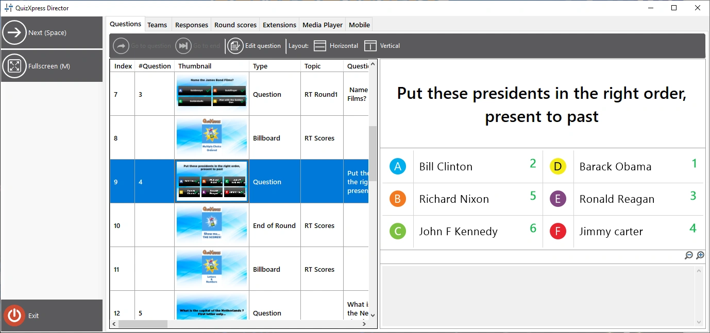

# QuizXpress Director

QuizXpress Director is een hulpmiddel waarmee u geavanceerde controle krijgt over de lopende quizshow. Het heeft een eigen gebruikersinterface die op uw hoofdscherm kan draaien terwijl de quizshow op de aangesloten beamer, tv of ledscherm draait. Hiervoor stelt u uw Windows-bureaublad in op de ‘uitgebreide modus’ (druk in Windows 10 op Windows-toets + P).

{ loading=lazy }

De gebruikersinterface van QuizXpress Director bestaat uit een opdrachtengebied (linkerpaneel), waarin alle op dat moment beschikbare opdrachtknoppen staan, en een aantal weergaven op tabbladen, elk met een eigen functie.

De beschikbare weergaven in Director zijn:

| **Vragen**       | Overzicht van de geladen quiz en bediening om tussen dia’s te navigeren                                                                                                   |
|------------------|---------------------------------------------------------------------------------------------------------------------------------------------------------------------------|
| **Teams**        | Overzicht van alle teams/spelers en hun scores                                                                                                                            |
| **Responses**    | Realtime overzicht van de responses                                                                                                                                       |
| **Ronde scores** | Overzicht van de scores en winnaars per ronde *(alleen zichtbaar als er rondes in het quizbestand worden gebruikt)*                                                       |
| **Extensies**    | Lijst met geïnstalleerde QuizXpress-‘plug-ins’ en bediening om deze plug-ins te starten, te stoppen en te configureren                                                     |
| **Media speler** | Een lijst met mediabestanden (geluid en video) en bediening om een mediabestand toe te voegen, te starten, te stoppen of te pauzeren (u kunt ook een video of geluid op de huidige dia opnieuw starten, indien beschikbaar), plus een [soundboard](the-media-player-tab.md#het-soundboard) om bestanden met één klik af te spelen |
| **Mobile**       | Een lijst met verbonden mobiele apparaten en diverse opdrachten om mobiele verbindingen te beheren                                                                         |

Er zijn twee manieren om het Director-venster te openen:

1)  Vink het selectievakje *Enable QuizXpress Director* aan op het tabblad Geavanceerd in Quiz Setup om Director standaard bij het opstarten te openen.

2)  Druk op elk moment tijdens de quizshow op de toets ‘D’.

Bij configuraties met meerdere schermen opent Director op het scherm tegenover het scherm waarop de quizshow draait. Draait uw quizshow dus op de beamer en heeft u uw bureaublad in Windows uitgebreid, dan opent Director op het scherm van uw laptop. U kunt in Quiz Setup ook expliciet het doelscherm voor de quizshow instellen (sectie ‘Schermen’).

U kunt Director altijd sluiten als u het niet meer nodig heeft, en op elk moment met de toets ‘D’ terugkeren (let op: als u vanuit Director een minigame heeft gestart, moet u dat spel eerst beëindigen, anders raakt u de controle erover kwijt).

Er is ook een app voor mobiele telefoons met de naam QuizXpress Director, met (grotendeels) dezelfde functionaliteit. Hiermee bedient u de quiz tijdens het spelen op vergelijkbare wijze als met de Director op de computer, maar u kunt zich vrijer door de ruimte bewegen en makkelijker met uw publiek communiceren.
