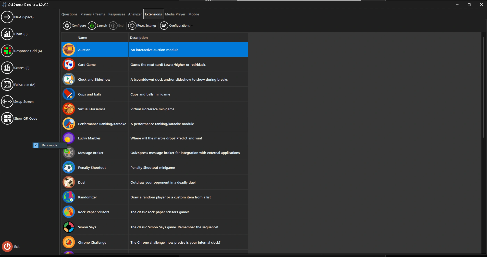

# Modalità scura di QuizXpress Director

Per ridurre l’affaticamento visivo quando si usa QuizXpress in un locale spesso buio, Director può essere impostato in modalità scura. A tal fine, fare clic con il pulsante destro del mouse sul pannello a sinistra di Director e selezionare “Dark mode”:

{ loading=lazy }

!!! note

    sarà necessario riaprire Director affinché questa impostazione abbia effetto.
