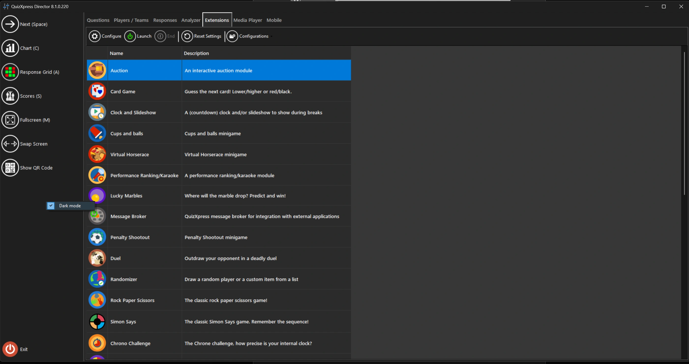

# QuizXpress Director in donkere modus

Om vermoeide ogen te voorkomen wanneer u QuizXpress gebruikt in een locatie waar het vaak donker is, kunt u Director in donkere modus zetten. Klik hiervoor met de rechtermuisknop op het linkerpaneel van Director en kies “Donkere modus”:

{ loading=lazy }

!!! note

    u moet Director opnieuw openen om deze instelling door te voeren.
