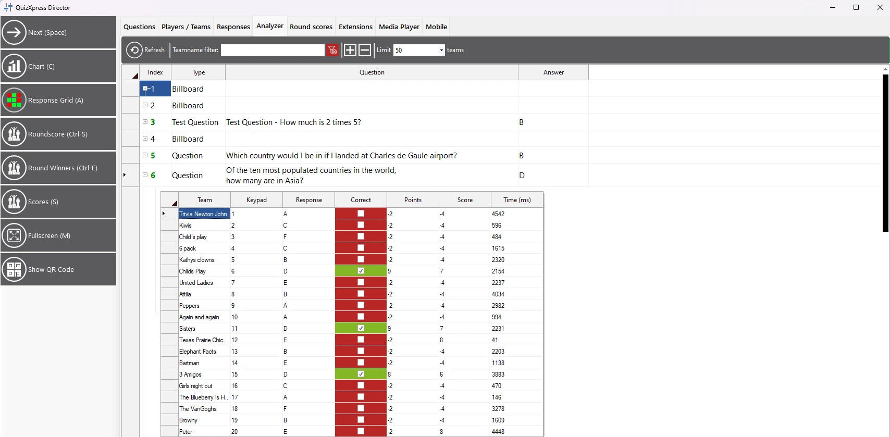

# La vista Analyzer

QuizXpress Director muestra el historial completo de todas las preguntas jugadas hasta el momento. Para cada pregunta, puede ver, por cada jugador, qué respuesta dio, si fue correcta o incorrecta y cuántos puntos ganó o perdió: ¡una herramienta muy útil para que el presentador del quiz demuestre que siempre tiene razón!

{ loading=lazy }
