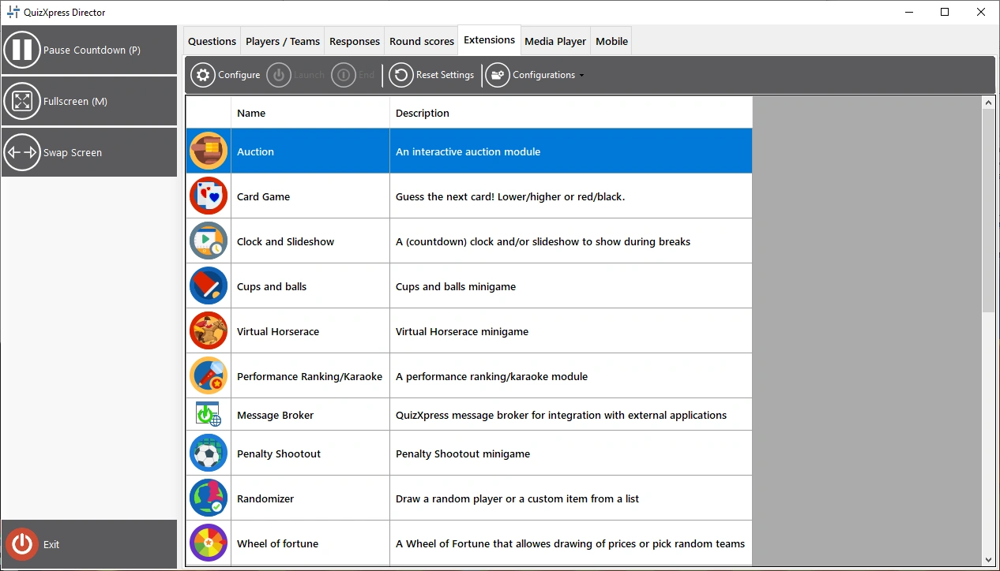
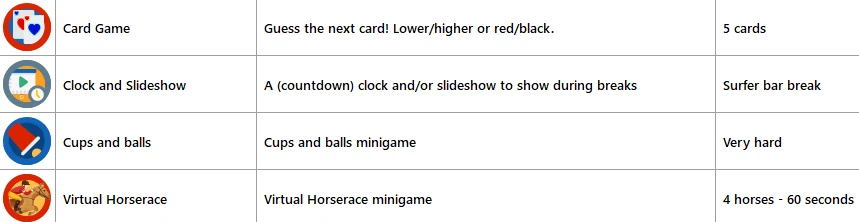

# La vista Extensions (minigiochi e plugin)

La vista ‘Extensions’ è il punto di accesso ai minigiochi QuizXpress inclusi nella licenza. Da qui è possibile avviare i minigiochi al volo in qualsiasi momento durante il quiz, quando il conto alla rovescia non è in corso né in pausa. In alternativa, è possibile inserire i minigiochi nel quiz durante la sua creazione. Per saperne di più sui minigiochi disponibili, consultare [Minigiochi](../../studio/mini-games/index.md).

Per ulteriori informazioni sull’inserimento di minigiochi nel quiz, consultare [Majority Rules](../../studio/slide-and-game-formats/majority-rules.md).

Su un plugin installato è possibile eseguire tre azioni: configurare, avviare e terminare. ‘Configure’ apre una finestra per modificare le impostazioni del plugin. ‘Launch’ avvia il plugin sulla schermata principale del quiz per i concorrenti. Il pulsante ‘End’ termina un plugin e riporta alla normale schermata del quiz.

{ loading=lazy }

Facendo clic sul pulsante ‘Configurations’ si può creare, eliminare o rinominare una configurazione. Le configurazioni disponibili sono mostrate nell’elenco dei plugin, accanto a ciascun plugin, per poterle scegliere. È inoltre possibile clonare la configurazione attualmente selezionata. Premere il pulsante Configure per modificare i dettagli della configurazione selezionata. La configurazione selezionata per un plugin è quella usata quando si avvia il plugin.

{ width="605" loading=lazy }

Una volta in esecuzione, il plugin può mostrare pulsanti aggiuntivi nel pannello a sinistra, che consentono di accedere a funzioni specifiche del plugin.

In genere nel pannello a sinistra è presente un pulsante Next che consente di avanzare nel gioco (in alternativa, è possibile usare la barra spaziatrice o il pulsante Avanti del telecomando per presentazioni).
