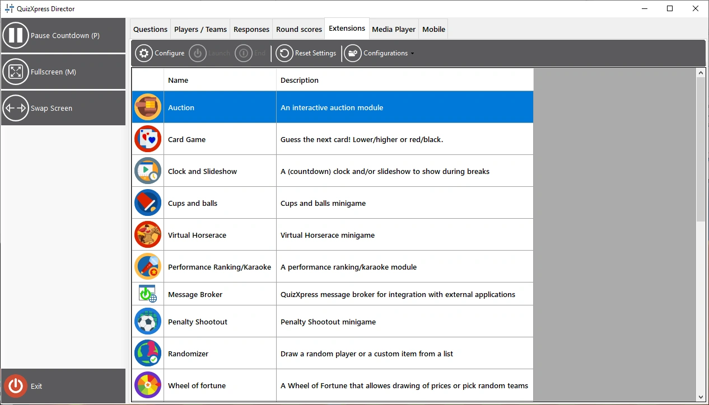
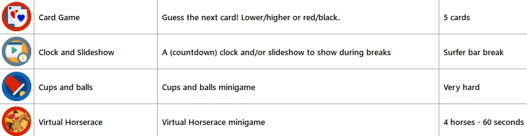

# De weergave Extensies (minigames en plug-ins)

De weergave ‘Extensies’ is uw toegang tot de QuizXpress-minigames die bij uw licentie horen. Hier kunt u op elk moment tijdens uw quiz minigames ter plekke starten, zolang de aftelklok niet tikt en niet gepauzeerd is. U kunt minigames ook in uw quiz invoegen terwijl u de quiz maakt. Meer over de beschikbare minigames leest u in [Minigames](../../studio/mini-games/index.md).

Raadpleeg [Majority Rules](../../studio/slide-and-game-formats/majority-rules.md) voor meer informatie over het invoegen van minigames in uw quiz.

Er zijn drie acties die u op een geïnstalleerde plug-in kunt uitvoeren: configureren, starten en beëindigen. ‘Configureren’ opent een venster om de instellingen van de plug-in te wijzigen. ‘Opstarten’ start de plug-in op het hoofdscherm van de quiz voor de deelnemers. De knop ‘Einde’ beëindigt een plug-in en brengt u terug naar het normale quizscherm.

{ loading=lazy }

Wanneer u op de knop ‘Configuraties’ klikt, ziet u dat u een configuratie kunt maken, verwijderen of hernoemen. Beschikbare configuraties staan in de lijst met plug-ins, naast elke plug-in, zodat u er een kunt kiezen. U kunt ook de geselecteerde configuratie klonen. Druk op de knop Configureren om de details van de geselecteerde configuratie te wijzigen. De geselecteerde configuratie van een plug-in is de configuratie die wordt gebruikt wanneer u de plug-in start.

{ width="605" loading=lazy }

Zodra de plug-in draait, kan hij extra knoppen in het linkerpaneel tonen waarmee u specifieke functies van de plug-in bedient.

Meestal staat er in het linkerpaneel een knop Volgende waarmee u door het spel gaat (u kunt ook de spatiebalk of de knop Volgende van de presenter-afstandsbediening gebruiken).
