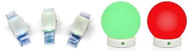
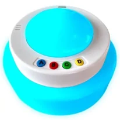
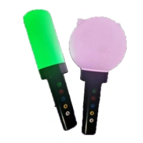

# L’onglet Galaxy

L’onglet Galaxy vous offre un contrôle étendu de vos appareils LED sans fil Galaxy connectés. Cet onglet n’est visible que lorsque la prise en charge de Galaxy est activée dans Quiz Setup. Les appareils Galaxy existent sous différentes formes, telles que des bracelets, des sphères, des cubes et des QuizXpress Torches.

{ width="374" loading=lazy } { width="103" loading=lazy } { width="115" loading=lazy }

Pendant un quiz, les appareils Galaxy donnent un retour aux joueurs en changeant de couleur (pour citer quelques exemples : votre vote a été reçu, votre réponse était correcte, votre réponse était incorrecte, vous êtes éliminé du jeu).

Tous ces changements se produisent automatiquement. Mais Galaxy vous permet d’aller plus loin ! Sur l’onglet Galaxy de QuizXpress Director, plusieurs options permettent d’utiliser manuellement vos appareils Galaxy de différentes façons :

- Les régler sur une couleur fixe (par exemple aux couleurs de votre événement)

- Choisir un ou plusieurs gagnants chanceux

- Les utiliser comme jeu de lumières lors de la diffusion de musique

Sur la page suivante, vous trouverez une image de l’onglet Galaxy de QuizXpress Director et une explication détaillée des options.

**General section**

- Show correct/incorrect : indique si la réponse donnée était correcte ou incorrecte

- Include inactive players : les appareils Galaxy des joueurs inactifs (éliminés du jeu) participent également

- High luminosity : donne plus de luminosité aux lumières (ce qui implique une consommation d’énergie un peu plus élevée)

- Show chosen answer : indique si la lumière affichera la couleur de la réponse choisie

- ABCD color boxes : définissent les couleurs affichées pour les réponses A, B, C et D

**Fixed color section**

Ici, vous pouvez régler tous les appareils Galaxy sur une couleur fixe. Vous pouvez, par exemple, l’utiliser pour les régler sur une couleur assortie à votre événement, pendant les pauses, ou pour créer une certaine ambiance — par exemple lors de la diffusion d’une vidéo.

**Select Lucky Winner(s)**

Cette section vous permet de choisir un ou plusieurs gagnants chanceux dans le public en allumant les appareils Galaxy des gagnants. La lumière du ou des gagnants chanceux parcourt le public puis s’arrête, indiquant qui est le gagnant. Les options sont les suivantes :

- Color : définit la couleur initiale des appareils Galaxy de tous les joueurs.

- Color Winner(s) : définit la couleur de l’appareil ou des appareils Galaxy du ou des gagnants chanceux.

- Number of winners : définit le nombre de joueurs gagnants.

- Light speed : définit la vitesse, en millisecondes, à laquelle la ou les lumières du ou des gagnants chanceux parcourent la foule.

- Random selection : si cette option est activée, les lumières parcourent le public de manière aléatoire. Sinon, les lumières parcourent les appareils Galaxy à partir du numéro 1. Remarque : lorsque les joueurs du public sont placés au hasard, ce paramètre n’a aucun effet. Il n’a d’effet que lorsque l’option Random selection est désactivée et que les joueurs sont alignés (par exemple, face à un public).

- Start button : allume tous les appareils Galaxy du public avec la couleur initiale.

- Choose Lucky Winner(s) : fait parcourir le public par la ou les lumières du ou des gagnants chanceux.

- Stop Gradually : fait s’arrêter progressivement les lumières des gagnants chanceux.

- Stop : arrête immédiatement les lumières des gagnants chanceux ; le ou les gagnants sont connus tout de suite.

La zone Winners affiche le ou les gagnants chanceux afin que l’animateur de quiz puisse aussi voir les numéros de keypad du ou des joueurs gagnants (remarque : ils ne sont pas nécessairement identiques aux numéros des appareils Galaxy — les joueurs peuvent avoir un appareil Galaxy avec un autre ID).

**Reverse Lucky Winner(s)**

L’option Reverse Lucky Winner(s) vous permet de désigner un ou plusieurs gagnants en éliminant progressivement des joueurs. Ainsi, là où Lucky Winner(s) choisit un ou plusieurs gagnants dans un public, Reverse Lucky Winner(s) élimine des joueurs jusqu’à ce qu’il reste un ou plusieurs gagnants. Les options sont les suivantes :

- Color : définit la couleur initiale des appareils Galaxy de tous les joueurs.

- Dropout(s) Color : définit la couleur des joueurs éliminés.

- Number to Drop : définit le nombre de joueurs à éliminer.

- Flash before Drop : vous indiquez ici si vous souhaitez que les appareils Galaxy clignotent avant l’affichage des joueurs éliminés. Trois options sont possibles :

  - Current color : fait clignoter tous les appareils Galaxy des joueurs restants dans la couleur actuelle

  - Random color : fait clignoter tous les appareils Galaxy des joueurs restants dans une couleur aléatoire (à chaque clignotement, chaque appareil Galaxy affiche une couleur aléatoire différente).

  - Random all same color : fait clignoter tous les appareils Galaxy des joueurs restants dans la même couleur aléatoire (à chaque clignotement, une autre couleur aléatoire s’affiche sur tous les appareils Galaxy).

- Start button : allume tous les appareils Galaxy du public avec la couleur initiale.

- Drop button : élimine le nombre de joueurs indiqué.

La zone *Remaining* affiche les numéros de keypad encore en lice pour gagner.

**Lightshow**

Avec les paramètres du jeu de lumières, vous pouvez ajouter une dimension supplémentaire à la musique diffusée en utilisant les appareils Galaxy comme un jeu de lumières. Les options sont les suivantes :

- Tempo (beats per minute) : définit la fréquence à laquelle les appareils s’allument

- Tap Tempo button : le plus souvent, vous ne connaissez pas le tempo (battements par minute) de la musique diffusée. En appuyant plusieurs fois sur le bouton Tap Tempo en rythme avec la musique, le tempo est déterminé et affiché dans la zone Tempo (beats per minute).

- Start button : démarre le jeu de lumières

- Trois options de couleur sont disponibles pour le jeu de lumières :

  - Fixed color : fait clignoter tous les appareils Galaxy dans la couleur fixe

  - Random color : fait clignoter tous les appareils Galaxy dans une couleur aléatoire (à chaque clignotement, chaque appareil Galaxy affiche une couleur aléatoire différente).

  - Random all same color : fait clignoter tous les appareils Galaxy dans la même couleur aléatoire (à chaque clignotement, une autre couleur aléatoire s’affiche sur tous les appareils Galaxy).
