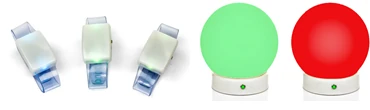
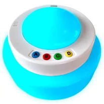
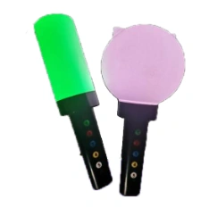

# La scheda Galaxy

La scheda Galaxy offre un controllo esteso dei dispositivi LED wireless Galaxy collegati. Questa scheda è visibile solo se in Quiz Setup è stato scelto un hardware Galaxy; in questo caso, nella scheda Hardware si attiva anche il riquadro ‘Galaxy’. I dispositivi Galaxy esistono in diverse varianti, come braccialetti, sfere, cubi e QuizXpress Torches.

{ width="374" loading=lazy } { width="103" loading=lazy } { width="115" loading=lazy }

Durante un quiz, i dispositivi Galaxy danno un riscontro ai giocatori cambiando colore (ad esempio: il voto è stato ricevuto, la risposta era corretta, la risposta era errata, si è fuori dal gioco).

Tutte queste variazioni avvengono automaticamente. Ma con Galaxy si può fare di più! Nella scheda Galaxy di QuizXpress Director sono disponibili varie opzioni per usare manualmente i dispositivi Galaxy in modi diversi:

- Impostarli su un colore fisso (ad esempio in linea con i colori dell’evento)

- Scegliere uno o più fortunati vincitori

- Usarli come spettacolo luminoso durante la riproduzione di musica

Di seguito si trovano un’immagine della scheda Galaxy di QuizXpress Director e una spiegazione più dettagliata delle opzioni.

**Riquadro ‘Generale’**

- Mostra Corretta/Errata: mostra se la risposta data era corretta o errata

- Includi Giocatori Inattivi: partecipano anche i dispositivi Galaxy dei giocatori inattivi (usciti dal gioco)

- Luminosità Elevata: rende le luci più luminose (ciò comporta un consumo di energia leggermente maggiore)

- Mostra Risposta Scelta: indica se la luce mostrerà il colore della risposta scelta

- Riquadri dei colori FF, A, B, C e D: impostano il colore del pulsante Dito più Veloce (FF) e i colori mostrati per le risposte A, B, C e D

- ‘Timer in Corso’, ‘Timer in Pausa’ e ‘Timer Concluso’: impostano il colore dei dispositivi Galaxy mentre il timer è in corso, quando è in pausa e quando termina

**Riquadro ‘Colore Unico’**

Qui è possibile impostare tutti i dispositivi Galaxy su un colore fisso. Ad esempio, è possibile usarlo per impostarli su un colore in linea con l’evento, durante le pause, o per creare una certa atmosfera — ad esempio durante la riproduzione di un video.

**Riquadro ‘Lucky Winner(s)’**

Con questa sezione è possibile scegliere uno o più fortunati vincitori tra il pubblico illuminando i dispositivi Galaxy dei vincitori. La luce del o dei fortunati vincitori si sposta tra il pubblico e si ferma, indicando chi è il vincitore. Le opzioni sono le seguenti:

- Colore: imposta il colore iniziale dei dispositivi Galaxy di tutti i giocatori.

- Colore Vincitori: imposta il colore del dispositivo o dei dispositivi Galaxy del o dei fortunati vincitori.

- Numero Vincitori: imposta quanti giocatori vincono.

- Velocità Luce (ms): imposta la velocità, in millisecondi, con cui la luce di selezione Lucky Winner scorre attraverso il pubblico.

- Selezione Casuale: se attivata, le luci si spostano tra il pubblico in modo casuale. In caso contrario, le luci si spostano tra i dispositivi Galaxy a partire dal numero 1. Nota: quando i giocatori del pubblico sono disposti in modo casuale, questa impostazione non ha effetto. Ha effetto solo quando l’impostazione ‘Selezione Casuale’ è disattivata e i giocatori sono in fila (ad esempio, davanti a un pubblico).

- Pulsante ‘Avvia’: illumina tutti i dispositivi Galaxy del pubblico con il colore iniziale.

- Seleziona Vincitore(i): fa scorrere la luce o le luci di selezione tra il pubblico.

- Arresta Gradualmente: fa fermare gradualmente le luci di selezione.

- Arresta: ferma immediatamente le luci di selezione; i vincitori sono identificati immediatamente.

Il riquadro ‘Vincitori’ mostra il o i fortunati vincitori, in modo che il Quizmaster possa vedere anche i numeri di pulsantiere dei giocatori che hanno vinto (nota: non coincidono necessariamente con i numeri dei dispositivi Galaxy — i giocatori possono avere un dispositivo Galaxy con un ID diverso).

**Riquadro ‘Lucky Winner(s) Inverso’**

L’opzione ‘Lucky Winner(s) Inverso’ consente di scegliere uno o più vincitori eliminando gradualmente gli altri giocatori. Quindi, mentre ‘Lucky Winner(s)’ sceglie uno o più vincitori da un pubblico, ‘Lucky Winner(s) Inverso’ elimina giocatori finché non restano uno o più vincitori. Le opzioni sono le seguenti:

- Colore: imposta il colore iniziale dei dispositivi Galaxy di tutti i giocatori.

- Colore Esclusi: imposta il colore dei giocatori eliminati.

- Numero Esclusi: imposta il numero di giocatori da eliminare.

- Lampeggia prima di Escludere: qui si può indicare se i dispositivi Galaxy devono lampeggiare prima che vengano mostrati i giocatori eliminati. Sono disponibili tre opzioni:

  - Colore Attuale: fa lampeggiare tutti i dispositivi Galaxy dei giocatori rimasti con il colore corrente

  - Colore Casuale: fa lampeggiare tutti i dispositivi Galaxy dei giocatori rimasti con un colore casuale (a ogni lampeggio, ogni dispositivo Galaxy mostra un colore casuale diverso).

  - Casuale dello stesso colore: fa lampeggiare tutti i dispositivi Galaxy dei giocatori rimasti con lo stesso colore casuale (a ogni lampeggio viene mostrato un altro colore casuale su tutti i dispositivi Galaxy).

- Pulsante ‘Avvia’: illumina tutti i dispositivi Galaxy del pubblico con il colore iniziale.

- Pulsante ‘Escludi’: elimina il numero di giocatori indicato.

Il riquadro ‘Restanti’ mostra i numeri di pulsantiere ancora in gara per la vittoria.

**Riquadro ‘Spettacolo Luminoso’**

Con le impostazioni dello spettacolo luminoso è possibile aggiungere una dimensione extra alla musica riprodotta, usando i dispositivi Galaxy come spettacolo luminoso. Le opzioni sono le seguenti:

- Tempo (battiti per minuto): imposta la frequenza con cui i dispositivi si illuminano

- Pulsante ‘Tempo Battito’: nella maggior parte dei casi non si conosce il tempo (battiti al minuto) della musica riprodotta. Toccando alcune volte il pulsante ‘Tempo Battito’ a tempo con la musica, il tempo viene determinato e mostrato nel campo ‘Tempo (battiti per minuto)’.

- Pulsante ‘Avvia’: avvia lo Spettacolo Luminoso

- Per lo spettacolo luminoso sono disponibili tre opzioni di colore:

  - Colore Unico: fa lampeggiare tutti i dispositivi Galaxy con il colore fisso

  - Colore Casuale: fa lampeggiare tutti i dispositivi Galaxy con un colore casuale (a ogni lampeggio, ogni dispositivo Galaxy mostra un colore casuale diverso).

  - Casuale dello stesso colore: fa lampeggiare tutti i dispositivi Galaxy con lo stesso colore casuale (a ogni lampeggio viene mostrato un altro colore casuale su tutti i dispositivi Galaxy).
